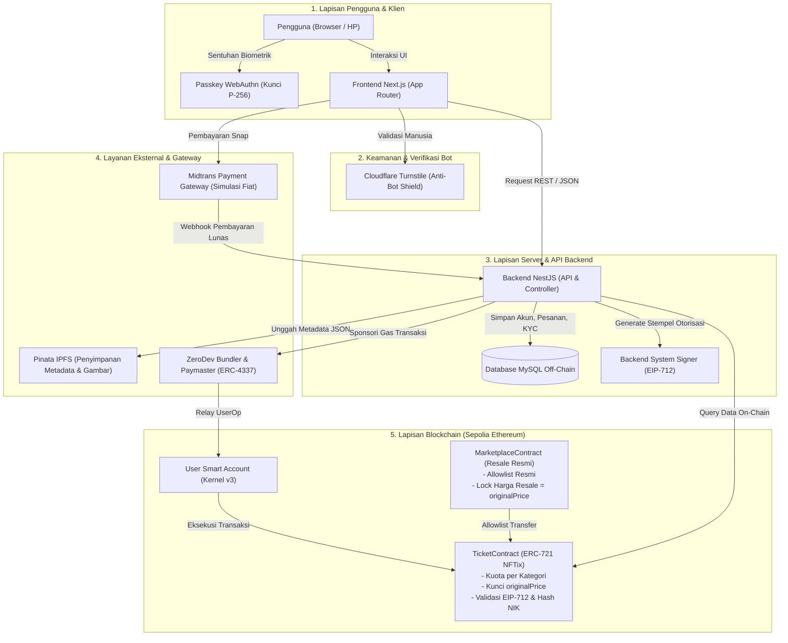

# 01. Cara Kerja Sistem

## Arsitektur Sistem

Sistem terdiri dari tiga lapisan utama dengan batas tanggung jawab yang tegas: antarmuka web, server API, dan smart contract blockchain. Aturan integritas kuota, penguncian harga, dan otorisasi pemindahan tiket ditegakkan langsung oleh smart contract di level blockchain agar tidak dapat diubah oleh pihak mana pun, termasuk pengelola sistem.

## Pembagian Tanggung Jawab Komponen

| Komponen | Tanggung Jawab Utama | Batasan Keamanan |
|---|---|---|
| **Frontend (Next.js)** | Menyajikan antarmuka pengguna, menangani input, memicu autentikasi passkey, dan menampilkan Snap Midtrans. | Tidak menyimpan private key atau secret token. Semua validasi bisnis diverifikasi ulang di server. |
| **Backend (NestJS)** | Mengelola autentikasi pengguna, memverifikasi webhook pembayaran Midtrans, mengunggah metadata ke IPFS, menandatangani stempel EIP-712, dan mencatat transaksi ke MySQL. | Tidak dapat mengubah kuota tiket atau harga asli yang sudah tercatat di blockchain. |
| **Smart Contract (Solidity)** | Mencetak tiket NFT (`ERC721`), membatasi kuota kategori, mengunci `originalPrice`, membatasi pembelian per dompet (`maxPerWallet`), dan menegakkan jalur transfer via allowlist. | Tidak menyimpan data sensitif seperti nomor identitas mentah, kata sandi, atau data pembayaran fiat. |

## Integrasi Layanan Pihak Ketiga

| Layanan | Peran Sistem | Protokol Komunikasi |
|---|---|---|
| **Midtrans Sandbox** | Memproses transaksi pembayaran rupiah secara simulasi dan mengirim konfirmasi lunas ke backend. | REST API dan Webhook HTTP dengan validasi signature SHA-512. |
| **Pinata (IPFS)** | Menyimpan metadata tiket dan berkas gambar secara terdesentralisasi menggunakan content identifier (CID). | HTTP IPFS Pinning API. |
| **ZeroDev** | Menyediakan infrastruktur Account Abstraction ERC-4337, mengorkestrasi pembuatan smart account, dan mensponsori biaya gas melalui Paymaster. | JSON-RPC ERC-4337 Bundler dan Paymaster RPC. |
| **Cloudflare Turnstile** | Memvalidasi bahwa permintaan pembelian tiket berasal dari interaksi manusia nyata, bukan bot otomatis. | Client-side widget token dan verifikasi server-side via `/siteverify`. |

## Strategi Distribusi Penyimpanan Data

| Lokasi Penyimpanan | Jenis Data yang Disimpan | Karakteristik Penyimpanan |
|---|---|---|
| **Blockchain (Sepolia)** | Hak milik tiket (NFT token ID), kuota event, harga beli awal (`originalPrice`), status penggunaan tiket (`used`), dan hash NIK identitas (`bytes32`). | Permanen, immutable, transparan publik, dan menjadi sumber kebenaran utama (single source of truth). |
| **Database MySQL** | Kredensial akun, data pelanggan, catatan KYC terlindungi, salinan cache tiket untuk query cepat, dan log notifikasi. | Terproteksi off-chain, relasional, memiliki performa baca tinggi, dan bersifat privat. |
| **IPFS (Pinata)** | Berkas gambar poster acara dan dokumen metadata JSON (nama event, tanggal, deskripsi lokasi). | Terdesentralisasi, beralamat berbasis konten hash (CID), dan tahan perubahan. |

Prinsip integritas data menetapkan bahwa blockchain adalah sumber kebenaran mutlak. Database lokal bertindak sebagai indeks baca cepat (read-cache). Jika terdapat perbedaan antara status di database lokal dan status on-chain, keputusan sistem selalu mengacu pada data blockchain.

## Lima Aturan Integritas Sistem

1. **Arsitektur Single Contract multi-event**: Seluruh event dikelola oleh satu instansiasi `TicketContract` dengan pembedaan berbasis nomor unik `eventId`, meminimalkan biaya deployment dan menyederhanakan audit.
2. **Transfer terproteksi via Allowlist**: Tiket NFT menolak transfer peer-to-peer langsung di luar kontrak resmi. Pemindahan hak milik hanya dapat dieksekusi melalui `MarketplaceContract`.
3. **Penguncian harga jual kembali**: Parameter `originalPrice` dikunci secara permanen pada memori on-chain saat tiket dicetak, mencegah spekulasi harga dan praktik calo tiket.
4. **Otorisasi pencetakan berbasis EIP-712**: Fungsi pencetakan on-chain mewajibkan bukti tanda tangan digital terstruktur dari `systemSigner` backend untuk mencegah eksploitasi bypass antarmuka web.
5. **Autentikasi akun pintar berbasis passkey**: Kunci privat pengguna diamankan pada modul perangkat keras biometrik (Secure Enclave / TPM) melalui standar WebAuthn, mengeliminasi kebutuhan pencatatan manual seed phrase bagi pengguna awam.
