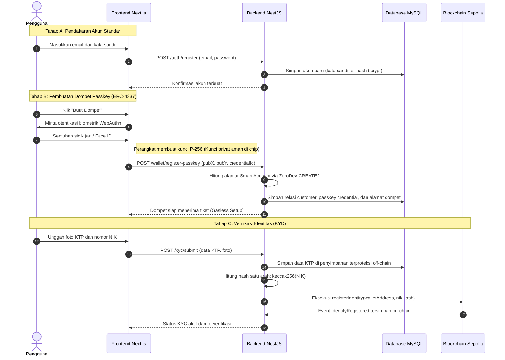
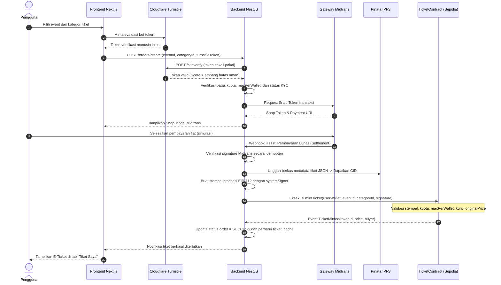
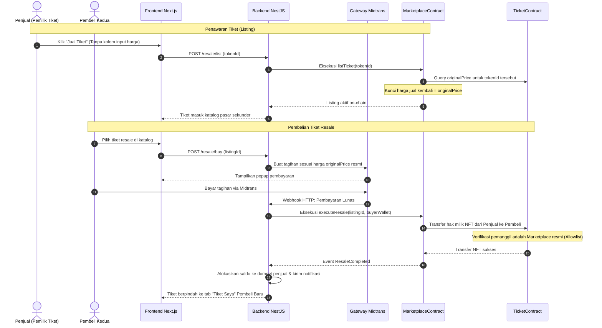
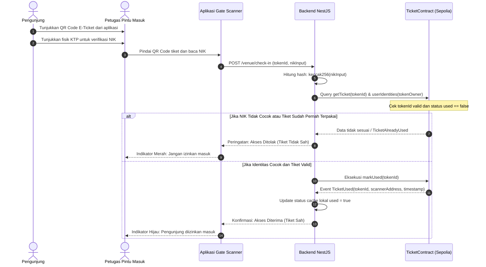
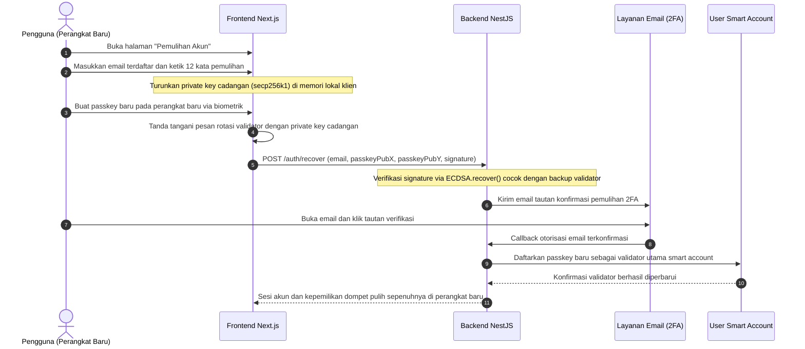

# 03. Alur Pengguna dan Sequence Diagram

Dokumen ini mendefinisikan alur interaksi pengguna dengan sistem melalui lima proses operasional: pendaftaran akun dan dompet, pembelian tiket primer, penjualan kembali tiket resmi, pemulihan akun, dan validasi tiket di lokasi acara.

---

## 1. Alur Pendaftaran Akun, Pembuatan Dompet, dan KYC

Pengguna membuat akun web standar, membangkitkan pasangan kunci passkey melalui antarmuka WebAuthn perangkat, dan meregistrasikan identitas KTP. Kunci privat passkey tetap tersimpan aman di Secure Enclave / TPM perangkat dan tidak pernah dikirim ke jaringan.

---

## 2. Alur Pembelian Tiket Primer (War Tiket dan Minting NFT)

Proses pembelian tiket memverifikasi status manusia pengguna via Cloudflare Turnstile, memproses pembayaran rupiah melalui Midtrans Snap, menerbitkan metadata ke IPFS, menandatangani stempel EIP-712, dan mengeksekusi pencetakan NFT tiket on-chain secara tersponsori.

---

## 3. Alur Penjualan Kembali Tiket Resmi (Resale Anti-Calo)

Tiket yang dijual kembali hanya dapat ditawarkan melalui `MarketplaceContract` resmi. Parameter harga dikunci otomatis setara dengan nilai pembelian awal (`originalPrice`), sehingga spekulasi margin keuntungan calo dieliminasi sepenuhnya oleh kode smart contract.

---

## 4. Alur Validasi Tiket di Lokasi Acara (Venue Check-In)

Pemeriksaan tiket fisik di gerbang masuk dilakukan secara real-time dengan membandingkan data hash NIK pengunjung terhadap catatan on-chain dan memvalidasi bahwa tiket belum pernah digunakan sebelumnya.

---

## 5. Alur Pemulihan Akun (Account Recovery)

Jika perangkat pengguna hilang atau rusak, akses smart account dipulihkan menggunakan 12 kata frasa pemulihan cadangan (BIP-39). Frasa tersebut diproses secara lokal di peramban untuk menandatangani otorisasi rotasi kunci passkey tanpa pernah membocorkan kunci privat ke server.

