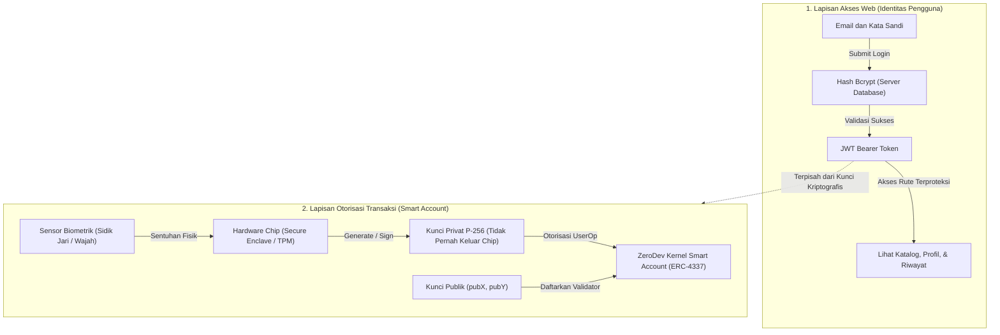
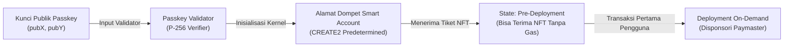
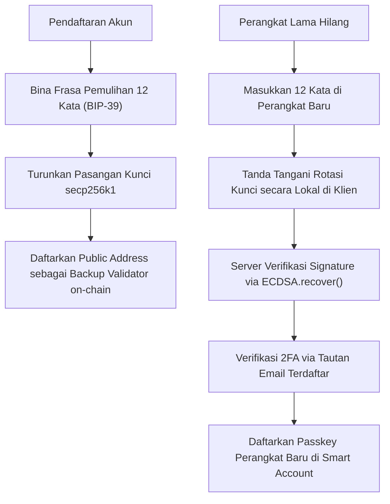

# 04. Arsitektur Dompet dan Passkey

Dokumen ini menjelaskan implementasi dompet blockchain berbasis Account Abstraction (ERC-4337) yang diintegrasikan dengan standar WebAuthn (Passkey P-256), sehingga pengguna dapat bertransaksi tanpa perlu menginstal ekstensi dompet pihak ketiga atau membayar biaya gas secara manual.

---

## Arsitektur Autentikasi Ganda

Sistem memisahkan akses sesi aplikasi web dengan otorisasi transaksi blockchain ke dalam dua lapisan kunci yang independen.

| Lapisan Akses | Kredensial yang Digunakan | Lingkup Otorisasi | Batasan Keamanan |
|---|---|---|---|
| **Akses Web** | Email dan kata sandi | Autentikasi sesi HTTP, query riwayat pesanan, profil pengguna, dan upload KYC. | Tidak memiliki hak tanda tangan transaksi on-chain. |
| **Otorisasi Blockchain** | Passkey WebAuthn (Kunci P-256) | Menandatangani persetujuan pemindahan tiket, verifikasi identitas, dan rotasi validator smart account. | Kunci privat tidak dapat diekspor atau diakses oleh server. |

---

## Struktur dan Siklus Hidup Smart Account (ERC-4337)

Pembuatan dompet memanfaatkan modul Kernel v3 dari ZeroDev. Alamat kontrak pintar dihitung secara deterministik sebelum kontrak tersebut dideploy ke blockchain.

1. **Komputasi Alamat Determinif (CREATE2)**: Alamat smart account dihitung dari kunci publik passkey. Alamat ini langsung sah menerima transfer NFT meskipun kode kontraknya belum dideploy di jaringan Sepolia.
2. **Pencetakan Tanpa Biaya Pengguna (Gasless Primary Mint)**: Pada saat pembelian tiket pertama, backend atau sponsor Paymaster menanggung biaya gas transaksi on-chain. Pengguna tidak diwajibkan memiliki saldo token uji Sepolia ETH.
3. **Validasi Tanda Tangan ERC-1271**: Kontrak memverifikasi keabsahan tanda tangan smart account melalui antarmuka `isValidSignature` standar ERC-1271 yang memetakan tanda tangan WebAuthn P-256 ke struktur signature Ethereum.

---

## Mekanisme Pemulihan Akun (Backup Validator)

Kehilangan perangkat fisik ditangani melalui modul validator cadangan tanpa mengorbankan sifat non-kustodial dompet.

Frasa pemulihan cadangan 12 kata (BIP-39) hanya diproses di sisi klien lokal (in-memory) dan tidak pernah disimpan dalam bentuk teks mentah di basis data backend.
