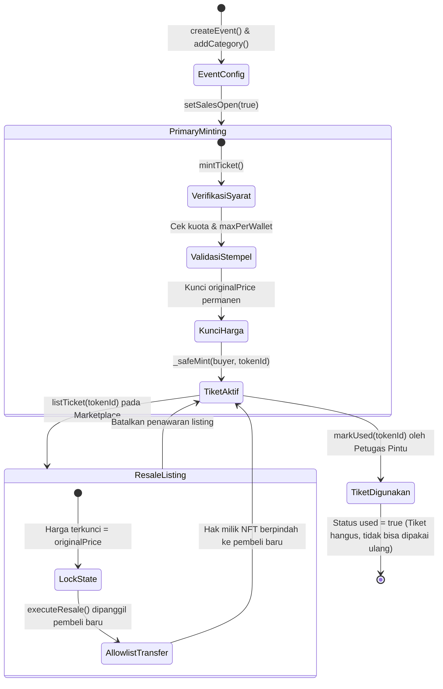
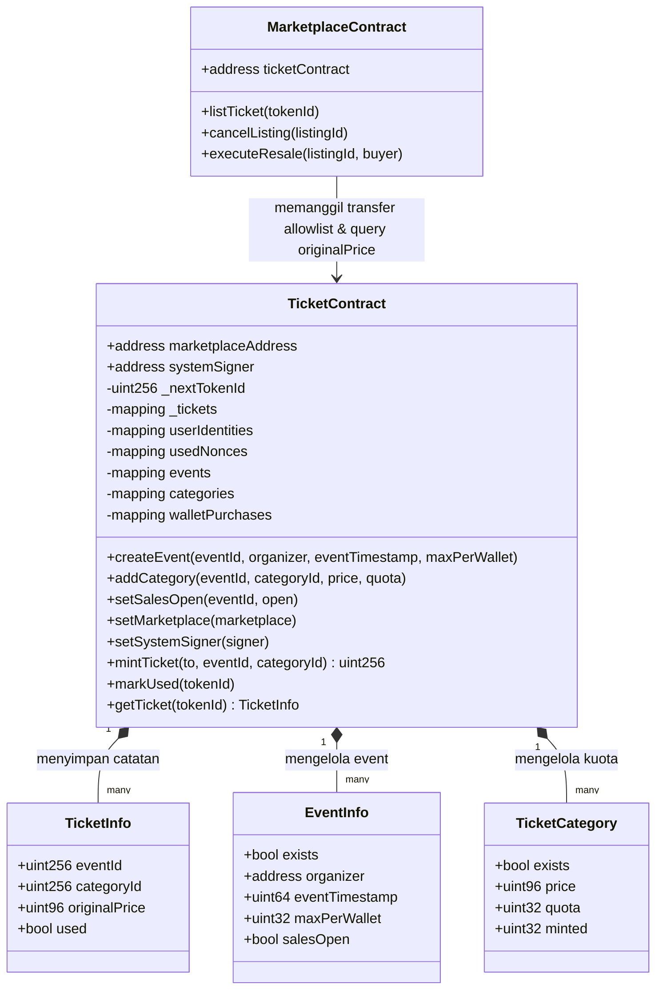

# 05. Spesifikasi Smart Contract

Dokumen ini mendokumentasikan arsitektur smart contract `TicketContract` dan interaksinya dengan `MarketplaceContract` pada jaringan Sepolia Ethereum. Seluruh aturan integritas kuota, batas kepemilikan, penguncian harga, dan status tiket ditegakkan langsung oleh logika on-chain.

---

## Diagram Status dan Siklus Hidup Tiket NFT

Setiap tiket melewati serangkaian perubahan status yang diatur secara ketat oleh fungsi-fungsi kontrak.

---

## Struktur Kontrak dan Interaksi Antar-Modul

`TicketContract` mengimplementasikan standar ERC-721 dengan kontrol akses kepemilikan `Ownable` dan pembatasan pemindahan berbasis allowlist.

---

## Spesifikasi Fungsi yang Diimplementasikan

| Fungsi | Pengakses yang Diizinkan | Validasi Integritas | Perilaku Eksekusi |
|---|---|---|---|
| `createEvent(...)` | `onlyOwner` | Memvalidasi `eventId > 0`, `organizer != 0`, `eventTimestamp > block.timestamp`, `maxPerWallet > 0`, dan id belum pernah terdaftar. | Menyimpan data struct `EventInfo` dan memancarkan event `EventCreated`. |
| `addCategory(...)` | `onlyOwner` | Memvalidasi event ada, `categoryId > 0`, `quota > 0`, `price > 0`, dan kategori belum ada. | Menginisialisasi `TicketCategory` dengan `minted = 0` dan memancarkan event `CategoryCreated`. |
| `setSalesOpen(...)` | `organizer` atau `onlyOwner` | Memverifikasi keberadaan event dan otorisasi pemanggil. | Memperbarui status boolean `salesOpen`. |
| `setMarketplace(...)` | `onlyOwner` | Memverifikasi alamat marketplace bukan alamat nol (`address(0)`). | Memperbarui variabel publik `marketplaceAddress`. |
| `setSystemSigner(...)` | `onlyOwner` | Memverifikasi alamat signer bukan alamat nol. | Memperbarui variabel publik `systemSigner`. |
| `mintTicket(...)` | Eksternal terotorisasi | Memeriksa ketersediaan kuota (`minted < quota`), batas dompet (`walletPurchases < maxPerWallet`), status penjualan buka, dan keberadaan event/kategori. | Menambahkan penghitung token, mengunci nilai `originalPrice`, mencetak NFT via `_safeMint`, dan memancarkan event `TicketMinted`. |
| `markUsed(...)` | Pemilik tiket, organizer, atau `onlyOwner` | Memeriksa token valid dan belum pernah digunakan (`used == false`). | Mengubah status `_tickets[tokenId].used = true` dan memancarkan event `TicketUsed`. |
| `getTicket(...)` | Publik (view) | Memvalidasi bahwa token id telah dicetak dan bukan alamat nol. | Mengembalikan struct `TicketInfo` untuk kebutuhan query frontend dan verifikasi gerbang. |

---

## Logika Penegakan Anti-Calo On-Chain

1. **Penyimpanan Harga Pembelian Asli (`originalPrice`)**: Nilai harga tiket dikunci secara tidak dapat diubah (`immutable property`) ke dalam struct `TicketInfo` pada saat transaksi `mintTicket` dieksekusi.
2. **Keterikatan Jalur Jual Kembali**: Smart contract marketplace membaca nilai `originalPrice` dari `TicketContract` dan menetapkannya sebagai satu-satunya harga penyelesaian transaksi. Antarmuka listing tidak menerima parameter harga custom dari penjual.
3. **Pembatasan Transfer (Allowlist Enforcement)**: Fungsi pemindahan NFT standar (`transferFrom` / `safeTransferFrom`) dibatasi sedemikian rupa sehingga pemindahan antar dompet hanya diizinkan apabila pemanggil terdaftar pada `marketplaceAddress` resmi.
