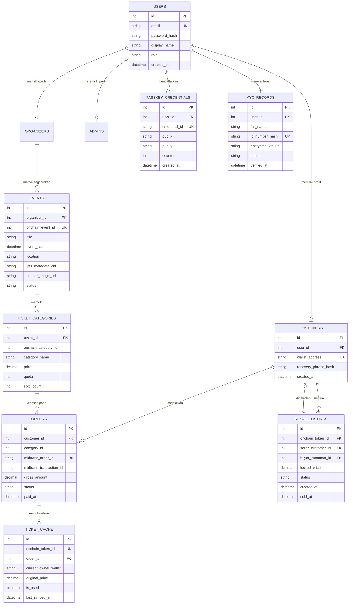

# 06. Arsitektur Basis Data Relasional

Dokumen ini menjelaskan struktur basis data relasional MySQL yang digunakan backend NestJS untuk mengelola data akun, sesi kredensial, entitas event, order pembayaran, dan cache pembacaan tiket off-chain.

---

## Diagram Hubungan Antar Entitas (Entity-Relationship Diagram)

Struktur tabel memisahkan otentikasi umum akun dari profil spesifik pelanggan, kredensial biometrik passkey, katalog tiket, dan pencatatan transaksi pesanan.

---

## Deskripsi Entitas Basis Data

| Nama Tabel | Peran dan Fungsi Entitas | Kunci Utama dan Kunci Asing |
|---|---|---|
| `users` | Menyimpan identitas akun dasar untuk autentikasi sistem web (email dan hash kata sandi). | PK: `id`, Unique: `email`. |
| `customers` | Menyimpan atribut spesifik pembeli tiket, termasuk alamat smart account yang ditautkan ke akun. | PK: `id`, FK: `user_id` menuju `users.id`. |
| `passkey_credentials` | Menyimpan kunci publik P-256 (`pub_x`, `pub_y`) dan kredensial WebAuthn yang digunakan untuk memverifikasi dompet smart account. | PK: `id`, FK: `user_id` menuju `users.id`. |
| `kyc_records` | Menyimpan verifikasi kartu identitas fisik. Hash satu arah dari NIK (`id_number_hash`) dipetakan ke smart contract untuk mencegah pendaftaran identitas ganda. | PK: `id`, FK: `user_id` menuju `users.id`, Unique: `id_number_hash`. |
| `events` | Menyimpan data katalog acara off-chain dan referensi `onchain_event_id` pada `TicketContract`. | PK: `id`, Unique: `onchain_event_id`. |
| `ticket_categories` | Menyimpan konfigurasi tier tiket (nama kategori, kuota, dan harga). | PK: `id`, FK: `event_id` menuju `events.id`. |
| `orders` | Mencatat tagihan transaksi pembelian fiat yang terhubung dengan status penyelesaian gateway Midtrans. | PK: `id`, Unique: `midtrans_order_id`. |
| `ticket_cache` | Salinan lokal dari data kepemilikan dan status tiket on-chain untuk mempercepat query antarmuka pengguna tanpa membebani node RPC blockchain. | PK: `id`, Unique: `onchain_token_id`. |
| `resale_listings` | Mengelola data penawaran tiket pada pasar sekunder dengan harga yang terkunci sesuai nilai pembelian awal. | PK: `id`, FK: `seller_customer_id`, FK: `buyer_customer_id`. |

---

## Batasan Sinkronisasi Data

Tabel `ticket_cache` berfungsi semata-mata sebagai proyeksi baca (*read projection*). Validasi hak milik dan kelayakan penukaran tiket di lokasi acara selalu divalidasi langsung ke smart contract Sepolia secara on-chain (`TicketContract.ownerOf` dan `TicketContract.getTicket`), guna menjamin ketahanan terhadap inkonsistensi data lokal.
