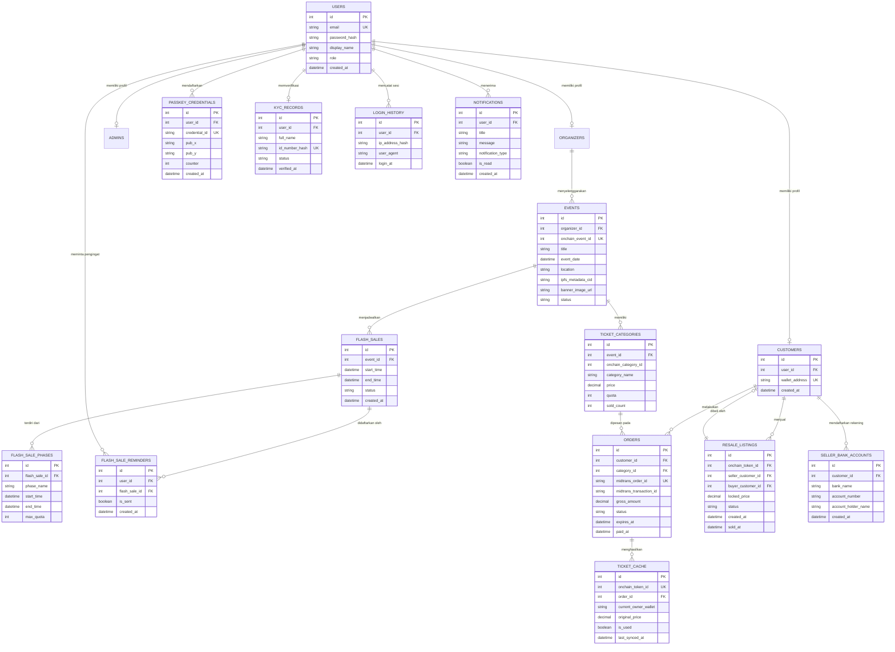

# 06. Arsitektur basis data relasional

Dokumen ini menjelaskan struktur basis data relasional MySQL yang digunakan backend NestJS untuk mengelola data akun, kredensial, katalog acara, sesi flash sale, transaksi pesanan, notifikasi, dan cache pembacaan tiket off-chain sesuai batasan ruang lingkup tugas akhir.

---

## Diagram hubungan antar entitas

Struktur tabel memisahkan autentikasi akun dari profil pelanggan, kredensial passkey, verifikasi identitas, katalog tiket, modul flash sale, riwayat transaksi, dan sistem notifikasi.

---

## Deskripsi entitas basis data

| Nama tabel | Peran dan fungsi entitas | Kunci utama dan relasi |
|---|---|---|
| `users` | Menyimpan identitas akun dasar untuk autentikasi sistem web (email dan hash kata sandi). | PK: `id`, Unique: `email`. |
| `customers` | Menyimpan atribut spesifik pembeli tiket dan tautan alamat smart account ERC-4337. | PK: `id`, FK: `user_id` menuju `users.id`. |
| `passkey_credentials` | Menyimpan kunci publik P-256 (`pub_x`, `pub_y`) dan kredensial WebAuthn untuk autentikasi biometrik. | PK: `id`, FK: `user_id` menuju `users.id`. |
| `kyc_records` | Menyimpan bukti verifikasi identitas fisik. Hanya menyimpan hash satu arah (`id_number_hash`) untuk mematuhi regulasi privasi. | PK: `id`, FK: `user_id` menuju `users.id`, Unique: `id_number_hash`. |
| `login_history` | Mencatat riwayat sesi masuk pengguna untuk keperluan audit keamanan dan mitigasi anomali akses. | PK: `id`, FK: `user_id` menuju `users.id`. |
| `notifications` | Menyimpan pesan notifikasi transaksi pengguna, meliputi status pembayaran, pencetakan tiket, hasil war tiket, dan penjualan resale. | PK: `id`, FK: `user_id` menuju `users.id`. |
| `events` | Menyimpan katalog acara off-chain dan referensi `onchain_event_id` pada smart contract. | PK: `id`, Unique: `onchain_event_id`. |
| `ticket_categories` | Menyimpan konfigurasi tier tiket, batas kuota, dan harga dasar. | PK: `id`, FK: `event_id` menuju `events.id`. |
| `flash_sales` | Mengelola sesi penjualan cepat kuota terbatas beserta waktu mulai dan berakhir. | PK: `id`, FK: `event_id` menuju `events.id`. |
| `flash_sale_phases` | Mengatur tahapan periode flash sale (tahap verifikasi pra-sesi dan tahap eksekusi pembelian kilat). | PK: `id`, FK: `flash_sale_id` menuju `flash_sales.id`. |
| `flash_sale_reminders` | Mencatat permintaan pengingat jadwal flash sale dari pengguna sebelum penjualan dibuka. | PK: `id`, FK: `user_id` menuju `users.id`, FK: `flash_sale_id` menuju `flash_sales.id`. |
| `orders` | Mencatat transaksi pembelian fiat, token Midtrans Snap, batas waktu pembayaran (`expires_at`), dan status pelunasan. | PK: `id`, Unique: `midtrans_order_id`. |
| `ticket_cache` | Salinan lokal kepemilikan dan status tiket on-chain untuk mempercepat kueri baca antarmuka web. | PK: `id`, Unique: `onchain_token_id`. |
| `resale_listings` | Mengelola data penawaran tiket pasar sekunder dengan harga terkunci setara harga beli awal. | PK: `id`, FK: `seller_customer_id`, FK: `buyer_customer_id`. |
| `seller_bank_accounts` | Menyimpan data rekening bank penjual untuk penyaluran dana hasil penjualan tiket sekunder. | PK: `id`, FK: `customer_id` menuju `customers.id`. |

---

## Batasan sinkronisasi data

Tabel `ticket_cache` berfungsi sebagai proyeksi baca (*read projection*). Validasi hak milik dan kelayakan penukaran tiket di lokasi acara selalu divalidasi langsung ke smart contract Sepolia secara on-chain (`TicketContract.ownerOf` dan `TicketContract.getTicket`), guna menjamin ketahanan terhadap inkonsistensi data lokal.
