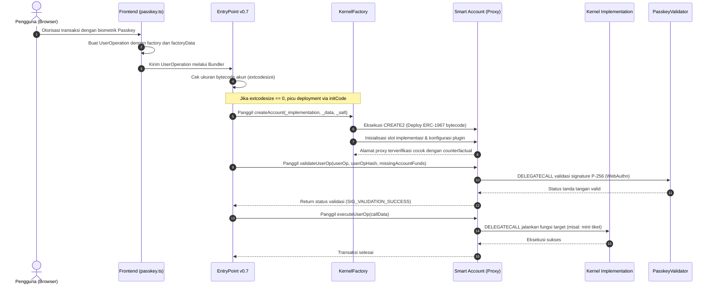

# Desain dan spesifikasi teknis initCode ERC-4337, proxy ERC-1967, dan ZeroDev Kernel

**Spesifikasi arsitektur deployment akun cerdas counterfactual dan pemisahan storage proxy**

| Parameter | Deskripsi |
| :--- | :--- |
| **Status** | Spesifikasi arsitektur implementasi final |
| **Penyusun** | Benedictus Leonardo Edward Stephen Sugianto (NRP: 160423176) |
| **Ruang lingkup** | Analisis pembentukan initCode, factory calldata, layout slot ERC-1967, determinisme CREATE2, dan delegasi eksekusi DELEGATECALL |
| **Dokumen terkait** | [02-passkey-cryptography-and-address-derivation.md](file:///d:/STEVE/Project-TA-NFT-Marketplace/explanation/02-passkey-cryptography-and-address-derivation.md), [03-evm-opcodes-guide.md](file:///d:/STEVE/Project-TA-NFT-Marketplace/explanation/03-evm-opcodes-guide.md), [04-webauthn-lifecycle-register-vs-login.md](file:///d:/STEVE/Project-TA-NFT-Marketplace/explanation/04-webauthn-lifecycle-register-vs-login.md) |
| **Sasaran pembaca** | Penguji sidang tugas akhir, pembimbing, dan perekayasa perangkat lunak |

---

## 1. Ringkasan eksekutif

Platform *NFTix* mengadopsi standar abstraksi akun ERC-4337 versi 0.7 dengan ZeroDev Kernel versi 3.3. Arsitektur ini memungkinkan pengguna berinteraksi dengan smart contract tanpa mengelola private key EOA (*Externally Owned Account*) tradisional maupun menyimpan saldo Ether pada awal pendaftaran.

Akun cerdas (*Smart Contract Account*) pengguna tidak langsung dideploy ke blockchain saat pendaftaran identitas biometrik. Alamat akun dihitung secara deterministik di peramban menggunakan opcode `CREATE2` (*counterfactual address*). Proses kompilasi fisik dan inisialisasi on-chain ditunda hingga transaksi pertama dikirimkan melalui struktur `initCode` (atau pasangan field `factory` dan `factoryData` pada ERC-4337 v0.7). 

Untuk meminimalkan konsumsi gas deployment dan mendukung pembaruan logika tanpa migrasi alamat, akun pengguna diwujudkan dalam bentuk *minimal proxy* ERC-1967. Seluruh panggilan eksekusi didelegasikan ke kontrak logika bersama (*Kernel Implementation*) dan modul plugin (*PasskeyValidator*) melalui instruksi `DELEGATECALL`.

---

## 2. Sumber fakta dan acuan kode

Spesifikasi implementasi ini bersumber pada berkas repositori aktif dan standar terbuka berikut:

| Komponen | Berkas sumber | Lokasi baris | Perilaku terverifikasi |
| :--- | :--- | :--- | :--- |
| Inisialisasi Kernel | [passkey.ts](file:///d:/STEVE/Project-TA-NFT-Marketplace/frontend/src/lib/passkey.ts) | 17 - 55 | Konfigurasi `entryPoint` v0.7, `KERNEL_V3_3`, dan pembuatan instance akun |
| Registrasi Passkey | [passkey.ts](file:///d:/STEVE/Project-TA-NFT-Marketplace/frontend/src/lib/passkey.ts) | 30 - 64 | Pemanggilan WebAuthn API dan perolehan alamat deterministik via `account.getAddress()` |
| Spesifikasi protokol | EIP-4337 | Eksternal | Definisi struktur UserOperation, mekanisme `initCode`, dan eksekusi EntryPoint |
| Standar slot proxy | EIP-1967 | Eksternal | Alokasi slot memori `keccak256("eip1967.proxy.implementation") - 1` |
| Kontrak pabrik | KernelFactory.sol | ZeroDev v3.3 | Eksekusi `CREATE2` dan inisialisasi state proxy ERC-1967 |

---

## 3. Tujuan dan batasan sistem

### 3.1 Tujuan
1. Menghilangkan biaya gas pendaftaran akun baru dengan mekanisme *counterfactual deployment*.
2. Memastikan alamat smart account bersifat deterministik dan identik di seluruh lingkungan EVM berdasarkan data kredensial publik pengguna.
3. Mengurangi konsumsi gas pembuatan akun dari rata-rata 2.000.000 gas (pada arsitektur monolitik) menjadi sekitar 150.000 gas menggunakan minimal proxy ERC-1967.
4. Mendukung peningkatan versi logika (*upgradability*) di masa depan tanpa mengubah alamat kontrak dan kepemilikan aset tiket.

### 3.2 Batasan (non-goals)
1. Tidak menggunakan model EOA berbasis kurva secp256k1 untuk wallet penonton konser.
2. Tidak menanam bytecode logika Kernel ke dalam transaksi client. Bytecode implementasi telah dideploy permanen satu kali di jaringan blockchain.
3. Tidak mendukung deployment akun manual tanpa melalui instruksi resmi EntryPoint atau KernelFactory.

---

## 4. Diagram desain sistem dan batas arsitektur komponen

Diagram blok berikut memetakan hubungan hierarkis antar-kontrak dan pemisahan boundary eksekusi pada arsitektur ZeroDev Kernel ERC-4337:

```mermaid
graph TB
    subgraph ClientLayer ["1. Client Layer (Peramban / Next.js)"]
        PasskeyClient["passkey.ts (toPasskeyValidator)"]
        KernelSDK["@zerodev/sdk (createKernelAccount)"]
        CounterfactualCalc["Perhitungan CREATE2 Offline (Tanpa Gas)"]
        PasskeyClient --> KernelSDK
        KernelSDK --> CounterfactualCalc
    end

    subgraph ConsensusLayer ["2. Network & Bundler Layer"]
        UserOp["UserOperation (Memuat factory & factoryData)"]
        Bundler["ERC-4337 Bundler (RPC Endpoint)"]
        EntryPoint["EntryPoint 0.7 (0x0000000071727De22E5E9d8BAf0edAc6f37da032)"]
        CounterfactualCalc -.->|Kemas ke UserOp| UserOp
        UserOp --> Bundler
        Bundler -->|Kirim Transaksi handleOps| EntryPoint
    end

    subgraph FactoryLayer ["3. Contract Creation Layer"]
        KernelFactory["KernelFactory (0x5de4839a7e2b84f542122a7b66df669d30da6b3d)"]
        CREATE2Opcode["Opcode CREATE2 (0xF5)"]
        EntryPoint -->|Eksekusi initCode jika code.length == 0| KernelFactory
        KernelFactory --> CREATE2Opcode
    end

    subgraph SmartAccountLayer ["4. Deployed Account Instance (Per-User Storage)"]
        ProxyAccount["ERC-1967 Minimal Proxy (Alamat Wallet Pengguna)"]
        StorageSlot["Slot 0x3608... (Pointer ke Kernel Implementation)"]
        StateData["Storage: Nonce, Pemilik, Plugin Config"]
        CREATE2Opcode -->|Instansiasi Kontrak Baru| ProxyAccount
        ProxyAccount --- StorageSlot
        ProxyAccount --- StateData
    end

    subgraph LogicSharedLayer ["5. Shared Logic & Validator Layer (Singleton On-Chain)"]
        KernelImpl["Kernel Implementation v3.3 (Logika Inti Eksekusi)"]
        PasskeyVal["PasskeyValidator (0x7ab16Ff354AcB328452F1D445b3Ddee9a91e9e69)"]
        ProxyAccount -->|DELEGATECALL (Eksekusi Logika)| KernelImpl
        ProxyAccount -->|DELEGATECALL (Verifikasi P-256)| PasskeyVal
    end
```

---

## 5. Diagram alur sekuensial deployment dan eksekusi perdana

Alur interaksi berikut menggambarkan eksekusi transisi state saat transaksi pertama kali dikirimkan oleh pengguna yang akunnya belum ter-deploy secara fisik:



---

## 6. Struktur data byte initCode dan pemisahan calldata factory

Dalam literatur awal atau pemahaman yang keliru, sering diasumsikan bahwa `initCode` adalah gabungan langsung dari data kredensial passkey dan bytecode smart contract. Pemahaman tersebut tidak sesuai dengan spesifikasi EIP-4337.

### 6.1 Spesifikasi struktur pada ERC-4337 versi 0.6
Pada protokol versi 0.6, `initCode` merupakan string biner tunggal dengan format:

```text
initCode = [ 20 Bytes Alamat Factory ] + [ Calldata Pemanggilan Fungsi Factory ]
```

### 6.2 Spesifikasi struktur pada ERC-4337 versi 0.7
Pada protokol versi 0.7 yang diterapkan di *NFTix* ([passkey.ts](file:///d:/STEVE/Project-TA-NFT-Marketplace/frontend/src/lib/passkey.ts) baris 20), field `initCode` dipisah menjadi dua field terpisah pada struktur `PackedUserOperation`:
1. **`factory` (address)**: Alamat resmi kontrak `KernelFactory`.
2. **`factoryData` (bytes)**: Calldata yang memuat pemanggilan fungsi pabrik.

Struktur calldata di dalam `factoryData` mengacu pada signature fungsi berikut:

```solidity
function createAccount(
    address _implementation,   // Alamat kontrak logika Kernel Implementation
    bytes calldata _data,      // Initialization data (berisi enableData passkey)
    uint256 _salt              // Bilangan acak deterministik untuk CREATE2
) external payable returns (address);
```

Dengan spesifikasi ini:
* Bytecode akun tidak pernah dikirimkan melalui jaringan internet di dalam UserOperation.
* Kredensial publik WebAuthn (`enableData` sepanjang 96 bytes) dipaketkan rapi di dalam parameter `_data`, bukan ditempelkan pada kode mesin akun.

---

## 7. Spesifikasi slot memori ERC-1967 dan mekanisme DELEGATECALL

Standar ERC-4337 tidak mendikte bagaimana penyimpanan data akun dikelola. Pilihan arsitektur diserahkan kepada penyusun akun. ZeroDev Kernel mengimplementasikan pola *ERC-1967 Proxy*.

### 7.1 Definisi matematika slot implementasi ERC-1967
Untuk mencegah terjadinya tabrakan slot memori (*storage collision*) antara variabel state akun (seperti saldo, status kepemilikan, atau urutan nonce) dengan alamat kontrak logika, EIP-1967 menetapkan lokasi slot implementasi pada posisi yang memiliki probabilitas tabrakan nyaris nol:

$$\text{Slot}_{\text{impl}} = \text{keccak256}(\text{"eip1967.proxy.implementation"}) - 1$$

Perhitungan nilai heksadesimal slot:
1. `keccak256("eip1967.proxy.implementation")` = `0x360894a13ba1a3210667c828492db98dca3e2076cc3735a920a3ca505d382bbd`
2. Pengurangan nilai 1 menghasilkan:
   $$\text{Slot}_{\text{impl}} = \text{0x360894a13ba1a3210667c828492db98dca3e2076cc3735a920a3ca505d382bbc}$$

### 7.2 Semantik eksekusi DELEGATECALL (Opcode 0xF4)
Ketika transaksi diproses oleh smart account pengguna:
1. Peramban atau EntryPoint memanggil fungsi pada alamat proxy pengguna.
2. Proxy membaca alamat pada slot `0x3608...bbc`.
3. Proxy meneruskan calldata ke alamat implementasi menggunakan instruksi `DELEGATECALL`.
4. Kode dijalankan menggunakan lingkungan komputasi kontrak implementasi, namun seluruh operasi pembacaan dan penulisan variabel dilakukan langsung pada penyimpanan (*storage*) milik akun proxy pengguna.
5. Konteks `msg.sender` dan `msg.value` tetap merujuk pada inisiator pemanggilan pertama, bukan proxy itu sendiri.

---

## 8. Analisis komparasi konsumsi gas dan justifikasi arsitektur proxy

Penggunaan kombinasi minimal proxy ERC-1967 dan factory memberikan efisiensi signifikan dibandingkan model monolitik.

| Parameter komparasi | Arsitektur monolitik | Arsitektur minimal proxy ERC-1967 | Selisih efisiensi |
| :--- | :--- | :--- | :--- |
| **Ukuran bytecode deployed** | ~24 Kilobytes (mendekati Spurious Dragon limit) | ~300 Bytes (kode proxy minimal) | Penurunan ukuran ~98.7% |
| **Konsumsi gas deployment** | ~1.800.000 - 2.500.000 gas | ~120.000 - 160.000 gas | Penghematan gas ~93% |
| **Dukungan upgradeability** | Tidak ada. Pengguna harus migrasi ke alamat baru | Didukung via UUPS (Universal Upgradeable Proxy Standard) | Mempertahankan alamat dan riwayat kepemilikan tiket |
| **Sifat deployment** | Harus on-chain sebelum menerima aset | Bersifat counterfactual (cukup alamat offline) | Pengguna dapat langsung menerima transfer tiket |

---

## 9. Matriks mitigasi ancaman keamanan

| Skenario ancaman | Mekanisme serangan | Mitigasi arsitektural terpasang |
| :--- | :--- | :--- |
| **Front-running deployment** | Pihak ketiga mendeteksi transaksi pendaftaran lalu mendeploy akun lebih awal | Opcode `CREATE2` menjamin alamat yang terbentuk terikat ketat pada inisialisasi `_data` dan `_salt`. Jika pihak ketiga mendeploy dengan parameter berbeda, alamat yang dihasilkan tidak akan cocok |
| **Storage collision** | Variabel internal logika implementasi menimpa penunjuk proxy | Standar ERC-1967 mengisolasi penunjuk alamat implementasi ke slot pseudorandom `0x3608...bbc`, jauh dari jangkauan slot penyimpanan linier Solidity (slot 0, 1, 2, dst.) |
| **Uninitialized proxy takeover** | Penyerang memanggil fungsi inisialisasi pada kontrak logika master | Kontrak `Kernel Implementation` dilindungi dengan pemanggilan constructor internal `_disableInitializers()`, mencegah inisialisasi langsung pada kontrak master |
| **DDoS melalui initCode** | Transaksi berulang mengirimkan payload initCode yang gagal | EntryPoint memeriksa apakah akun sudah memiliki kode via `extcodesize`. Jika akun telah ter-deploy, field factory tidak akan pernah dieksekusi kembali |

---

## 10. Referensi standar dan spesifikasi terbuka

1. **Ethereum Improvement Proposal 4337 (EIP-4337):** Account Abstraction Using Alt Mempool. [https://eips.ethereum.org/EIPS/eip-4337](https://eips.ethereum.org/EIPS/eip-4337).
2. **Ethereum Improvement Proposal 1967 (EIP-1967):** Standard Proxy Storage Slots. [https://eips.ethereum.org/EIPS/eip-1967](https://eips.ethereum.org/EIPS/eip-1967).
3. **Ethereum Improvement Proposal 1014 (EIP-1014):** Skinny CREATE2. [https://eips.ethereum.org/EIPS/eip-1014](https://eips.ethereum.org/EIPS/eip-1014).
4. **ZeroDev Kernel Protocol Documentation & Repositories:** [https://docs.zerodev.app/](https://docs.zerodev.app/) dan [https://github.com/zerodev-app/kernel](https://github.com/zerodev-app/kernel).
