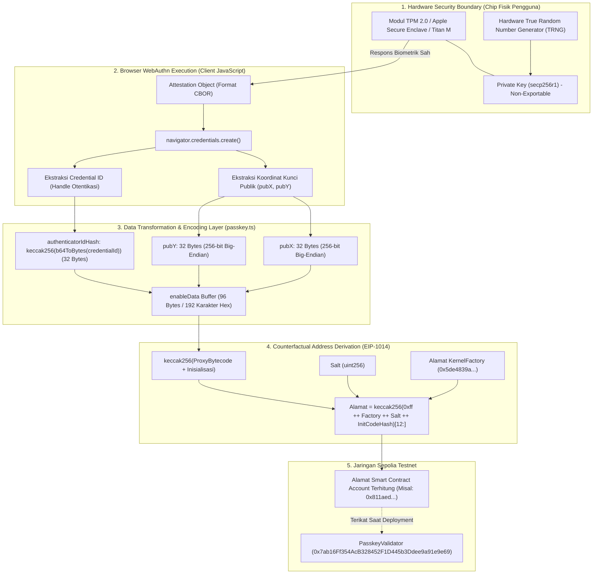
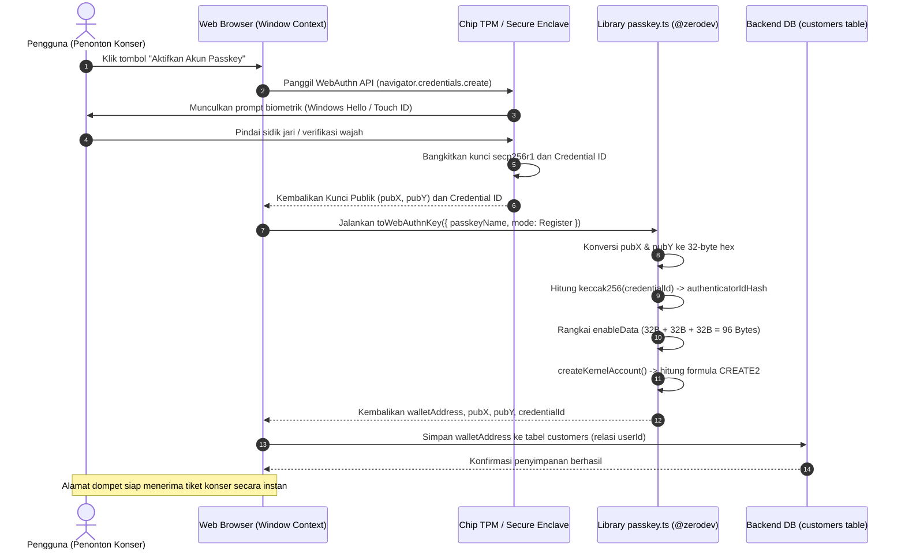

# Desain dan spesifikasi teknis kriptografi passkey dan derivasi alamat counterfactual

**Spesifikasi teknis struktur 96-byte enableData, kurva eliptik P-256 (secp256r1), dan formula matematis CREATE2**

| Parameter | Deskripsi |
| :--- | :--- |
| **Status** | Spesifikasi arsitektur kriptografi final |
| **Penyusun** | Benedictus Leonardo Edward Stephen Sugianto (NRP: 160423176) |
| **Ruang lingkup** | Ekstraksi kunci publik WebAuthn P-256, hashing authenticator ID, encoding enableData 96 bytes, dan derivasi deterministik alamat Smart Account (EIP-1014) |
| **Dokumen terkait** | [01-erc4337-initcode-and-erc1967.md](file:///d:/STEVE/Project-TA-NFT-Marketplace/explanation/01-erc4337-initcode-and-erc1967.md), [03-evm-opcodes-guide.md](file:///d:/STEVE/Project-TA-NFT-Marketplace/explanation/03-evm-opcodes-guide.md), [04-webauthn-lifecycle-register-vs-login.md](file:///d:/STEVE/Project-TA-NFT-Marketplace/explanation/04-webauthn-lifecycle-register-vs-login.md) |
| **Sasaran pembaca** | Penguji sidang tugas akhir, pembimbing, dan perekayasa perangkat lunak |

---

## 1. Ringkasan eksekutif

Sistem autentikasi dan kepemilikan akun pada platform *NFTix* memanfaatkan standar W3C Web Authentication (WebAuthn) dan FIDO2. Berbeda dengan akun Ethereum konvensional (EOA) yang menggunakan pasangan kunci kurva Koblitz `secp256k1`, kredensial passkey dieksekusi di atas kurva standar NIST `secp256r1` (dikenal juga sebagai P-256 atau prime256v1). Kurva ini didukung langsung oleh chip keamanan perangkat keras konsumen modern, seperti Apple Secure Enclave, Android StrongBox/Keystore, Windows Hello TPM, dan kunci fisik FIDO (misal YubiKey).

Kunci privat pengguna dibangkitkan dan diisolasi secara permanen di dalam modul perangkat keras tahan intrusi (*tamper-resistant hardware*), sehingga tidak dapat diekspor atau dicuri melalui serangan phishing peramban.

Sebagai gantinya, peramban mengekstraksi koordinat kunci publik $X$ dan $Y$ beserta pengenal autentikator (*credential ID*). Komponen-komponen ini dikemas menjadi struktur 96 bytes bernama `enableData`. Struktur data ini kemudian dijadikan parameter input deterministik pada fungsi matematika opcode `CREATE2` (EIP-1014), menghasilkan alamat smart contract akun pengguna yang siap bertransaksi secara instan tanpa memerlukan transaksi *on-chain* di muka (*counterfactual address derivation*).

---

## 2. Sumber fakta dan acuan kode

Spesifikasi kriptografi ini didasarkan pada implementasi kode aktif pada repositori dan pustaka resmi:

| Komponen | Berkas sumber | Lokasi baris | Perilaku terverifikasi |
| :--- | :--- | :--- | :--- |
| Ekstraksi WebAuthn | [passkey.ts](file:///d:/STEVE/Project-TA-NFT-Marketplace/frontend/src/lib/passkey.ts) | 30 - 38 | Memanggil `toWebAuthnKey` dengan mode `Register` untuk memperoleh kunci publik koordinat $X$ dan $Y$ |
| Plugin Validator | [passkey.ts](file:///d:/STEVE/Project-TA-NFT-Marketplace/frontend/src/lib/passkey.ts) | 40 - 46 | Mengikat `webAuthnKey` ke `PasskeyValidatorContractVersion.V0_0_3_PATCHED` |
| Derivasi Akun | [passkey.ts](file:///d:/STEVE/Project-TA-NFT-Marketplace/frontend/src/lib/passkey.ts) | 48 - 63 | Menurunkan alamat dompet via `account.getAddress()` tanpa pengiriman gas |
| Pustaka Encoding | `@zerodev/webauthn-key` | `toWebAuthnKey.ts` | Transformasi `authenticatorId` Base64URL ke `keccak256` dan penggabungan 96 bytes hex |
| Kontrak Validator On-chain | `PasskeyValidator.sol` | Sepolia: `0x7ab16...` | Memverifikasi tanda tangan ECDSA P-256 saat UserOperation divalidasi |

---

## 3. Tujuan dan batasan sistem

### 3.1 Tujuan
1. Menjamin bahwa kunci privat penonton konser tidak pernah meninggalkan perangkat keras pengguna.
2. Membentuk format kredensial deterministik 96 bytes yang kompatibel dengan modul verifikasi on-chain `PasskeyValidator`.
3. Menghitung alamat dompet Ethereum secara presisi di lapisan client sebelum akun fisik ter-deploy ke blockchain.
4. Memungkinkan pengguna menerima tiket NFT atau transfer saldo ke alamat kontraknya secara instan segera setelah proses pendaftaran biometrik berhasil.

### 3.2 Batasan (non-goals)
1. Tidak menyimpan kunci privat pengguna di basis data backend maupun localStorage peramban.
2. Tidak mengizinkan pemulihan akun melalui seed phrase (karena model passkey berbasis enklaf perangkat keras dan sinkronisasi ekosistem penyedia kredensial seperti iCloud Keychain atau Google Password Manager).
3. Tidak mendukung verifikasi on-chain native tanpa kontrak pembantu (karena EVM pra-Pectra tidak memiliki precompile native RIP-7212 pada seluruh layer 1).

---

## 4. Diagram desain sistem dan batas kriptografis komponen

Diagram blok berikut menggambarkan batas isolasi perangkat keras, alur konversi data pada lapisan peramban, dan pemetaan ke validator on-chain:



---

## 5. Diagram alur sekuensial registrasi biometrik dan derivasi alamat

Diagram sekuensial berikut menjabarkan pertukaran pesan dari interaksi sensor fisik hingga penentuan alamat dompet:



---

## 6. Struktur biner data kredensial enableData

Kontrak pintar on-chain `PasskeyValidator` membutuhkan payload sepanjang tepat 96 bytes untuk mengidentifikasi kepemilikan akun. Format byte ini disusun secara kontinu tanpa pemisah (*unpadded byte concatenation*):

$$\text{enableData} = \text{pubX} \parallel \text{pubY} \parallel \text{authenticatorIdHash}$$

| Segmen | Panjang | Tipe data | Deskripsi teknis |
| :--- | :--- | :--- | :--- |
| **`pubX`** | 32 Bytes (0x00 - 0x1F) | `uint256` | Koordinat horizontal $X$ titik kurva eliptik P-256 dalam representasi *big-endian*. |
| **`pubY`** | 32 Bytes (0x20 - 0x3F) | `uint256` | Koordinat vertikal $Y$ titik kurva eliptik P-256 dalam representasi *big-endian*. |
| **`authenticatorIdHash`** | 32 Bytes (0x40 - 0x5F) | `bytes32` | Hash `keccak256` dari biner identifier kredensial yang dikeluarkan oleh chip hardware. |

Total panjang representasi heksadesimal adalah $96 \times 2 = 192$ karakter heksadesimal (ditambah prefiks `0x`).

Implementasi pada berkas pustaka `@zerodev/webauthn-key/toWebAuthnKey.ts`:

```typescript
// 1. authenticatorId (Base64URL) diubah ke byte biner lalu di-hash dengan keccak256
const authenticatorIdHash = keccak256(
    uint8ArrayToHexString(b64ToBytes(authenticatorId))
);

// 2. Ketiga komponen digabung menjadi satu buffer heksadesimal 96 bytes
export const encodeWebAuthnPubKey = (pubKey: WebAuthnKey) => {
    return concatHex([
        toHex(pubKey.pubX, { size: 32 }),
        toHex(pubKey.pubY, { size: 32 }),
        pad(pubKey.authenticatorIdHash, { size: 32 })
    ]);
};
```

---

## 7. Formulasi matematis derivasi alamat counterfactual (EIP-1014)

Sebelum akun smart contract dideploy ke jaringan blockchain Sepolia, alamat akun dihitung di lingkungan client peramban secara offline menggunakan formula standar opcode `CREATE2` (EIP-1014):

$$\text{Address} = \text{keccak256}\Big(\text{0xff} \parallel \text{FactoryAddress} \parallel \text{Salt} \parallel \text{keccak256}(\text{InitCode})\Big)_{[12:]}$$

Keterangan notasi:
* $\text{0xff}$: Satu byte konstanta pencegah tabrakan dengan opcode `CREATE` konvensional.
* $\text{FactoryAddress}$: Alamat smart contract pabrik yang memiliki kewenangan mendeploy akun (alamat `KernelFactory`).
* $\text{Salt}$: Nilai entropy deterministik 32 bytes (misal indeks akun).
* $\text{InitCode}$: Gabungan dari creation bytecode proxy ERC-1967 beserta parameter inisialisasinya (yang memuat konfigurasi `PasskeyValidator` dan 96 bytes `enableData`).
* $_{[12:]}$: Pemotongan 12 byte terdepan (96 bit) dari total 32 byte hasil hash keccak256, menyisakan 20 byte paling belakang (160 bit) sebagai alamat akun Ethereum.

---

## 8. Studi kasus komputasi data uji riil

Bagian ini mendokumentasikan nilai komputasi riil yang diperoleh dari pengujian aktivasi akun pengguna "Andi" melalui peramban Google Chrome dengan autentikator Windows Hello TPM pada Sepolia Testnet.

### 8.1 Langkah 1: Data mentah dari WebAuthn API
* **Identitas akun**: `andi@gmail.com`
* **Credential ID (Base64URL)**: `ftAgGUM6AiPiezXqYZRdiaV3exgtAYtkC6Ado98ke7A`
* **Koordinat pubX (Desimal)**: `17202315053155700871337482835269222479261778142721832047805908906935293299702`
* **Koordinat pubY (Desimal)**: `10915904975765796246328639556277636181467438466635848270513904677708575007329`

### 8.2 Langkah 2: Konversi ke representasi heksadesimal 32 bytes
1. **Konversi koordinat $X$**:
   Angka desimal di atas dikonversi ke format heksadesimal 256-bit rata kanan (*zero-padded* 64 karakter hex):
   ```text
   pubX (hex) = 26047944581761d3621db35790c6fff12aa6d1e80fbfb9d499492bff6857cbf6
   ```

2. **Konversi koordinat $Y$**:
   Angka desimal di atas dikonversi ke format heksadesimal 256-bit rata kanan:
   ```text
   pubY (hex) = 1820a94ffdbd20e9795cbb5cb31957135d7c5bf56fe73a056556856d397ed261
   ```

3. **Perhitungan hash autentikator**:
   String Base64URL didecode menjadi 32 byte data biner, lalu dihitung fungsi hash `keccak256`:
   ```text
   authenticatorIdHash = keccak256(bytes)
                       = 7ed0201943ba0223e27b45ea61945d8985777b182d018b640ba01da3df247bb0
   ```

### 8.3 Langkah 3: Penggabungan 96 bytes enableData
Menggabungkan ketiga nilai heksadesimal secara sekuensial:

```text
enableData = 0x
26047944581761d3621db35790c6fff12aa6d1e80fbfb9d499492bff6857cbf6
1820a94ffdbd20e9795cbb5cb31957135d7c5bf56fe73a056556856d397ed261
7ed0201943ba0223e27b45ea61945d8985777b182d018b640ba01da3df247bb0
```

### 8.4 Langkah 4: Hasil derivasi alamat on-chain
Dengan parameter sistem:
* **Kontrak Validator**: `0x7ab16Ff354AcB328452F1D445b3Ddee9a91e9e69` (Sepolia)
* **EntryPoint v0.7**: `0x0000000071727De22E5E9d8BAf0edAc6f37da032`
* **Versi Kernel**: `KERNEL_V3_3`

Hasil perhitungan deterministik menghasilkan alamat smart contract:
```text
Alamat Wallet Terverifikasi = 0x811aed8154d90B9454AFbe246f167106eF4361Eb
```

Alamat ini unik milik pengguna "Andi", langsung tercatat di tabel `customers` basis data backend, dan dapat menerima tiket NFT konser sebelum akun memiliki transaksi keluar pertama.

---

## 9. Matriks analisis keamanan dan komparasi kurva eliptik

| Parameter evaluasi | Kurva Koblitz secp256k1 (EOA biasa) | Kurva NIST P-256 / secp256r1 (Passkey) |
| :--- | :--- | :--- |
| **Isolasi perangkat keras** | Tidak didukung secara native pada chip TPM/Enclave | Didukung langsung oleh chip keamanan perangkat keras konsumen |
| **Ketahanan terhadap pencurian kunci** | Rentan jika komputer pengguna terinfeksi malware / infostealer | Kebal ekstraksi fisik karena kunci privat tidak pernah keluar dari enklaf |
| **Kerentanan phishing domain** | Sangat rentan. Pengguna bisa tertipu menandatangani pesan di web palsu | Kebal phishing domain karena peramban memvalidasi Origin / Relying Party ID |
| **Dukungan native pada EVM** | Didukung secara murah via opcode `ecrecover` (3.000 gas) | Membutuhkan verifikasi software atau precompile RIP-7212 (~250.000 gas) |
| **Pengalaman pengguna** | Mengharuskan pengguna mencatat 12 atau 24 seed phrase | Menggunakan autentikasi biometrik wajah atau sidik jari |

---

## 10. Referensi standar terbuka

1. **W3C Recommendation:** Web Authentication: An API for accessing Public Key Credentials Level 3. [https://www.w3.org/TR/webauthn-3/](https://www.w3.org/TR/webauthn-3/).
2. **FIDO Alliance Specifications:** Client to Authenticator Protocol (CTAP) Implementation Guidelines. [https://fidoalliance.org/specifications/](https://fidoalliance.org/specifications/).
3. **NIST Special Publication 800-186:** Recommendation for Discrete Logarithm-Based Cryptography: Elliptic Curve Domain Parameters. [https://csrc.nist.gov/publications/detail/sp/800-186/final](https://csrc.nist.gov/publications/detail/sp/800-186/final).
4. **Ethereum Improvement Proposal 1014 (EIP-1014):** Skinny CREATE2. [https://eips.ethereum.org/EIPS/eip-1014](https://eips.ethereum.org/EIPS/eip-1014).
5. **ZeroDev Passkey Validator Architecture:** [https://docs.zerodev.app/sdk/plugins/passkey](https://docs.zerodev.app/sdk/plugins/passkey).
