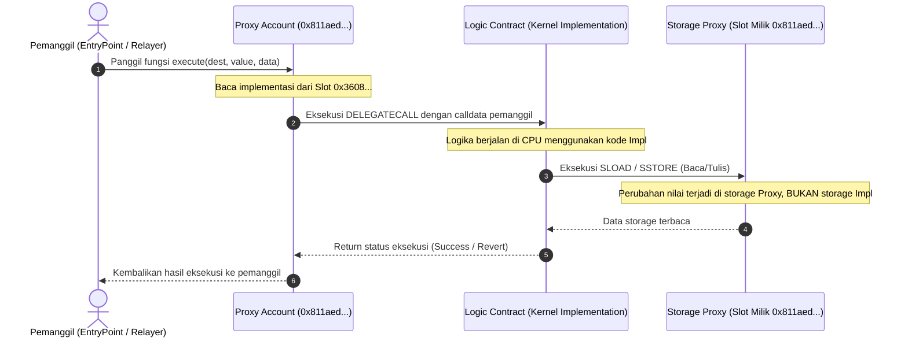

# Desain dan spesifikasi teknis eksekusi opcode EVM pada smart contract dan ERC-4337

**Analisis komputasi mesin stack 256-bit, alokasi memori, opcode kunci (CREATE2, DELEGATECALL, STATICCALL, SSTORE), dan dinamika konsumsi gas**

| Parameter | Deskripsi |
| :--- | :--- |
| **Status** | Spesifikasi analisis eksekusi mesin virtual EVM final |
| **Penyusun** | Benedictus Leonardo Edward Stephen Sugianto (NRP: 160423176) |
| **Ruang lingkup** | Karakteristik eksekusi mesin stack 256-bit, empat domain memori EVM (Stack, Memory, Storage, Calldata), semantik opcode deployment dan delegasi, serta optimasi biaya gas |
| **Dokumen terkait** | [01-erc4337-initcode-and-erc1967.md](file:///d:/STEVE/Project-TA-NFT-Marketplace/explanation/01-erc4337-initcode-and-erc1967.md), [02-passkey-cryptography-and-address-derivation.md](file:///d:/STEVE/Project-TA-NFT-Marketplace/explanation/02-passkey-cryptography-and-address-derivation.md), [06-smart-contract-fundamentals-and-mint-flow.md](file:///d:/STEVE/Project-TA-NFT-Marketplace/explanation/06-smart-contract-fundamentals-and-mint-flow.md) |
| **Sasaran pembaca** | Penguji sidang tugas akhir, pembimbing, dan perekayasa perangkat lunak |

---

## 1. Ringkasan eksekutif

Ethereum Virtual Machine (EVM) adalah mesin virtual deterministik berbasis stack (*stack-based virtual machine*) dengan ukuran kata (*word size*) 256-bit (32 bytes). Komputer atau node validator dalam jaringan Ethereum tidak mengeksekusi bahasa pemrograman tingkat tinggi seperti Solidity secara langsung, melainkan mengeksekusi kumpulan instruksi mesin satu byte yang disebut *Operation Codes* (Opcodes), yang memiliki rentang nilai dari `0x00` hingga `0xFF`.

Pada platform *NFTix*, pemahaman mendalam mengenai perilaku opcode menjadi landasan arsitektur dalam perancangan smart contract `TicketContract.sol`, sistem relayer transaksi gasless, dan abstraksi akun ERC-4337. 

Instruksi seperti `CREATE2` memungkinkan derivasi alamat akun pengguna secara deterministik sebelum kompilasi fisik on-chain. Instruksi `DELEGATECALL` memungkinkan kontrak proxy ERC-1967 mengeksekusi logika ZeroDev Kernel dan PasskeyValidator dalam konteks penyimpanan proxy milik pengguna. Sementara itu, instruksi `STATICCALL` dan `SSTORE` menjamin integritas pembacaan data tiket tanpa efek samping serta pencatatan hak milik token secara permanen dan hemat gas.

---

## 2. Sumber fakta dan acuan kode

Analisis teknis dalam dokumen ini berpedoman pada implementasi kode kontrak pintar pada repositori dan spesifikasi resmi Ethereum:

| Komponen | Berkas sumber | Lokasi baris | Perilaku terverifikasi |
| :--- | :--- | :--- | :--- |
| Smart contract tiket | [TicketContract.sol](file:///d:/STEVE/Project-TA-NFT-Marketplace/contracts/src/TicketContract.sol) | 165 - 208 | Penggunaan `_safeMint`, `error`, `emit`, dan operasi penulisan storage `_tickets` |
| Kontrak marketplace | [MarketplaceContract.sol](file:///d:/STEVE/Project-TA-NFT-Marketplace/contracts/src/MarketplaceContract.sol) | 45 - 85 | Eksekusi `STATICCALL` untuk membaca harga tiket dan transfer aman ERC-721 |
| Library ZeroDev | `@zerodev/sdk` | Modul factory | Pemanfaatan opcode `CREATE2` (0xF5) untuk pembentukan akun counterfactual |
| Spesifikasi formal | Ethereum Yellow Paper | Bagian 9 & Lampiran H | Definisi formal eksekusi instruksi EVM dan biaya gas dasar |

---

## 3. Tujuan dan batasan sistem

### 3.1 Tujuan
1. Memetakan empat domain ruang memori EVM dan implikasinya terhadap biaya gas eksekusi kontrak tiket.
2. Menganalisis perbedaan semantik opcode eksekusi (`CALL`, `DELEGATECALL`, `STATICCALL`) dalam relasi proxy akun dan marketplace.
3. Memberikan landasan pembuktian ilmiah mengapa teknik *struct packing* pada `TicketContract.sol` mampu menghemat biaya instruksi `SSTORE`.
4. Mengidentifikasi batas-batas keamanan eksekusi opcode guna mencegah serangan manipulasi reentrancy dan delegasi liar.

### 3.2 Batasan (non-goals)
1. Tidak merancang mesin virtual alternatif di luar spesifikasi EVM London/Shanghai/Cancun.
2. Tidak mengubah skema pembebanan gas dasar yang telah ditetapkan oleh protokol konsensus Ethereum.

---

## 4. Diagram desain sistem dan arsitektur model memori EVM

Diagram blok berikut menggambarkan arsitektur pemrosesan instruksi EVM dan pembagian domain memori selama transaksi berlangsung:

```mermaid
graph TB
    subgraph ExecutionEngine ["EVM Execution Engine (Node Validator)"]
        PC["Program Counter (Penunjuk Baris Opcode)"]
        Decoder["Opcode Decoder & Dispatcher"]
        GasMeter["Gas Metering Controller (Pengurang Gas per Opcode)"]
        PC --> Decoder
        Decoder --> GasMeter
    end

    subgraph TransientDomain ["Domain Memori Sementara (Transient / Non-Persistent)"]
        Stack["1. Stack (LIFO, Max 1024 Elemen, Ukuran Kata 256-bit, Sangat Murah)"]
        Memory["2. Memory (Byte-Array Volatile, Linear Expansion Cost Kuadratis)"]
        Calldata["3. Calldata (Byte-Array Read-Only, Dikirim Inisiator Transaksi)"]
    end

    subgraph PersistentDomain ["Domain Memori Permanen (Persistent On-Chain)"]
        Storage["4. State Storage (Tabel Hash 256-bit ke 256-bit di Disk Node, Sangat Mahal)"]
        StorageSlot0["Slot 0: Owner / Proxy Implementation"]
        StorageSlotN["Slot keccak256(tokenId, slot): Struct TicketInfo"]
        Storage --- StorageSlot0
        Storage --- StorageSlotN
    end

    Decoder -->|Operasi Aritmatika & Kontrol Alur| Stack
    Decoder -->|Alokasi Struktur Sementara| Memory
    Decoder -->|Baca Argumen Fungsi (external)| Calldata
    Decoder -->|Instruksi SLOAD / SSTORE| Storage
```

---

## 5. Diagram alur sekuensial eksekusi DELEGATECALL pada arsitektur proxy

Diagram sekuensial berikut menjabarkan mekanisme isolasi memori saat sebuah kontrak proxy mengeksekusi instruksi `DELEGATECALL` ke kontrak implementasi:



---

## 6. Taksonomi dan spesifikasi teknis opcode kunci

### 6.1 Opcode `CREATE2` (`0xF5`)
* **Fungsi:** Menciptakan kontrak pintar baru dengan penentuan alamat yang bersifat deterministik tanpa bergantung pada nonce akun pembuat.
* **Perbandingan matematis:**
  * Opcode konvensional `CREATE` (`0xF0`):
    $$\text{Address} = \text{keccak256}(\text{RLP.encode}([\text{sender}, \text{nonce}]))_{[12:]}$$
  * Opcode deterministik `CREATE2` (`0xF5`):
    $$\text{Address} = \text{keccak256}(\text{0xff} \parallel \text{sender} \parallel \text{salt} \parallel \text{keccak256}(\text{initCode}))_{[12:]}$$
* **Relevansi sistem *NFTix*:**
  Memungkinkan pembeli tiket memperoleh alamat dompet smart account sebelum membayar biaya deployment. Kontrak fisik baru dibuat secara otomatis ketika tiket pertama dikirimkan.

---

### 6.2 Opcode `DELEGATECALL` (`0xF4`)
* **Fungsi:** Memanggil kode pada kontrak target, namun eksekusi komputasi dilakukan secara penuh di dalam konteks penyimpanan (*storage*) kontrak pemanggil.
* **Karakteristik konteks eksekusi:**
  * Konteks penyimpanan: Menggunakan storage milik kontrak pemanggil (`Proxy`).
  * Nilai `msg.sender`: Tetap bernilai inisiator asli pemanggil proxy.
  * Nilai `msg.value`: Mempertahankan saldo transfer asli yang diterima proxy.
* **Relevansi sistem *NFTix*:**
  Mendasari seluruh arsitektur modular ZeroDev Kernel, di mana akun proxy pengguna mendelegasikan logika validasi tanda tangan biometrik ke `PasskeyValidator` tanpa menduplikasi bytecode validator ke setiap dompet pengguna.

---

### 6.3 Opcode `STATICCALL` (`0xFA`)
* **Fungsi:** Memanggil kontrak target dengan jaminan deterministik bahwa pemanggilan tersebut **tidak akan mengubah status penyimpanan apapun (*state modification restriction*)**.
* **Proteksi mesin:**
  Jika di dalam sub-eksekusi `STATICCALL` terdapat opcode modifikasi state seperti `SSTORE`, `CREATE`, `CREATE2`, `SELFDESTRUCT`, atau `LOG0`-`LOG4`, EVM akan langsung melempar eksepsi *state violation* dan membatalkan transaksi.
* **Relevansi sistem *NFTix*:**
  Digunakan oleh `MarketplaceContract.sol` saat membaca fungsi `getTicket(tokenId)` pada `TicketContract.sol` untuk memastikan harga tiket asli tidak dapat dimodifikasi selama proses kalkulasi royalti dan verifikasi kepemilikan berlangsung.

---

### 6.4 Opcode `SSTORE` (`0x55`) dan `SLOAD` (`0x54`)
* **Fungsi:** Mengambil (`SLOAD`) dan menulis (`SSTORE`) data 32 bytes pada storage persisten blockchain.
* **Karakteristik dinamika gas (EIP-2200 & EIP-2929):**
  * Penulisan slot kosong (nilai awal `0` menjadi `non-zero`): Menelan biaya dasar sebesar **20.000 gas** ditambah biaya slot dingin (*cold storage access*) sebesar **2.100 gas**.
  * Pembaruan slot yang sudah terisi (*dirty slot*): Menelan biaya sekitar **2.900 gas** (atau 5.000 gas pada perubahan tertentu).
  * Pembacaan slot dingin: **2.100 gas**, sedangkan pembacaan slot hangat (*warm slot*): **100 gas**.
* **Relevansi sistem *NFTix*:**
  Struktur `TicketInfo` pada `TicketContract.sol` sengaja dirancang menggunakan teknik *struct packing*, di mana variabel `originalPrice` (`uint96`) dan `used` (`bool` = 8 bit) digabungkan ke dalam satu slot memori 256-bit tunggal ($96 + 8 = 104 \text{ bit} \le 256 \text{ bit}$). Teknik ini memangkas satu kali pemanggilan `SSTORE` ekstra, menghemat sekitar 20.000 gas per pencetakan tiket.

---

### 6.5 Opcode `REVERT` (`0xFD`)
* **Fungsi:** Menghentikan eksekusi secara instan, mengembalikan seluruh perubahan state yang telah terjadi pada transaksi tersebut, namun tetap mengembalikan sisa gas (*unused gas*) kepada pemanggil.
* **Relevansi sistem *NFTix*:**
  Dipicu oleh *custom error* Solidity (seperti `error TicketAlreadyUsed()`, `error Unauthorized()`, `error InvalidPrice()`). Custom error hanya mengembalikan 4-byte hash selektor fungsi error, jauh lebih hemat gas dibandingkan pemanggilan string revert panjang via `require(condition, "Pesan string panjang...")`.

---

## 7. Analisis gas komparatif dan model biaya eksekusi

Tabel berikut menunjukkan perbandingan alokasi biaya gas untuk operasi dasar pada sistem *NFTix*:

| Kategori operasi | Opcode yang dieksekusi | Estimasi biaya gas | Implikasi arsitektural |
| :--- | :--- | :--- | :--- |
| **Aritmatika dasar** | `ADD`, `SUB`, `MUL`, `DIV` | 3 - 5 gas | Eksekusi di stack sangat murah |
| **Akses calldata** | `CALLDATALOAD`, `CALLDATASIZE` | 3 gas | Membaca parameter fungsi `external` jauh lebih murah daripada `memory` |
| **Pencatatan event** | `LOG1` - `LOG4` | 375 gas + (375 per topic) + (8 per byte) | Digunakan untuk audit riwayat tanpa membebani storage persisten |
| **Validasi hashing** | `SHA3` / `KECCAK256` | 30 gas + (6 per word) | Digunakan pada verifikasi EIP-712 dan penurunan alamat |
| **Delegasi proxy** | `DELEGATECALL` | ~2.600 gas (cold) / 100 gas (warm) | Biaya overhead yang sangat kecil dibandingkan manfaat penghematan deployment |
| **Alokasi slot baru** | `SSTORE` (0 ke non-zero) | ~22.100 gas | Operasi paling mahal, diminimalkan via struct packing |

---

## 8. Matriks mitigasi ancaman keamanan level opcode

| Vektor serangan opcode | Skenario ancaman | Solusi penanganan terpasang |
| :--- | :--- | :--- |
| **Reentrancy attack** | Penyerang memanfaatkan `CALL` eksternal untuk memanggil kembali fungsi sebelum state storage diperbarui | Menerapkan pola *Checks-Effects-Interactions* dan memprioritaskan opcode `STATICCALL` untuk operasi pembacaan lintas kontrak |
| **Delegatecall injection** | Penyerang mengarahkan alamat implementasi ke kontrak berbahaya yang menjalankan `SELFDESTRUCT` | Alamat implementasi dikunci di slot memori ERC-1967 dan hanya dapat diubah melalui otoritas mutlak pemilik akun via signature biometrik |
| **Storage collision** | Benturan slot variabel antara proxy dan logic contract saat melakukan `DELEGATECALL` | ZeroDev Kernel menerapkan layout penyimpanan terstruktur (*Diamond Storage* / ERC-1967 layout) sehingga slot tidak tumpang tindih |
| **Gas limit exhaustion** | Eksekusi looping tidak terbatas yang melampaui batas gas blok | Seluruh operasi pencetakan dan verifikasi tiket dirancang dalam kompleksitas waktu konstan $O(1)$ tanpa iterasi unbounded |

---

## 9. Referensi standar terbuka

1. **Wood, Gavin.** Ethereum: A Secure Decentralised Generalised Transaction Ledger (Ethereum Yellow Paper). [https://ethereum.github.io/yellowpaper/paper.pdf](https://ethereum.github.io/yellowpaper/paper.pdf).
2. **Ethereum Improvement Proposal 150 (EIP-150):** Gas cost changes for IO-heavy operations. [https://eips.ethereum.org/EIPS/eip-150](https://eips.ethereum.org/EIPS/eip-150).
3. **Ethereum Improvement Proposal 214 (EIP-214):** New opcode STATICCALL. [https://eips.ethereum.org/EIPS/eip-214](https://eips.ethereum.org/EIPS/eip-214).
4. **Ethereum Improvement Proposal 1014 (EIP-1014):** Skinny CREATE2. [https://eips.ethereum.org/EIPS/eip-1014](https://eips.ethereum.org/EIPS/eip-1014).
5. **Ethereum Improvement Proposal 2200 (EIP-2200):** Structured Definitions for Net Gas Metering. [https://eips.ethereum.org/EIPS/eip-2200](https://eips.ethereum.org/EIPS/eip-2200).
