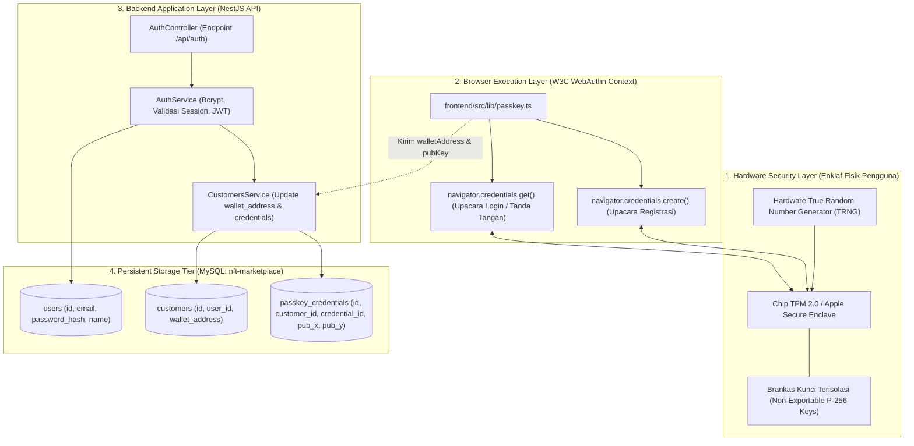
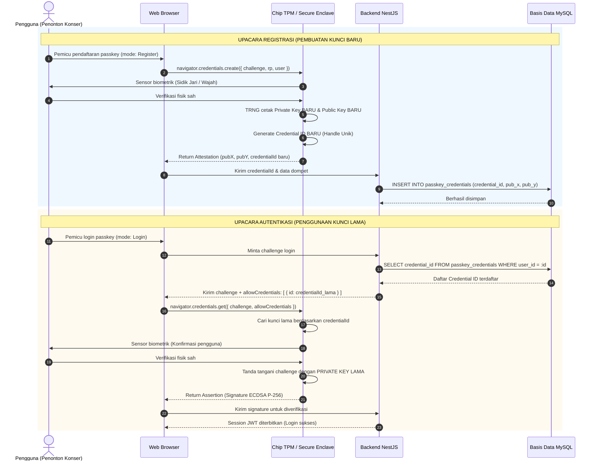

# Desain dan spesifikasi teknis siklus hidup WebAuthn passkey (upacara registrasi vs autentikasi)

**Spesifikasi teknis protokol FIDO2, determinisme entropi TPM hardware, persistensi credential ID, dan arsitektur session state**

| Parameter | Deskripsi |
| :--- | :--- |
| **Status** | Spesifikasi arsitektur autentikasi biometrik final |
| **Penyusun** | Benedictus Leonardo Edward Stephen Sugianto (NRP: 160423176) |
| **Ruang lingkup** | Analisis upacara pendaftaran (`navigator.credentials.create`), upacara login (`navigator.credentials.get`), entropi chip keamanan fisik (TPM/Secure Enclave), persistensi basis data relasional, dan lifecycle progressive onboarding |
| **Dokumen terkait** | [02-passkey-cryptography-and-address-derivation.md](file:///d:/STEVE/Project-TA-NFT-Marketplace/explanation/02-passkey-cryptography-and-address-derivation.md), [05-fullstack-auth-architecture-and-troubleshooting.md](file:///d:/STEVE/Project-TA-NFT-Marketplace/explanation/05-fullstack-auth-architecture-and-troubleshooting.md), [20-progressive-onboarding-and-wallet-activation.md](file:///d:/STEVE/Project-TA-NFT-Marketplace/explanation/20-progressive-onboarding-and-wallet-activation.md) |
| **Sasaran pembaca** | Penguji sidang tugas akhir, pembimbing, dan perekayasa perangkat lunak |

---

## 1. Ringkasan eksekutif

Standar W3C Web Authentication (WebAuthn) dan FIDO2 Client-to-Authenticator Protocol (CTAP2) mendefinisikan dua interaksi kriptografis utama yang disebut sebagai *ceremonies* (upacara): **Upacara Registrasi** (`navigator.credentials.create`) dan **Upacara Autentikasi** (`navigator.credentials.get`).

Dalam sistem *NFTix*, pemahaman terhadap kedua upacara ini sangat penting untuk menjelaskan perilaku sistem kepada penguji sidang tugas akhir:
1. Mengapa pendaftaran ulang dengan identitas pengguna (email) yang sama persis akan selalu menghasilkan `credentialId` dan pasangan kunci baru yang berbeda dari pendaftaran sebelumnya.
2. Bagaimana chip keamanan perangkat keras (*Hardware Security Module* seperti TPM 2.0 atau Apple Secure Enclave) menjamin bahwa kunci privat tidak pernah dapat diekstraksi, diduplikasi, maupun dipindahkan antarperangkat secara tidak sah.
3. Bagaimana *NFTix* menerapkan arsitektur *progressive onboarding*, di mana proses pendaftaran identitas dasar (email dan kata sandi) dipisahkan dari proses pembangkitan kunci kriptografi biometrik passkey (aktivasi dompet saat pembelian tiket).

---

## 2. Sumber fakta dan acuan kode

Spesifikasi implementasi ini bersumber pada kode aktif di repositori aplikasi:

| Komponen | Berkas sumber | Lokasi baris | Perilaku terverifikasi |
| :--- | :--- | :--- | :--- |
| Registrasi Passkey | [passkey.ts](file:///d:/STEVE/Project-TA-NFT-Marketplace/frontend/src/lib/passkey.ts) | 30 - 38 | Pemanggilan `toWebAuthnKey` dengan parameter `mode: WebAuthnMode.Register` |
| Pendaftaran Akun | [actions.ts](file:///d:/STEVE/Project-TA-NFT-Marketplace/frontend/src/app/signup/actions.ts) | 12 - 58 | Server Action Next.js untuk registrasi awal pengguna (`email`, `password`, `name`) |
| Service Autentikasi | [auth.service.ts](file:///d:/STEVE/Project-TA-NFT-Marketplace/backend/src/auth/auth.service.ts) | 35 - 75 | Hashing kata sandi bcrypt, pembuatan entitas `User`, dan inisialisasi relasi `Customer` |
| Entitas Kredensial | [customer.entity.ts](file:///d:/STEVE/Project-TA-NFT-Marketplace/backend/src/customers/entities/customer.entity.ts) | 10 - 25 | Kolom `wallet_address` yang pada awalnya bernilai `NULL` sebelum aktivasi passkey |
| Spesifikasi FIDO | W3C WebAuthn L3 | Bagian 5 & 6 | Definisi kamus opsi pembuatan dan pengambilan kredensial publik |

---

## 3. Tujuan dan batasan sistem

### 3.1 Tujuan
1. Memastikan seluruh kunci kriptografis pengguna dibangkitkan secara aman oleh generator bilangan acak perangkat keras (*True Random Number Generator*).
2. Menghindari kebingungan dalam siklus pengembangan terkait alasan teknis perubahan `credentialId` di setiap eksekusi registrasi baru.
3. Mencegah serangan *credential stuffing* dan *man-in-the-middle* (MitM) melalui pengikatan kriptografis asal domain (*origin binding*).
4. Menyediakan jalur pemulihan dan pembaruan kredensial terkelola melalui basis data relasional backend.

### 3.2 Batasan (non-goals)
1. Tidak menyimpan kunci privat maupun seed phrase pengguna di basis data aplikasi.
2. Tidak mengizinkan proses login passkey tanpa ketersediaan `credentialId` sah yang tercatat di basis data backend.
3. Tidak mendukung sinkronisasi passkey lintas ekosistem sistem operasi yang berbeda secara otomatis tanpa bantuan protokol FIDO Cross-Device Authentication (Hybrid).

---

## 4. Diagram desain sistem dan arsitektur batas komponen

Diagram blok berikut menggambarkan pemisahan lapisan aplikasi dari antarmuka WebAuthn peramban hingga penyimpanan persisten backend:



---

## 5. Diagram perbandingan alur sekuensial: Registrasi vs Autentikasi

Diagram alur berikut mengontraskan secara tegas perbedaan mendasar antara Upacara Registrasi (pembuatan kunci baru) dan Upacara Autentikasi (penggunaan kunci lama):



---

## 6. Analisis mendalam mekanisme upacara registrasi dan mutasi credential ID

Pertanyaan yang kerap muncul dalam evaluasi sistem:
> *"Mengapa setiap kali seorang pengguna mendaftar ulang dengan alamat surel yang sama (misal `andi@gmail.com`), `credentialId` yang dihasilkan oleh peramban selalu berubah?"*

### 6.1 Landasan spesifikasi W3C WebAuthn
Berdasarkan spesifikasi resmi W3C WebAuthn bagian 5.1 (*Creating New Credentials*), ketika metode `navigator.credentials.create()` dipanggil:
1. Peramban mengirimkan instruksi ke sistem operasi untuk berinteraksi dengan autentikator perangkat keras (*authenticator*).
2. Chip keamanan perangkat keras diwajibkan oleh spesifikasi FIDO2 untuk memperlakukan setiap pemanggilan `create()` sebagai permintaan pembuatan **kredensial kriptografi baru yang independen**.
3. Autentikator mengaktifkan modul TRNG (*True Random Number Generator*) perangkat keras untuk membangkitkan:
   * Sepasang kunci kurva eliptik P-256 baru ($\text{Private Key}_{\text{baru}}$, $\text{Public Key}_{\text{baru}}$).
   * Sebuah deretan byte acak unik yang berfungsi sebagai `credentialId` baru.
4. Chip enklaf perangkat keras **tidak memiliki memori pencarian berdasarkan alamat surel**; chip hanya mengindeks kunci berdasarkan `credentialId`.
5. Oleh karena itu, mendaftar dua kali dengan alamat surel yang sama secara alami akan menghasilkan dua buah kunci privat yang berbeda dan dua buah `credentialId` yang sama sekali tidak berkorelasi.

### 6.2 Implikasi pada sistem *NFTix*
Karena alamat smart contract account diturunkan dari koordinat kunci publik (`pubX` dan `pubY`) serta hash dari `credentialId` (sebagaimana dijabarkan pada [02-passkey-cryptography-and-address-derivation.md](file:///d:/STEVE/Project-TA-NFT-Marketplace/explanation/02-passkey-cryptography-and-address-derivation.md)), maka pembuatan passkey baru untuk pengguna yang sama akan menghasilkan **alamat smart contract baru**.

Untuk mencegah terjadinya duplikasi akun dan kehilangan akses ke tiket lama, sistem *NFTix* memisahkan pendaftaran akun dari pembuatan passkey melalui pola *progressive onboarding*.

---

## 7. Analisis mendalam mekanisme upacara autentikasi (login)

Berbeda dengan proses pendaftaran, upacara autentikasi memanfaatkan metode `navigator.credentials.get()`.

### 7.1 Parameter kunci: allowCredentials
Agar chip keamanan perangkat keras mengetahui kunci mana yang harus digunakan, backend mengirimkan daftar kredensial yang sah milik pengguna melalui parameter `allowCredentials`:

```typescript
const options = {
    challenge: Buffer.from("random_server_challenge"),
    allowCredentials: [
        {
            id: b64ToBytes(userStoredCredentialId), // ID yang tersimpan di database
            type: "public-key",
            transports: ["internal", "hybrid"]
        }
    ],
    userVerification: "required"
};
```

### 7.2 Semantik penandatanganan pada chip
1. Peramban menyerahkan `allowCredentials` dan `challenge` ke chip hardware.
2. Chip mencocokkan `id` yang diterima dengan daftar kunci di brankas terisolasi.
3. Setelah sensor biometrik (wajah atau sidik jari) memvalidasi kehadiran pengguna, chip menandatangani `challenge` dan `clientDataJSON` menggunakan kunci privat yang sudah ada.
4. Chip mengembalikan objek `AuthenticatorAssertionResponse` yang memuat signature digital ECDSA P-256.
5. Pada alur ini, **tidak ada kunci baru maupun credential ID baru yang diciptakan**.

---

## 8. Pola progressive onboarding pada NFTix

Untuk mengatasi tantangan siklus hidup WebAuthn dan memberikan pengalaman pengguna yang optimal bagi masyarakat umum, *NFTix* membagi alur orientasi menjadi dua tahap terpisah:

| Fase orientasi | Antarmuka pengguna | Aksi yang dieksekusi | Entitas database terdampak |
| :--- | :--- | :--- | :--- |
| **Tahap 1: Registrasi Dasar** | Halaman `/signup` | Pengguna memasukkan nama, email, dan kata sandi | `users` terisi, `customers.wallet_address` bernilai `NULL` |
| **Tahap 2: Aktivasi Dompet** | Halaman `/dashboard/buy` | Pengguna mengonfirmasi aktivasi passkey biometrik saat ingin bertransaksi | `customers.wallet_address` diperbarui, `passkey_credentials` dicatat |

Pemisahan ini memastikan bahwa:
1. Pengguna dapat mengeksplorasi katalog konser tanpa harus mengonfigurasi perangkat biometrik terlebih dahulu.
2. Pembuatan kunci privat hardware dan derivasi alamat smart contract hanya dilakukan saat pengguna benar-benar berniat melakukan pembelian tiket konser.

---

## 9. Matriks mitigasi ancaman keamanan WebAuthn

| Vektor ancaman | Deskripsi serangan | Mekanisme pertahanan WebAuthn / NFTix |
| :--- | :--- | :--- |
| **Man-in-the-middle (MitM)** | Penyerang membuat web tiruan (*phishing site*) untuk mencuri kredensial | Peramban menyertakan nilai `origin` terverifikasi di dalam `clientDataJSON`. Signature menjadi tidak valid jika domain tidak cocok dengan Relying Party ID |
| **Replay attack** | Penyerang merekam signature lama dan mengirimkannya kembali ke server | Server membangkitkan `challenge` unik kriptografis yang memiliki batas waktu kadaluarsa (*time-to-live*) dan hanya dapat digunakan satu kali |
| **Pencurian fisik basis data** | Penyerang membobol server backend dan mencuri seluruh isi tabel basis data | Basis data hanya menyimpan `credentialId` (handle publik) dan koordinat kunci publik. Kunci privat tetap aman berada di dalam enklaf perangkat pengguna |
| **Pemaksaan tanda tangan tanpa izin** | Malware di komputer pengguna mencoba memanggil fungsi tanda tangan secara diam-diam | Chip keamanan perangkat keras mewajibkan *User Presence* dan *User Verification* fisik (sensor sentuhan / kamera wajah) sebelum melepas signature |

---

## 10. Referensi standar terbuka

1. **W3C Recommendation:** Web Authentication: An API for accessing Public Key Credentials Level 3 (WebAuthn). [https://www.w3.org/TR/webauthn-3/](https://www.w3.org/TR/webauthn-3/).
2. **FIDO Alliance:** Client to Authenticator Protocol (CTAP) Implementation Guidelines. [https://fidoalliance.org/specs/fido-v2.1-ps-20210615/fido-client-to-authenticator-protocol-v2.1-ps-errata-20220621.html](https://fidoalliance.org/specs/fido-v2.1-ps-20210615/fido-client-to-authenticator-protocol-v2.1-ps-errata-20220621.html).
3. **NIST Special Publication 800-90A:** Recommendation for Random Number Generation Using Deterministic Random Bit Generators. [https://csrc.nist.gov/publications/detail/sp/800-90a/rev-1/final](https://csrc.nist.gov/publications/detail/sp/800-90a/rev-1/final).
4. **RFC 6234:** US Secure Hash Algorithms (SHA and SHA-based HMAC and HKDF). [https://datatracker.ietf.org/doc/html/rfc6234](https://datatracker.ietf.org/doc/html/rfc6234).
