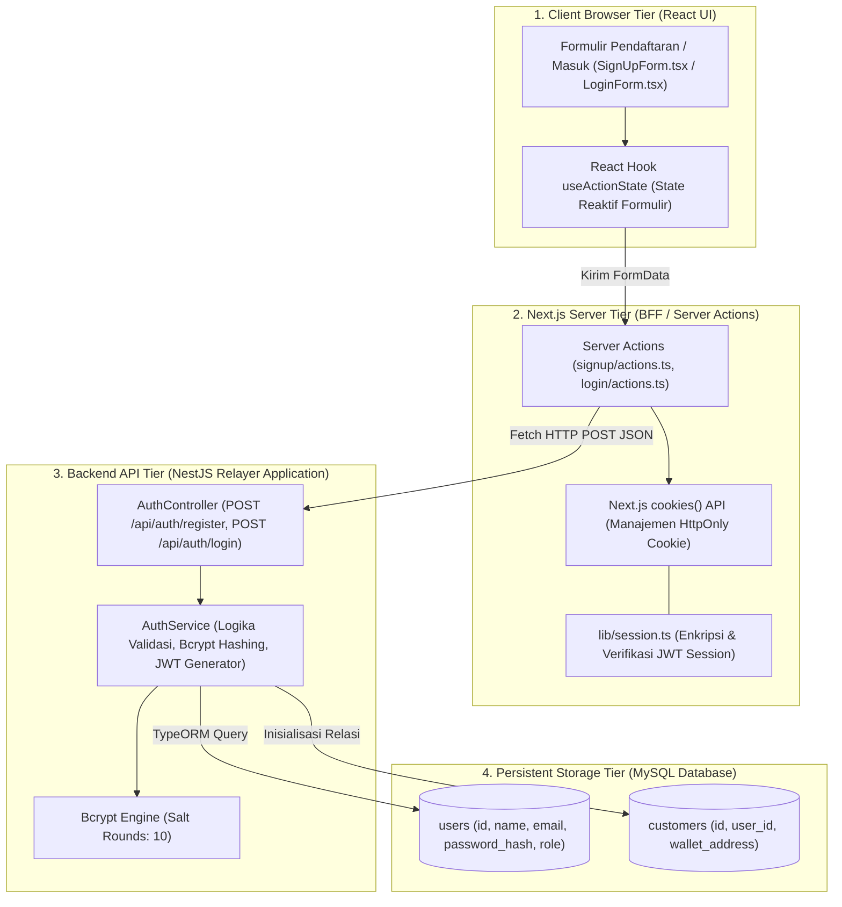
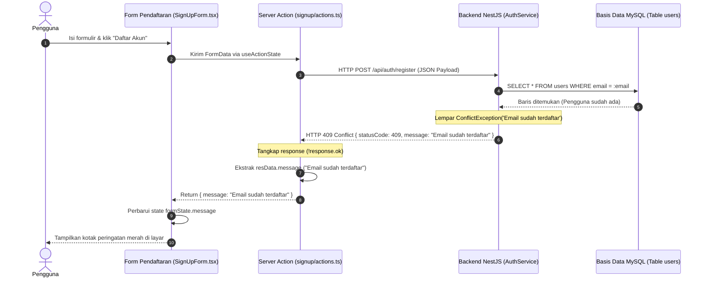

# Desain dan spesifikasi teknis arsitektur autentikasi fullstack dan penanganan kesalahan server actions

**Spesifikasi teknis komunikasi Next.js BFF, NestJS TypeORM, manajemen session cookie HttpOnly, dan resolusi eksepsi NEXT_REDIRECT**

| Parameter | Deskripsi |
| :--- | :--- |
| **Status** | Spesifikasi arsitektur autentikasi fullstack final |
| **Penyusun** | Benedictus Leonardo Edward Stephen Sugianto (NRP: 160423176) |
| **Ruang lingkup** | Pola Backend-for-Frontend (BFF), siklus hidup cookie HttpOnly JWT, propagasi status HTTP (401, 409), penanganan eksepsi Next.js `redirect()`, dan penjaminan integritas sesi |
| **Dokumen terkait** | [04-webauthn-lifecycle-register-vs-login.md](file:///d:/STEVE/Project-TA-NFT-Marketplace/explanation/04-webauthn-lifecycle-register-vs-login.md), [20-progressive-onboarding-and-wallet-activation.md](file:///d:/STEVE/Project-TA-NFT-Marketplace/explanation/20-progressive-onboarding-and-wallet-activation.md), [21-midtrans-payment-gateway-integration.md](file:///d:/STEVE/Project-TA-NFT-Marketplace/explanation/21-midtrans-payment-gateway-integration.md) |
| **Sasaran pembaca** | Penguji sidang tugas akhir, pembimbing, dan perekayasa perangkat lunak |

---

## 1. Ringkasan eksekutif

Sistem autentikasi pada platform *NFTix* mengadopsi pola arsitektur *Backend-for-Frontend* (BFF) yang menjembatani interaksi antara komponen peramban Next.js dan REST API NestJS. Keamanan sesi pengguna dikelola melalui token JWT (*JSON Web Token*) yang disimpan dalam cookie terenkripsi dengan atribut `HttpOnly`, `SameSite=Lax`, dan `Secure`. Atribut ini menjamin bahwa token sesi kebal dari pencurian melalui serangan berbasis skrip lintas situs (*Cross-Site Scripting* / XSS).

Dalam pengembangan sistem fullstack modern berbasis React 19 dan Next.js App Router, pemisahan tanggung jawab (*separation of concerns*) antara validasi logika bisnis di backend dan penyajian visual di frontend menuntut penanganan kesalahan yang disiplin. 

Dokumen ini mendokumentasikan secara rinci arsitektur propagasi kode status HTTP (termasuk HTTP 409 Conflict saat duplikasi surel dan HTTP 401 Unauthorized saat kesalahan kata sandi), alur mutasi state formulir via React `useActionState`, serta analisis akar masalah teknis terkait penanganan eksepsi internal Next.js `NEXT_REDIRECT` yang kerap tertelan oleh blok penanganan kesalahan (*try-catch block*) konvensional.

---

## 2. Sumber fakta dan acuan kode

Spesifikasi implementasi ini bersumber pada berkas repositori aktif berikut:

| Komponen | Berkas sumber | Lokasi baris | Perilaku terverifikasi |
| :--- | :--- | :--- | :--- |
| Server Action SignUp | [actions.ts](file:///d:/STEVE/Project-TA-NFT-Marketplace/frontend/src/app/signup/actions.ts) | 12 - 58 | Validasi field formulir pendaftaran dan pemanggilan endpoint backend NestJS |
| Server Action Login | [actions.ts](file:///d:/STEVE/Project-TA-NFT-Marketplace/frontend/src/app/login/actions.ts) | 10 - 48 | Otentikasi kredensial pengguna dan pembuatan sesi cookie `session` |
| Sesi Cookie BFF | [session.ts](file:///d:/STEVE/Project-TA-NFT-Marketplace/frontend/src/lib/session.ts) | 1 - 45 | Fungsi `createSession`, `verifySession`, dan `deleteSession` berbasis JWT |
| Service Autentikasi | [auth.service.ts](file:///d:/STEVE/Project-TA-NFT-Marketplace/backend/src/auth/auth.service.ts) | 35 - 90 | Pemeriksaan eksistensi surel via TypeORM, hashing `bcrypt`, dan pelemparan exception |
| Controller Autentikasi | [auth.controller.ts](file:///d:/STEVE/Project-TA-NFT-Marketplace/backend/src/auth/auth.controller.ts) | 18 - 32 | Penanganan rute `/api/auth/register` dan `/api/auth/login` |

---

## 3. Tujuan dan batasan sistem

### 3.1 Tujuan
1. Memastikan token kredensial sesi pengguna tidak dapat diakses oleh kode JavaScript pihak ketiga di sisi peramban.
2. Menjamin pesan kesalahan dari validasi basis data di backend (seperti surel terdaftar) dipropagasi secara utuh hingga ke elemen visual formulir pengguna.
3. Menyediakan mekanisme navigasi halaman yang andal pasca otentikasi tanpa merusak alur pelemparan eksepsi internal perutean Next.js.
4. Memisahkan antarmuka publik peramban dari komunikasi jaringan langsung ke basis data relasional.

### 3.2 Batasan (non-goals)
1. Tidak menyimpan kredensial sesi pada `localStorage` atau `sessionStorage` peramban.
2. Tidak mengimplementasikan otentikasi pihak ketiga berbasis OAuth (seperti Google Sign-In) pada modul inti demi menjaga kemandirian basis data pengguna.
3. Tidak melakukan pembaruan state reaktif di frontend tanpa melalui mekanisme Server Actions atau form submission.

---

## 4. Diagram desain sistem dan batas arsitektur komponen

Diagram blok berikut memetakan pembagian tier sistem autentikasi, batas isolasi jaringan, dan aliran data sesi pengguna:



---

## 5. Diagram alur sekuensial penanganan error dan propagasi pesan

Diagram alur berikut mengilustrasikan siklus hidup permintaan pendaftaran surel yang telah terdaftar, memperlihatkan bagaimana pesan kesalahan HTTP 409 Conflict dari NestJS ditransmisikan kembali ke komponen UI:



---

## 6. Arsitektur manajemen session cookie HttpOnly

Sistem *NFTix* tidak mengizinkan penyimpanan token otentikasi pada media penyimpanan yang rentan terhadap akses skrip peramban.

### 6.1 Konfigurasi atribut cookie
Pada berkas [session.ts](file:///d:/STEVE/Project-TA-NFT-Marketplace/frontend/src/lib/session.ts), cookie sesi dikonfigurasi dengan parameter keamanan ketat sesuai spesifikasi RFC 6265:

```typescript
const cookieStore = await cookies();
cookieStore.set("session", token, {
    httpOnly: true,                                    // Mencegah akses dari document.cookie di JavaScript
    secure: process.env.NODE_ENV === "production",     // Wajib HTTPS pada lingkungan produksi
    sameSite: "lax",                                   // Proteksi terhadap serangan CSRF
    path: "/",                                         // Berlaku untuk seluruh sub-rute aplikasi
    expires: new Date(Date.now() + 7 * 24 * 60 * 60 * 1000) // Masa aktif 7 hari
});
```

### 6.2 Struktur muatan token JWT
Payload token sesi memuat informasi minimal yang diperlukan untuk mengidentifikasi konteks pengguna tanpa menyertakan data sensitif seperti hash kata sandi:

```json
{
  "userId": 14,
  "email": "andi@gmail.com",
  "name": "Andi Pratama",
  "role": "customer",
  "iat": 1718000000,
  "exp": 1718604800
}
```

---

## 7. Analisis mendalam penanganan kesalahan: NestJS vs Server Actions

Pertanyaan arsitektural yang sering diuji dalam sidang tugas akhir:
> *"Jika terjadi kegagalan otentikasi, di mana pesan teks kesalahan didefinisikan? Siapa yang bertanggung jawab menampilkannya ke layar peramban?"*

Tanggung jawab penanganan kesalahan dibagi secara jelas dalam tiga lapisan:

1. **Lapisan Pendefinisian Kebenaran (Backend NestJS):**
   Pesan kesalahan didefinisikan secara resmi di lapisan service backend:
   ```typescript
   // backend/src/auth/auth.service.ts
   if (existingUser) {
       throw new ConflictException("Email sudah terdaftar");
   }
   ```
   NestJS Exception Filter secara otomatis menyusun respon berstandar RFC 7807:
   ```json
   {
       "statusCode": 409,
       "message": "Email sudah terdaftar",
       "error": "Conflict"
   }
   ```

2. **Lapisan Penjembatan dan Normalisasi (Next.js Server Actions):**
   Server Action bertindak sebagai proxy cerdas. Tindakan ini membaca respon dari backend, memprioritaskan properti `message` yang dikirim backend, dan hanya menggunakan teks cadangan (*fallback*) jika backend tidak mengirimkan pesan yang valid:
   ```typescript
   // frontend/src/app/signup/actions.ts
   const resData = await response.json();
   if (!response.ok) {
       return {
           message: resData.message || "Registrasi gagal diproses"
       };
   }
   ```

3. **Lapisan Penyajian Visual (React Component):**
   Komponen `SignUpForm.tsx` membaca objek kembalian melalui hook `useActionState`:
   ```tsx
   {state?.message && (
       <div className="p-3 text-sm text-red-500 bg-red-50 border border-red-200 rounded">
           {state.message}
       </div>
   )}
   ```

---

## 8. Studi kasus investigasi bug kritis: Eksepsi NEXT_REDIRECT

Selama proses pengembangan sistem otentikasi, ditemukan sebuah anomali teknis kritis: ketika fungsi `redirect("/dashboard")` dipanggil di dalam blok `try ... catch` pada Server Action, peramban gagal melakukan navigasi dan justru menampilkan pesan teks kesalahan:
```text
"NEXT_REDIRECT"
```

### 8.1 Analisis akar masalah (Root Cause Analysis)
Di dalam arsitektur Next.js App Router:
1. Fungsi `redirect()` dari pustaka `next/navigation` **bukanlah fungsi yang melakukan mutasi HTTP secara pasif**.
2. Fungsi `redirect()` bekerja dengan sengaja melempar sebuah kesalahan internal JavaScript bertipe `Error` khusus yang diberi penanda `NEXT_REDIRECT`.
3. Framework Next.js mengandalkan pelemparan eksepsi ini agar alur eksekusi fungsi terhenti seketika dan sinyal pengalihan halaman dapat ditangkap oleh router inti Next.js.
4. Ketika pengembang membungkus pemanggilan `redirect()` di dalam blok `catch (error)` umum:
   ```typescript
   // Pola yang keliru (anti-pattern):
   try {
       // Logika otentikasi...
       redirect("/dashboard"); // Melempar eksepsi internal NEXT_REDIRECT
   } catch (error: any) {
       return { message: error.message }; // Eksepsi tertelan! Server Action mengembalikan teks "NEXT_REDIRECT"
   }
   ```
   Blok `catch` mengira `NEXT_REDIRECT` adalah kesalahan sistem, menangkapnya, dan mengembalikannya sebagai teks kesalahan ke formulir. Akibatnya, pengalihan halaman tidak pernah terjadi.

### 8.2 Solusi teknis permanen
Dua pendekatan arsitektural yang diterapkan untuk menyelesaikan masalah ini:

1. **Pendekatan Penempatan di Luar Try-Catch:**
   Memindahkan eksekusi `redirect()` ke luar lingkup penanganan kesalahan `try-catch`, sehingga eksepsi internal dapat menggelembung bebas ke router Next.js:
   ```typescript
   let isSuccess = false;
   try {
       await performAuth();
       isSuccess = true;
   } catch (error) {
       return { message: "Otentikasi gagal" };
   }
   if (isSuccess) {
       redirect("/dashboard");
   }
   ```

2. **Pendekatan Pengecekan Eksepsi Redirect:**
   Memeriksa apakah error yang ditangkap merupakan instansiasi eksepsi redirect, lalu melemparnya kembali (*rethrow*):
   ```typescript
   import { isRedirectError } from "next/dist/client/components/redirect-error";

   try {
       // Operasi login...
       redirect("/dashboard");
   } catch (error) {
       if (isRedirectError(error)) {
           throw error; // Biarkan Next.js menangani perutean
       }
       return { message: "Terjadi kesalahan sistem" };
   }
   ```

---

## 9. Matriks mitigasi ancaman keamanan sesi

| Vektor ancaman | Dampak risiko | Mekanisme penanganan terpasang |
| :--- | :--- | :--- |
| **XSS Cookie Theft** | Penyerang menyuntikkan skrip berbahaya untuk mencuri token sesi pengguna | Penandaan atribut `HttpOnly` memblokir akses objek `document.cookie` dari seluruh runtime skrip client |
| **Cross-Site Request Forgery (CSRF)** | Situs eksternal memicu aksi tidak sah atas nama sesi korban | Konfigurasi `SameSite=Lax` melarang peramban melampirkan cookie pada request POST lintas situs |
| **Man-in-the-middle Eavesdropping** | Intersepsi paket jaringan pada jaringan Wi-Fi publik | Penerapan atribut `Secure` menjamin transmisi cookie hanya dapat dilakukan melalui kanal TLS/HTTPS terenkripsi |
| **Credential Stuffing** | Penyerang mencoba daftar kombinasi kata sandi hasil kebocoran data eksternal | Penerapan algoritma `bcrypt` dengan faktor kerja (*salt rounds*) 10 untuk memperlambat upaya komputasi brute-force |

---

## 10. Referensi standar terbuka

1. **RFC 6265:** HTTP State Management Mechanism (Cookie Specifications). [https://datatracker.ietf.org/doc/html/rfc6265](https://datatracker.ietf.org/doc/html/rfc6265).
2. **RFC 7519:** JSON Web Token (JWT) Architectural Guidelines. [https://datatracker.ietf.org/doc/html/rfc7519](https://datatracker.ietf.org/doc/html/rfc7519).
3. **Next.js Documentation:** Server Actions and Mutations Error Handling. [https://nextjs.org/docs/app/building-your-application/data-fetching/server-actions-and-mutations](https://nextjs.org/docs/app/building-your-application/data-fetching/server-actions-and-mutations).
4. **OWASP Foundation:** Session Management Cheat Sheet. [https://cheatsheetseries.owasp.org/cheatsheets/Session_Management_Cheat_Sheet.html](https://cheatsheetseries.owasp.org/cheatsheets/Session_Management_Cheat_Sheet.html).
