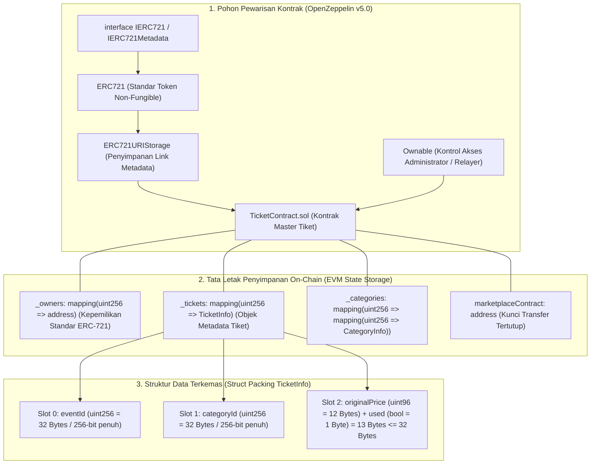
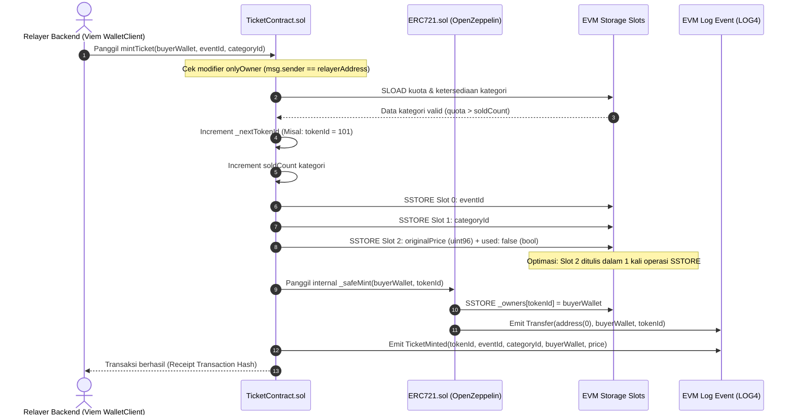

# Desain dan spesifikasi teknis fondasi smart contract Solidity dan alur minting tiket NFT

**Spesifikasi teknis struktur data TicketInfo, optimasi storage slot packing, semantik eksekusi Solidity, dan alur pencetakan on-chain**

| Parameter | Deskripsi |
| :--- | :--- |
| **Status** | Spesifikasi arsitektur smart contract final |
| **Penyusun** | Benedictus Leonardo Edward Stephen Sugianto (NRP: 160423176) |
| **Ruang lingkup** | Desain data struct dan mapping ERC-721, analisis slot packing EVM, semantik visibilitas/mutabilitas, custom error EIP-838 vs require string, dan alur eksekusi minting tiket |
| **Dokumen terkait** | [03-evm-opcodes-guide.md](file:///d:/STEVE/Project-TA-NFT-Marketplace/explanation/03-evm-opcodes-guide.md), [08-evm-storage-capacity-and-multi-event-architecture.md](file:///d:/STEVE/Project-TA-NFT-Marketplace/explanation/08-evm-storage-capacity-and-multi-event-architecture.md), [10-tickets-service-relayer-deep-dive.md](file:///d:/STEVE/Project-TA-NFT-Marketplace/explanation/10-tickets-service-relayer-deep-dive.md) |
| **Sasaran pembaca** | Penguji sidang tugas akhir, pembimbing, dan perekayasa perangkat lunak |

---

## 1. Ringkasan eksekutif

Platform *NFTix* mengimplementasikan kontrak pintar `TicketContract.sol` yang dibangun di atas standar token non-fungible Ethereum ERC-721 dengan ekstensi `ERC721URIStorage` dan kontrol akses `Ownable` dari OpenZeppelin Contracts versi 5.0. Kontrak ini bertindak sebagai buku besar tunggal (*master ledger*) yang mengelola pencetakan tiket, penguncian harga dasar anti-calo, dan pencatatan status penggunaan tiket konser.

Solidity mengeksekusi logika di atas mesin berbasis stack 256-bit tanpa paradigma objek berbasis kelas (*class*) murni. Representasi tiket diwujudkan melalui perpaduan struktur data `struct TicketInfo` dan pemetaan hash `mapping(uint256 => TicketInfo)`. 

Untuk menekan biaya transaksi pencetakan tiket bagi penyelenggara konser atau relayer sponsor gas, kontrak ini menerapkan teknik optimasi penyimpanan memori EVM tingkat lanjut yang disebut *storage slot packing*. Variabel `originalPrice` (`uint96`) dan `used` (`bool` = 8-bit) dikemas ke dalam satu slot 256-bit tunggal, memangkas konsumsi satu kali instruksi `SSTORE` (menghemat ~20.000 gas per pencetakan tiket).

---

## 2. Sumber fakta dan acuan kode

Analisis arsitektur ini merujuk langsung pada implementasi kode kontrak aktif di repositori proyek:

| Komponen | Berkas sumber | Lokasi baris | Perilaku terverifikasi |
| :--- | :--- | :--- | :--- |
| Struktur Data Tiket | [TicketContract.sol](file:///d:/STEVE/Project-TA-NFT-Marketplace/contracts/src/TicketContract.sol) | 43 - 48 | Definisi `struct TicketInfo` dengan tipe data teroptimasi `uint96` dan `bool` |
| Pemetaan Storage | [TicketContract.sol](file:///d:/STEVE/Project-TA-NFT-Marketplace/contracts/src/TicketContract.sol) | 53 | Deklarasi tabel hash privat `_tickets` terindeks `tokenId` |
| Eksekusi Pencetakan | [TicketContract.sol](file:///d:/STEVE/Project-TA-NFT-Marketplace/contracts/src/TicketContract.sol) | 165 - 208 | Fungsi `mintTicket(to, eventId, categoryId)` dengan kontrol akses `onlyOwner` |
| Definisi Kesalahan | [TicketContract.sol](file:///d:/STEVE/Project-TA-NFT-Marketplace/contracts/src/TicketContract.sol) | 15 - 28 | Deklarasi custom error EIP-838 hemat gas (`error Unauthorized()`, dll.) |
| Emisi Event | [TicketContract.sol](file:///d:/STEVE/Project-TA-NFT-Marketplace/contracts/src/TicketContract.sol) | 30 - 39 | Deklarasi log blockchain `event TicketMinted(...)` berparameter `indexed` |

---

## 3. Tujuan dan batasan sistem

### 3.1 Tujuan
1. Menyediakan representasi tiket digital yang tidak dapat dipalsukan dan mematuhi standar ERC-721.
2. Mengunci harga tiket resmi (`originalPrice`) secara permanen di tingkat penyimpanan on-chain untuk mencegah manipulasi kenaikan harga di pasar sekunder.
3. Mengoptimalkan alokasi slot penyimpanan EVM guna meminimalkan konsumsi biaya gas penulisan (`SSTORE`).
4. Membatasi hak pemanggilan fungsi pencetakan hanya kepada relayer backend resmi (*gas sponsor*) melalui modifier `onlyOwner`.

### 3.2 Batasan (non-goals)
1. Tidak menyimpan metadata gambar konser yang berukuran besar langsung di penyimpanan on-chain (metadata disimpan di IPFS/Arweave dan ditunjuk via URI).
2. Tidak mengizinkan pembeli umum memanggil fungsi pencetakan secara langsung tanpa melalui relayer terotorisasi.
3. Tidak mendukung penghancuran tiket (*burn*) sepihak oleh pengguna tanpa instruksi pembatalan resmi acara.

---

## 4. Diagram desain sistem dan arsitektur model data smart contract

Diagram blok berikut memetakan hierarki pewarisan kontrak, struktur penyimpanan memori on-chain, dan gerbang otorisasi pencetakan:



---

## 5. Diagram alur sekuensial eksekusi minting tiket on-chain

Diagram sekuensial berikut menjabarkan urutan instruksi dari pemanggilan relayer backend hingga pencatatan event on-chain:



---

## 6. Representasi objek tiket dan pemisahan state kepemilikan ERC-721

Bahasa pemrograman Solidity tidak mengadopsi model alokasi memori heap untuk instansiasi objek seperti bahasa Java atau C++. Sebagai gantinya, objek direpresentasikan melalui pemetaan kunci-nilai:

```solidity
struct TicketInfo {
    uint256 eventId;       // Pengenal unik konser (32 bytes)
    uint256 categoryId;    // Kategori tiket (VIP, CAT 1, Festival) (32 bytes)
    uint96 originalPrice;  // Harga resmi yang dikunci permanen (12 bytes)
    bool used;             // Status penukaran di pintu masuk konser (1 byte)
}

mapping(uint256 => TicketInfo) private _tickets;
```

### Pemisahan kepemilikan dengan standar ERC-721
Perhatikan bahwa di dalam struktur data `TicketInfo` di atas, **tidak terdapat field alamat pemilik (`address owner`)**. Hal ini merupakan keputusan desain yang terukur:
1. Protokol ERC-721 OpenZeppelin secara internal telah menyediakan pemetaan:
   ```solidity
   mapping(uint256 tokenId => address) private _owners;
   ```
2. Menyimpan alamat pemilik kembali di dalam `TicketInfo` akan menyebabkan redundansi data penyimpanan sebesar 20 bytes (menelan ~20.000 gas tambahan).
3. Identitas kepemilikan tiket dikelola secara langsung melalui fungsi standar ERC-721 seperti `ownerOf(tokenId)`.

---

## 7. Formulasi matematika dan optimasi storage slot packing

Pada mesin virtual EVM, setiap slot penyimpanan (*storage slot*) memiliki kapasitas tetap sebesar 32 bytes (256-bit). Biaya penulisan slot dari nilai kosong (`0`) ke nilai terisi (`non-zero`) adalah **20.000 gas** ditambah biaya akses dingin sebesar **2.100 gas**.

### 7.1 Analisis tanpa optimasi (Model Naif)
Jika variabel dideklarasikan tanpa perhitungan ukuran tipe data:
```solidity
// Model tidak teroptimasi (Menghabiskan 4 Slot)
struct UnoptimizedTicketInfo {
    uint256 eventId;       // Slot 0: 32 Bytes
    uint256 categoryId;    // Slot 1: 32 Bytes
    uint256 originalPrice; // Slot 2: 32 Bytes
    bool used;             // Slot 3: 1 Byte (Sisa 31 Bytes terbuang sia-sia)
}
```
Total operasi `SSTORE` baru: $4 \times 22.100 = 88.400 \text{ gas}$.

### 7.2 Analisis dengan optimasi struct packing pada NFTix
Kompiler Solidity secara otomatis menggabungkan variabel-variabel yang dideklarasikan secara berurutan ke dalam satu slot 32 bytes jika jumlah kapasitas bitnya tidak melampaui 256-bit:

$$\text{Kapasitas Slot 2} = \text{size}(\text{uint96}) + \text{size}(\text{bool}) = 96 \text{ bit} + 8 \text{ bit} = 104 \text{ bit} \le 256 \text{ bit}$$

Sisa kapasitas slot 2 adalah $256 - 104 = 152 \text{ bit}$ yang belum terpakai. 

Pemilihan tipe data `uint96` untuk `originalPrice` didasarkan pada perhitungan matematis:
$$2^{96} - 1 \approx 7.92 \times 10^{28} \text{ Wei} \approx 79.228.162.514 \text{ ETH}$$
Nilai batas atas tersebut jauh melampaui total suplai uang beredar di seluruh dunia, sehingga tipe data `uint96` sepenuhnya aman dari risiko luapan bilangan (*integer overflow*) untuk representasi harga tiket dalam satuan Rupiah maupun Wei.

Total operasi `SSTORE` baru: $3 \times 22.100 = 66.300 \text{ gas}$.
**Penghematan gas: 22.100 gas per tiket (~25% efisiensi penyimpanan).**

---

## 8. Analisis komparatif semantik kata kunci Solidity

### 8.1 Penanganan kesalahan: Custom Error (EIP-838) vs Require String
Sebelum versi Solidity 0.8.4, penanganan kesalahan dilakukan melalui string pesan:
```solidity
// Pendekatan lama yang boros gas:
require(msg.sender == owner(), "Error: Caller is not the authorized contract owner");
```
Setiap karakter teks string membutuhkan alokasi memori dan eksekusi instruksi pembacaan calldata.

Pada `TicketContract.sol`, sistem secara konsisten menggunakan *Custom Error*:
```solidity
error Unauthorized();
// Dipanggil dengan:
if (msg.sender != owner()) revert Unauthorized();
```
* Custom error hanya menghasilkan 4-byte hash selektor: $\text{keccak256}(\text{"Unauthorized()"})_{[0:4]}$.
* Penghematan biaya gas mencapai ratusan gas di setiap eksepsi yang dipicu.

### 8.2 Logging riwayat: Event dan Emit
Operasi logging menggunakan kata kunci `event` dan dieksekusi dengan perintah `emit`:
1. Log ditulis ke struktur *Bloom Filter* blok Ethereum menggunakan opcode EVM `LOG0` hingga `LOG4`.
2. Biaya penulisan log berkisar antara 375 gas hingga beberapa ribu gas, jauh lebih murah dibandingkan `SSTORE` (20.000 gas).
3. Parameter bertanda `indexed` (maksimal 3 parameter per event) disimpan di dalam array `topics`, memungkinkan pengindeksan instan oleh antarmuka frontend, pustaka Viem, maupun penjelajah blok seperti Etherscan.

### 8.3 Mutabilitas dan visibilitas fungsi
1. **`external` vs `public`**: Fungsi `mintTicket` dideklarasikan sebagai `external` karena fungsi tersebut hanya dipanggil dari luar kontrak oleh relayer. Parameter fungsi `external` dibaca langsung dari pointer calldata tanpa penyalinan ke memori internal, sehingga menghemat gas.
2. **`view` vs `pure`**: 
   * `view`: Membaca variabel penyimpanan on-chain tanpa melakukan modifikasi (contoh: `getTicket(tokenId)`).
   * `pure`: Melakukan komputasi murni tanpa membaca maupun mengubah variabel state kontrak.

---

## 9. Matriks mitigasi ancaman keamanan smart contract

| Vektor ancaman | Deskripsi serangan | Mitigasi arsitektural terpasang |
| :--- | :--- | :--- |
| **Pencetakan tiket liar** | Pengguna luar memanggil fungsi `mintTicket` secara langsung untuk mendapatkan tiket gratis | Dilindungi oleh modifier `onlyOwner` (hanya dompet relayer yang sah yang dapat memicu pencetakan) |
| **Integer overflow / underflow** | Manipulasi penambahan atau pengurangan saldo tiket melampaui batas tipe data | Dilindungi oleh pemeriksa bawaan (*checked arithmetic*) Solidity versi 0.8.20+ yang otomatis melempar revert |
| **Penjualan tiket melebihi kuota** | Terjadi race condition saat permintaan tiket melebihi kapasitas kategori | Pemeriksaan ketat `soldCount < quota` dieksekusi secara atomik sebelum id tiket baru diterbitkan |
| **Pembelian tiket ganda tanpa izin** | Satu alamat dompet menimbun tiket dalam jumlah besar | Batasan kuota maksimum per dompet (`max_per_wallet`) divalidasi di backend relayer dan dicatat di database |

---

## 10. Referensi standar terbuka

1. **Ethereum Improvement Proposal 721 (EIP-721):** Non-Fungible Token Standard. [https://eips.ethereum.org/EIPS/eip-721](https://eips.ethereum.org/EIPS/eip-721).
2. **Ethereum Improvement Proposal 838 (EIP-838):** ABI specifications for custom errors. [https://eips.ethereum.org/EIPS/eip-838](https://eips.ethereum.org/EIPS/eip-838).
3. **OpenZeppelin Contracts Documentation:** ERC721 and Access Control Implementations. [https://docs.openzeppelin.com/contracts/5.x/erc721](https://docs.openzeppelin.com/contracts/5.x/erc721).
4. **Solidity Language Documentation:** Layout of State Variables in Storage and Memory. [https://docs.soliditylang.org/en/v0.8.20/internals/layout_in_storage.html](https://docs.soliditylang.org/en/v0.8.20/internals/layout_in_storage.html).
