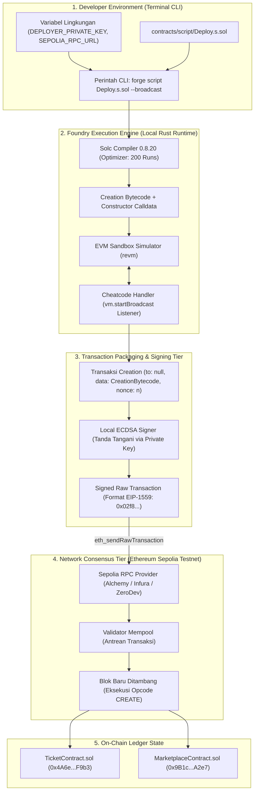
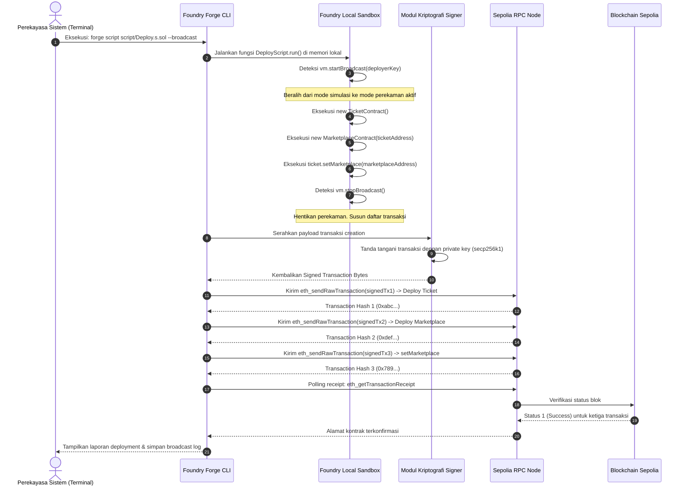

# Desain dan spesifikasi teknis mekanisme deployment smart contract via Foundry dan analisis script broadcast

**Spesifikasi teknis otomasi deployment kontrak cerdas, semantik cheatcode VM Foundry, transaksi creation bytecode to:null, dan derivasi alamat RLP**

| Parameter | Deskripsi |
| :--- | :--- |
| **Status** | Spesifikasi deployment infrastruktur final |
| **Penyusun** | Benedictus Leonardo Edward Stephen Sugianto (NRP: 160423176) |
| **Ruang lingkup** | Analisis skrip Foundry `Deploy.s.sol`, semantik cheatcode `vm.startBroadcast`, struktur transaksi Ethereum pembentukan kontrak (`to: null`), fungsi hash deterministik RLP, dan alur integrasi CI/CD ke Sepolia Testnet |
| **Dokumen terkait** | [03-evm-opcodes-guide.md](file:///d:/STEVE/Project-TA-NFT-Marketplace/explanation/03-evm-opcodes-guide.md), [06-smart-contract-fundamentals-and-mint-flow.md](file:///d:/STEVE/Project-TA-NFT-Marketplace/explanation/06-smart-contract-fundamentals-and-mint-flow.md), [08-evm-storage-capacity-and-multi-event-architecture.md](file:///d:/STEVE/Project-TA-NFT-Marketplace/explanation/08-evm-storage-capacity-and-multi-event-architecture.md) |
| **Sasaran pembaca** | Penguji sidang tugas akhir, pembimbing, dan perekayasa perangkat lunak |

---

## 1. Ringkasan eksekutif

Penerapan smart contract pada platform *NFTix* dikelola menggunakan toolkit pengembangan Ethereum berbasis bahasa Rust bernama Foundry. Pendekatan ini menggantikan perkakas berbasis JavaScript lawas seperti Hardhat atau Truffle, memungkinkan pengujian dan penulisan skrip deployment dieksekusi secara native menggunakan bahasa Solidity.

Proses deployment kontrak pintar ke blockchain Ethereum bukanlah sekadar operasi pengunggahan berkas secara pasif ke peladen web. Deployment adalah sebuah transaksi pembentukan kontrak (*contract creation transaction*) dengan kolom alamat tujuan bernilai kosong (`to: null`). 

Di dalam lingkungan Foundry, skrip [`Deploy.s.sol`](file:///d:/STEVE/Project-TA-NFT-Marketplace/contracts/script/Deploy.s.sol) memanfaatkan instruksi virtual machine khusus (*cheatcode*) seperti `vm.startBroadcast()`. Instruksi ini menginstruksikan mesin simulator Foundry untuk merekam transaksi pembentukan kontrak, menandatanganinya secara kriptografis menggunakan kunci privat deployer, dan memancarkannya ke jaringan publik Sepolia Testnet melalui protokol JSON-RPC standar `eth_sendRawTransaction`.

---

## 2. Sumber fakta dan acuan kode

Spesifikasi implementasi ini bersumber pada berkas repositori aktif berikut:

| Komponen | Berkas sumber | Lokasi baris | Perilaku terverifikasi |
| :--- | :--- | :--- | :--- |
| Skrip Deployment | [Deploy.s.sol](file:///d:/STEVE/Project-TA-NFT-Marketplace/contracts/script/Deploy.s.sol) | 1 - 35 | Inisialisasi kontrak `TicketContract` dan `MarketplaceContract` serta pengikatan relasi allowlist |
| Konfigurasi Toolkit | `foundry.toml` | Root contracts | Pengaturan versi solc (0.8.20), optimasi optimizer runs (200), dan RPC endpoints |
| Kontrak Tiket | [TicketContract.sol](file:///d:/STEVE/Project-TA-NFT-Marketplace/contracts/src/TicketContract.sol) | 147 - 153 | Fungsi `setMarketplace` untuk mendaftarkan kontrak pasar sekunder resmi |
| Spesifikasi Formal | Ethereum Yellow Paper | Bagian 7 | Definisi matematis transaksi pembuatan kontrak dan penentuan alamat |

---

## 3. Tujuan dan batasan sistem

### 3.1 Tujuan
1. Mengotomatisasi proses deployment smart contract dan inisialisasi relasi izin antarkontrak dalam satu alur eksekusi yang dapat diulang (*reproducible deployment*).
2. Memisahkan fase simulasi lokal (*dry-run*) dari fase pengiriman transaksi fisik ke jaringan publik guna mencegah pemborosan gas akibat kegagalan eksekusi.
3. Memastikan alamat kontrak yang terbentuk dapat diprediksi secara matematis melalui skema pengkodean RLP (*Recursive Length Prefix*).
4. Menyediakan artefak rekaman deployment terstruktur (*broadcast logs*) dalam format JSON untuk kebutuhan integrasi otomatis dengan backend relayer.

### 3.2 Batasan (non-goals)
1. Tidak mendukung deployment kontrak manual melalui antarmuka web dompet MetaMask yang rentan terhadap salah ketik parameter constructor.
2. Tidak melakukan kompilasi ulang pada lingkungan produksi (seluruh bytecode dikompilasi secara deterministik pada lingkungan build Foundry).
3. Tidak mengekspos kunci privat deployer di dalam riwayat kontrol versi Git (kunci diinjeksi via variabel lingkungan terminal).

---

## 4. Diagram desain sistem dan batas arsitektur deployment Foundry

Diagram blok berikut menggambarkan tahapan pemrosesan skrip Solidity di dalam mesin virtual Foundry hingga transaksinya diterima oleh jaringan validator Sepolia:



---

## 5. Diagram alur sekuensial eksekusi script deployment

Diagram sekuensial berikut menjabarkan siklus hidup dari perintah deployment terminal hingga terbentuknya alamat kontrak di blockchain:



---

## 6. Anatomi skrip Solidity: Peran cheatcode vm.startBroadcast

Foundry menyediakan serangkaian fungsi khusus yang disebut *cheatcodes* yang dapat dipanggil langsung dari kode Solidity. Cheatcode ini diidentifikasi oleh mesin Foundry melalui antarmuka khusus pada alamat tiruan `VM_ADDRESS = 0x7109709ECfa91a80626fF3989D68f67F5b1DD12D`.

### 6.1 Mode simulasi vs mode broadcast
Secara bawaan, eksekusi skrip Solidity di Foundry hanya berjalan di dalam lingkungan memori sandbox (*dry-run*). Kode tersebut tidak memicu pengeluaran saldo ETH dan tidak mengirim paket data ke internet.

```solidity
// contracts/script/Deploy.s.sol
function run() external {
    uint256 deployerPrivateKey = vm.envUint("PRIVATE_KEY");

    // 1. Mulai merekam transaksi yang ditujukan untuk pengiriman on-chain
    vm.startBroadcast(deployerPrivateKey);

    // Seluruh baris pemanggilan kontrak di bawah ini direkam dan ditandatangani
    TicketContract ticket = new TicketContract();
    MarketplaceContract marketplace = new MarketplaceContract(address(ticket));
    ticket.setMarketplace(address(marketplace));

    // 2. Akhiri sesi perekaman transaksi
    vm.stopBroadcast();
}
```

### 6.2 Peran flag CLI --broadcast
Perintah terminal yang membedakan antara simulasi lokal dan pengiriman fisik:

* **Mode Dry-Run (Tanpa flag `--broadcast`):**
  ```powershell
  forge script script/Deploy.s.sol:DeployScript --rpc-url $SEPOLIA_RPC_URL
  ```
  Foundry mengevaluasi apakah seluruh instruksi valid, menghitung estimasi gas, dan memeriksa potensi revert tanpa mengirimkan transaksi ke jaringan Sepolia.

* **Mode Broadcast Nyata (Dengan flag `--broadcast`):**
  ```powershell
  forge script script/Deploy.s.sol:DeployScript --rpc-url $SEPOLIA_RPC_URL --broadcast
  ```
  Foundry mengambil seluruh transaksi yang telah ditandatangani selama blok `startBroadcast`, menyusunnya menjadi transaksi EIP-1559, dan memancarkannya ke mempool node Sepolia melalui metode RPC `eth_sendRawTransaction`.

---

## 7. Level EVM: Semantik kata kunci new dan struktur transaksi pembentukan kontrak

Pada baris kode Solidity:
```solidity
TicketContract ticket = new TicketContract();
```

Di balik layar, kompiler Solidity (*solc*) menerjemahkan pernyataan ini menjadi transaksi Ethereum pembentukan kontrak (*contract creation transaction*).

### 7.1 Karakteristik transaksi pembentukan kontrak
Pada transaksi transfer ETH atau interaksi kontrak biasa, struktur data transaksi memuat atribut alamat penerima (`to: 0xTargetAddress`). Namun, khusus untuk transaksi pembuatan kontrak baru:
1. Kolom **`to` dibiarkan kosong / bernilai `null`**.
2. Kolom **`data` diisi dengan *Creation Bytecode*** (bukan runtime bytecode).
3. Creation bytecode memuat:
   * Kode instruksi inisialisasi (*constructor execution*).
   * Nilai parameter constructor yang di-encode secara ABI.
   * Kumpulan instruksi yang bertugas menyalin kode logika inti (*Runtime Bytecode*) ke penyimpanan kode akun di blockchain menggunakan opcode `RETURN`.

### 7.2 Eksekusi opcode CREATE (0xF0)
Ketika validator memproses transaksi dengan atribut `to: null`, mesin EVM mengeksekusi instruksi mesin opcode `CREATE`:
1. Mengalokasikan ruang memori untuk akun smart contract baru.
2. Menjalankan kode constructor untuk menginisialisasi variabel penyimpanan awal (seperti nama token, simbol, dan penunjukan owner).
3. Menyimpan hasil runtime bytecode ke alamat baru tersebut.

---

## 8. Formula matematis derivasi alamat kontrak RLP (Opcode CREATE)

Alamat smart contract yang dihasilkan oleh opcode `CREATE` konvensional dihitung secara deterministik menggunakan pengkodean RLP (*Recursive Length Prefix*) dan fungsi hash Keccak-256:

$$\text{ContractAddress} = \text{keccak256}\Big(\text{RLP.encode}([\text{DeployerAddress}, \text{Nonce}])\Big)_{[12:]}$$

Keterangan parameter:
* $\text{DeployerAddress}$: Alamat publik dompet pengirim yang menandatangani transaksi deployment (berasal dari `deployerPrivateKey`).
* $\text{Nonce}$: Nomor urut transaksi (*transaction sequence counter*) dari dompet deployer pada saat transaksi tersebut diproses.
* $\text{RLP.encode}$: Standar serialisasi biner formal Ethereum untuk struktur data array dan byte string.
* $_{[12:]}$: Pemotongan 12 byte pertama dari hasil 32-byte hash, menghasilkan 20 bytes (160 bit) alamat akun Ethereum.

### Implikasi pada arsitektur NFTix
Karena alamat kontrak ditentukan oleh urutan nonce deployer:
1. Skrip `Deploy.s.sol` secara sekuensial mendeploy `TicketContract` pada Nonce $n$, menghasilkan alamat $\text{Address}_{\text{ticket}}$.
2. Kemudian mendeploy `MarketplaceContract` pada Nonce $n+1$ dengan memasukkan $\text{Address}_{\text{ticket}}$ ke dalam constructor-nya.
3. Terakhir, pada Nonce $n+2$, skrip memanggil fungsi `setMarketplace` pada `TicketContract` untuk mengunci relasi izin antarkontrak secara permanen.

---

## 9. Matriks analisis risiko deployment dan verifikasi artefak

| Risiko deployment | Dampak kegagalan | Mitigasi arsitektural Foundry |
| :--- | :--- | :--- |
| **Out-of-Gas saat deployment** | Transaksi revert di tengah jalan, saldo gas terpotong tanpa menghasilkan kontrak | Simulasi lokal (*dry-run*) secara otomatis mengukur estimasi gas dan menghentikan proses sebelum transaksi disiarkan jika gas tidak mencukupi |
| **Inversi ketergantungan kontrak** | Marketplace memerlukan alamat Ticket, sementara Ticket memerlukan alamat Marketplace | Pola deployment dua tahap: deployment kontrak dasar terlebih dahulu, disusul konfigurasi alamat izin via fungsi `setMarketplace` |
| **Kebocoran private key** | Akses administratif kontrak dikuasai penyerang | Penggunaan variabel lingkungan terminal atau hardware wallet (*ledger/trezor*) tanpa pernah menyimpan kunci mentah di berkas skrip |
| **Kegagalan sinkronisasi RPC** | Skrip menganggap transaksi gagal karena node RPC lambat memperbarui status blok | Fitur bawaan Foundry menunggu konfirmasi sejumlah blok (*receipt verification*) sebelum melanjutkan ke instruksi berikutnya |

---

## 10. Referensi standar terbuka

1. **Foundry Book:** Solidity Scripting and Broadcast Automation. [https://book.getfoundry.sh/tutorials/solidity-scripting](https://book.getfoundry.sh/tutorials/solidity-scripting).
2. **Ethereum Yellow Paper:** Formal specification of contract creation and RLP serialization. [https://ethereum.github.io/yellowpaper/paper.pdf](https://ethereum.github.io/yellowpaper/paper.pdf).
3. **Ethereum Improvement Proposal 1559 (EIP-1559):** Fee market change for ETH 1.0 chain. [https://eips.ethereum.org/EIPS/eip-1559](https://eips.ethereum.org/EIPS/eip-1559).
4. **OpenZeppelin Contracts:** Scripting patterns and access control deployment guidelines. [https://docs.openzeppelin.com/](https://docs.openzeppelin.com/).
