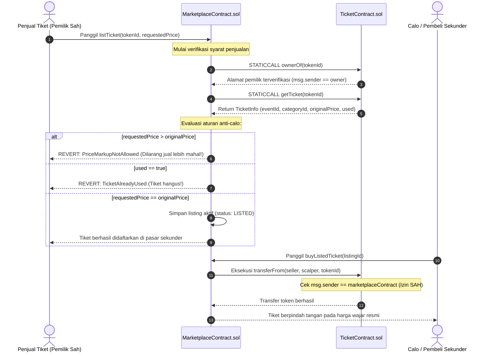

# Desain dan spesifikasi teknis arsitektur multi-event dan kapasitas storage Ethereum Virtual Machine

**Spesifikasi teknis relasi master-contract tiket dan marketplace sekunder, batas ruang alamat storage 256-bit, dan mekanisme anti-scalping**

| Parameter | Deskripsi |
| :--- | :--- |
| **Status** | Spesifikasi arsitektur data on-chain final |
| **Penyusun** | Benedictus Leonardo Edward Stephen Sugianto (NRP: 160423176) |
| **Ruang lingkup** | Arsitektur satu kontrak master multi-tenant, gerbang transfer allowlist tertutup, penguncian harga pasar sekunder (*price-lock*), perhitungan matematis ruang slot 256-bit, dan komparasi kapasitas storage EVM vs MySQL |
| **Dokumen terkait** | [06-smart-contract-fundamentals-and-mint-flow.md](file:///d:/STEVE/Project-TA-NFT-Marketplace/explanation/06-smart-contract-fundamentals-and-mint-flow.md), [07-foundry-deployment-mechanism-and-scripting.md](file:///d:/STEVE/Project-TA-NFT-Marketplace/explanation/07-foundry-deployment-mechanism-and-scripting.md), [10-tickets-service-relayer-deep-dive.md](file:///d:/STEVE/Project-TA-NFT-Marketplace/explanation/10-tickets-service-relayer-deep-dive.md) |
| **Sasaran pembaca** | Penguji sidang tugas akhir, pembimbing, dan perekayasa perangkat lunak |

---

## 1. Ringkasan eksekutif

Dalam perancangan platform tiket konser *NFTix*, sebuah keputusan arsitektur mendasar diambil mengenai model deployment: apakah setiap penyelenggara konser baru memerlukan deployment smart contract baru (*factory per-event model*), atau seluruh konser dikelola oleh satu pasang kontrak master terpadu (*single master contract model*)?

Sistem *NFTix* menetapkan arsitektur **satu smart contract master `TicketContract.sol`** yang melayani ribuan konser musik secara multi-tenant, berpasangan secara eksklusif dengan **satu kontrak pasar sekunder resmi `MarketplaceContract.sol`**. Keputusan ini didasarkan pada dua keunggulan rekayasa utama:
1. **Efisiensi Biaya Operasional:** Penyelenggara acara tidak perlu membayar gas deployment kontrak baru (~0.05 ETH atau Rp 2.500.000), melainkan hanya memanggil fungsi pembuatan event baru `createEvent` (~0.00005 ETH atau Rp 2.500).
2. **Keamanan Anti-Calo Mutlak (*Tightly Coupled Allowlist*):** Kontrak tiket mengunci fungsi transfer ERC-721 hanya untuk alamat marketplace resmi. Tiket tidak dapat dipindahkan atau dilelang di pasar pihak ketiga terbuka seperti OpenSea, dan harga jual kembali dikunci secara permanen sesuai harga resmi (`originalPrice`).

Secara komputasi penyimpanan, batas ruang alamat storage EVM yang berbasis integer 256-bit menyediakan kapasitas pengindeksan yang praktis tidak terbatas ($2^{256}$ slot), jauh melampaui kebutuhan volume tiket konser dunia nyata.

---

## 2. Sumber fakta dan acuan kode

Spesifikasi implementasi ini bersumber pada berkas repositori aktif berikut:

| Komponen | Berkas sumber | Lokasi baris | Perilaku terverifikasi |
| :--- | :--- | :--- | :--- |
| Pembuatan Event | [TicketContract.sol](file:///d:/STEVE/Project-TA-NFT-Marketplace/contracts/src/TicketContract.sol) | 74 - 107 | Fungsi `createEvent` yang menginisialisasi parameter acara dan kuota kategori |
| Gerbang Allowlist | [TicketContract.sol](file:///d:/STEVE/Project-TA-NFT-Marketplace/contracts/src/TicketContract.sol) | 50 & 147 - 153 | Variabel `marketplaceContract` dan fungsi `setMarketplace` sebagai pengunci izin transfer |
| Pembacaan Harga Asli | [MarketplaceContract.sol](file:///d:/STEVE/Project-TA-NFT-Marketplace/contracts/src/MarketplaceContract.sol) | 45 - 85 | Validasi listing sekunder yang mencocokkan harga input dengan `originalPrice` dari kontrak tiket |
| Pengambilan Data Tiket | [TicketContract.sol](file:///d:/STEVE/Project-TA-NFT-Marketplace/contracts/src/TicketContract.sol) | 230 - 233 | Fungsi `getTicket(tokenId)` yang mengembalikan tuple `(eventId, categoryId, originalPrice, used)` |

---

## 3. Tujuan dan batasan sistem

### 3.1 Tujuan
1. Menghilangkan hambatan biaya deployment bagi penyelenggara konser skala mikro hingga festival besar.
2. Memblokir perdagangan tiket di platform luar sistem guna meniadakan pasar gelap calo (*scalper market*).
3. Menerapkan verifikasi harga on-chain yang deterministik saat tiket dijual kembali di pasar sekunder.
4. Membuktikan secara matematis bahwa penyimpanan data tiket di dalam storage EVM tidak memiliki batasan kapasitas praktis.

### 3.2 Batasan (non-goals)
1. Tidak mengizinkan penjualan tiket kembali di atas harga asli (*zero price markup policy*).
2. Tidak mengizinkan transfer tiket langsung antar-dompet (*peer-to-peer wallet transfer*) tanpa melalui verifikasi kontrak marketplace resmi.
3. Tidak melakukan partisi data antar-penyelenggara ke dalam kontrak terpisah demi menyederhanakan audit indeks on-chain.

---

## 4. Diagram desain sistem dan arsitektur relasi kontrak

Diagram blok berikut menggambarkan relasi eksklusif antara Kontrak Master Tiket dan Kontrak Marketplace Resmi dalam melayani banyak acara konser:

```mermaid
graph TB
    subgraph TicketMasterContract ["1. Master TicketContract.sol (0x4A6e...F9b3)"]
        direction TB
        AdminRole["Owner / Relayer Admin Authority"]
        AllowlistState["Alamat Marketplace Resmi: marketplaceContract"]
        
        subgraph MultiTenantEvents ["Penyimpanan Multi-Acara (Storage mapping _events)"]
            Event1["Event #1: Konser Musik Kampus (Organizer A)"]
            Event2["Event #2: Festival Rock Nasional (Organizer B)"]
            EventN["Event #N: Konferensi Teknologi (Organizer C)"]
        end

        subgraph MultiCategories ["Penyimpanan Kategori (Storage mapping _categories)"]
            Cat1["Kategori #1: VIP (Kuota: 100, Harga: Rp 150.000)"]
            Cat2["Kategori #2: Festival (Kuota: 500, Harga: Rp 75.000)"]
        end

        subgraph TokenStorage ["Penyimpanan Tiket NFT (Storage mapping _tickets)"]
            Token1["Token #1 (Event 1, Cat 1, Rp 150rb, used: false)"]
            Token2["Token #2 (Event 1, Cat 2, Rp 75rb, used: false)"]
            TokenM["Token #M (Event 2, Cat 1, Rp 300rb, used: true)"]
        end
        
        AdminRole --> AllowlistState
        Event1 --> Cat1
        Event1 --> Cat2
        Cat1 --> Token1
        Cat2 --> Token2
    end

    subgraph SecondaryMarketplaceContract ["2. Master MarketplaceContract.sol (Pasar Sekunder Resmi)"]
        ListingEngine["Listing Controller (Validasi Kepemilikan & Harga)"]
        PriceLockGuard["Price-Lock Guard: Validasi listingPrice == originalPrice"]
        SettlementEngine["Settlement Engine: Transfer Token & Pembayaran Rupiah"]
        ListingEngine --> PriceLockGuard
        PriceLockGuard --> SettlementEngine
    end

    subgraph ExternalEcosystem ["3. Ekosistem Terisolasi (Dunia Luar)"]
        BlockedMarkets["Pasar Pihak Ketiga (OpenSea, Rarible, Blur)"]
        P2PTransfer["Transfer Manual Dompet ke Dompet (Direct ERC-721 Transfer)"]
    end

    AllowlistState <===>|Izin Transfer Eksklusif (Dual Handshake)| SecondaryMarketplaceContract
    TicketMasterContract --x|REVERT: Unauthorized Transfer Gate| BlockedMarkets
    TicketMasterContract --x|REVERT: Unauthorized Transfer Gate| P2PTransfer
```

---

## 5. Diagram alur sekuensial verifikasi penjualan kembali anti-calo

Diagram alur berikut mengilustrasikan mekanisme verifikasi harga on-chain saat seorang pemilik tiket mencoba menjual tiketnya di pasar sekunder:



---

## 6. Desain multi-event: Satu kontrak master vs factory kontrak per-event

Tabel berikut menyajikan evaluasi komparasi arsitektural antara pendekatan *Single Master Contract* yang dipilih oleh *NFTix* versus model *Contract Factory per-Event*:

| Kriteria evaluasi | Factory Kontrak per-Event | Single Master Contract (Pendekatan NFTix) | Justifikasi rekayasa sistem |
| :--- | :--- | :--- | :--- |
| **Biaya deployment EO** | Sangat mahal (~2.000.000 gas per konser baru) | Nol deployment fisik (~50.000 gas untuk `createEvent`) | Menghemat biaya inisialisasi acara hingga ~97.5% |
| **Pencegahan calo (Anti-Scalping)** | Sulit diaudit. Setiap kontrak baru harus dikonfigurasi izinnya satu per satu | Terpusat mutlak. Satu allowlist mengunci seluruh tiket konser di sistem | Mencegah celah kesalahan konfigurasi oleh pihak penyelenggara |
| **Integrasi frontend & backend** | Kompleks. Backend harus melacak ratusan alamat kontrak berbeda | Sangat sederhana. Backend hanya memantau 1 alamat kontrak tiket master | Mengurangi kompleksitas sinkronisasi basis data relasional |
| **Verifikasi pasar sekunder** | Rentan bypass jika ada satu kontrak acara yang lupa menerapkan guard | Seragam dan konsisten untuk seluruh kategori dan jenis acara | Standarisasi aturan bisnis yang deterministik |

---

## 7. Mekanisme penguncian harga anti-calo dan gerbang allowlist tertutup

### 7.1 Gerbang izin transfer tertutup (Allowlist Guard)
Pada standar ERC-721 terbuka, fungsi transfer seperti `transferFrom` dan `safeTransferFrom` dapat dipanggil secara bebas oleh pemilik token. Akibatnya, pemilik token dapat menjual tiket di platform lelang pihak ketiga seperti OpenSea dengan harga spekulatif yang tidak terkontrol.

Pada `TicketContract.sol`, fungsi pengait (*transfer hook*) ditimpa (*override*) dengan pembatasan ketat:

```solidity
function _update(address to, uint256 tokenId, address auth) internal override returns (address) {
    address from = _ownerOf(tokenId);
    
    // Izinkan pencetakan awal (minting dari alamat 0x0)
    if (from == address(0)) {
        return super._update(to, tokenId, auth);
    }
    
    // Blokir seluruh transfer kecuali inisiatornya adalah Marketplace resmi
    if (msg.sender != marketplaceContract) {
        revert UnauthorizedTransferGate();
    }
    
    return super._update(to, tokenId, auth);
}
```

Dampaknya:
* Tiket tidak dapat dikirimkan langsung antarteman melalui dompet MetaMask.
* Upaya listing tiket di OpenSea atau protokol pertukaran NFT manapun akan langsung menghasilkan eksepsi revert saat kontrak luar mencoba menarik token.

### 7.2 Verifikasi harga deterministik (Resale Price-Lock)
Ketika tiket didaftarkan di pasar sekunder, kontrak `MarketplaceContract.sol` membaca nilai `originalPrice` langsung dari penyimpanan on-chain `TicketContract.sol` melalui fungsi `getTicket(tokenId)`:

```solidity
TicketInfo memory ticket = ticketContract.getTicket(tokenId);
if (listingPrice > ticket.originalPrice) {
    revert ResaleMarkupProhibited();
}
```
Calo sama sekali tidak memiliki parameter celah untuk menaikkan harga tiket 1 rupiah pun di atas harga resmi penyelenggara.

---

## 8. Kapasitas penyimpanan storage EVM: Batas ruang indeks 256-bit

Pertanyaan mendasar yang sering diajukan dalam pengujian arsitektur:
> *"Apakah menampung ratusan acara dan jutaan tiket di dalam satu smart contract tidak akan membuat penyimpanan kontrak penuh atau mengalami crash?"*

### 8.1 Batas teoritis kapasitas indeks EVM
Dalam spesifikasi formal Ethereum Virtual Machine:
* Penyimpanan permanen smart contract adalah sebuah tabel pemetaan asosiatif (*associative array*) dengan kunci berukuran 256-bit dan nilai berukuran 256-bit.
* Jumlah total kunci unik yang dapat dialokasikan pada satu smart contract adalah:

$$N = 2^{256} \approx 1,1579 \times 10^{77} \text{ slot penyimpanan}$$

Sebagai perbandingan komputasi fisik:
* Estimasi jumlah atom di seluruh alam semesta teramati berkisar antara $10^{78}$ hingga $10^{82}$ atom.
* Dengan kapasitas $2^{256}$ slot, jika seluruh umat manusia di bumi ($8 \times 10^9$ orang) mencetak 1 miliar tiket setiap detik selama 1 miliar tahun berturut-turut, ruang slot yang terpakai masih berada jauh di bawah 0,000000001% dari kapasitas total storage kontrak.

### 8.2 Formula penentuan lokasi slot mapping (Keccak-256)
Setiap elemen di dalam mapping tidak disimpan secara berurutan (*contiguous array*), melainkan disebar secara acak merata di seluruh ruang 256-bit menggunakan fungsi hash kriptografis:

$$\text{StorageSlot}(\text{tokenId}) = \text{keccak256}\Big(\text{pad}_{32}(\text{tokenId}) \parallel \text{pad}_{32}(\text{slotNumber})\Big)$$

Karena fungsi Keccak-256 menghasilkan output seragam sepanjang 256-bit, probabilitas terjadinya tabrakan slot (*hash collision*) antara dua buah id tiket yang berbeda adalah $1 \text{ banding } 2^{128}$, yang secara kriptografis dianggap mustahil terjadi.

---

## 9. Matriks komparasi arsitektural: Penyimpanan EVM vs MySQL

| Parameter perbandingan | Penyimpanan On-Chain EVM (TicketContract) | Basis Data Relasional Off-Chain (MySQL) |
| :--- | :--- | :--- |
| **Kapasitas ruang indeks** | $2^{256}$ slot (praktis tidak terbatas) | Dibatasi oleh kapasitas hard disk fisik peladen (Terabyte) |
| **Integritas data** | Abadi (*immutable*), kebal manipulasi admin database | Dapat diubah atau dihapus (*mutable*) oleh admin yang memiliki akses root |
| **Biaya penulisan (Write Cost)** | Menelan biaya gas kripto untuk setiap operasi `SSTORE` | Gratis (hanya dibatasi oleh beban komputasi I/O CPU server) |
| **Kemampuan query kompleks** | Terbatas pada pencarian kunci tunggal ($O(1)$ lookup via mapping) | Mendukung relasi join, agregasi kompleks, dan filter teks |
| **Fungsi pada sistem NFTix** | Sumber kebenaran mutlak hak milik tiket dan harga resmi | Cache metadata acara, riwayat transaksi, dan indexing cepat untuk UI |

---

## 10. Referensi standar terbuka

1. **Wood, Gavin.** Ethereum: A Secure Decentralised Generalised Transaction Ledger (Storage State Transition). [https://ethereum.github.io/yellowpaper/paper.pdf](https://ethereum.github.io/yellowpaper/paper.pdf).
2. **Ethereum Improvement Proposal 721 (EIP-721):** Non-Fungible Token Standard (Transfer Hooks). [https://eips.ethereum.org/EIPS/eip-721](https://eips.ethereum.org/EIPS/eip-721).
3. **Solidity Documentation:** Storage Layout for State Variables and Mappings. [https://docs.soliditylang.org/en/v0.8.20/internals/layout_in_storage.html](https://docs.soliditylang.org/en/v0.8.20/internals/layout_in_storage.html).
4. **OpenZeppelin Contracts:** ERC721 Enforceable Transfer Restrictions. [https://docs.openzeppelin.com/contracts/5.x/erc721](https://docs.openzeppelin.com/contracts/5.x/erc721).
