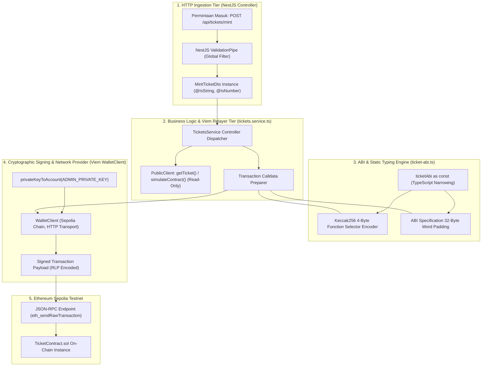
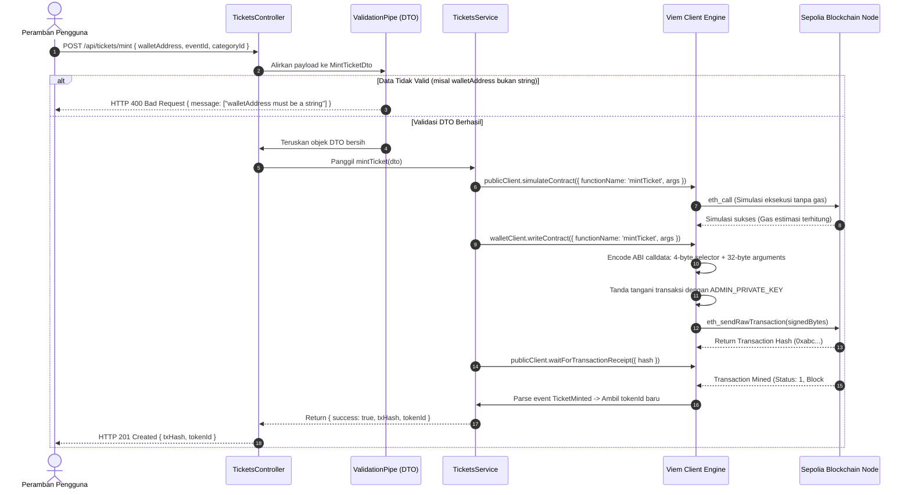

# Desain dan spesifikasi teknis integrasi Viem pada NestJS, validasi DTO, dan standar ABI smart contract

**Spesifikasi teknis jembatan Web2 ke Web3, inferensi tipe TypeScript statis via as const, serialisasi calldata, dan parsing log event indexed**

| Parameter | Deskripsi |
| :--- | :--- |
| **Status** | Spesifikasi integrasi jembatan blockchain final |
| **Penyusun** | Benedictus Leonardo Edward Stephen Sugianto (NRP: 160423176) |
| **Ruang lingkup** | Desain layer DTO class-validator, komunikasi RPC berbasis Viem PublicClient dan WalletClient, kompilasi ABI JSON ke selektor calldata, inferensi tipe statis via `as const`, dan ekstraksi log topik indexed |
| **Dokumen terkait** | [06-smart-contract-fundamentals-and-mint-flow.md](file:///d:/STEVE/Project-TA-NFT-Marketplace/explanation/06-smart-contract-fundamentals-and-mint-flow.md), [10-tickets-service-relayer-deep-dive.md](file:///d:/STEVE/Project-TA-NFT-Marketplace/explanation/10-tickets-service-relayer-deep-dive.md), [21-midtrans-payment-gateway-integration.md](file:///d:/STEVE/Project-TA-NFT-Marketplace/explanation/21-midtrans-payment-gateway-integration.md) |
| **Sasaran pembaca** | Penguji sidang tugas akhir, pembimbing, dan perekayasa perangkat lunak |

---

## 1. Ringkasan eksekutif

Sistem *NFTix* mengintegrasikan pustaka klien Ethereum modern berbasis TypeScript, yaitu Viem, ke dalam kerangka kerja backend NestJS. Viem menggantikan pustaka pendahulunya seperti Ethers.js atau Web3.js dengan menawarkan ukuran bundle yang jauh lebih ringan, kinerja serialisasi calldata yang lebih cepat, serta inferensi sistem tipe statis yang sangat ketat.

Dalam arsitektur relayer transaksi gasless, backend bertindak sebagai perantara yang menerima permintaan HTTP dari peramban, memvalidasi integritas data masukan melalui *Data Transfer Object* (DTO), menerjemahkan data tingkat tinggi ke dalam representasi biner ABI (*Application Binary Interface*), menandatangani transaksi menggunakan kunci privat admin, dan mengirimkannya ke node RPC Sepolia Testnet.

Dokumen ini menguraikan secara komprehensif rancangan gerbang validasi DTO, mekanisme kompresi tanda tangan fungsi ABI menjadi selektor 4-byte, peran penting asersi tipe TypeScript `as const` dalam mencegah kesalahan tipe pada saat kompilasi (*compile-time safety*), serta arsitektur ekstraksi log event bertopik `indexed` dari tanda terima transaksi (*transaction receipt*).

---

## 2. Sumber fakta dan acuan kode

Analisis teknis dan implementasi kode dalam dokumen ini merujuk langsung pada berkas repositori aktif:

| Komponen | Berkas sumber | Lokasi baris | Perilaku terverifikasi |
| :--- | :--- | :--- | :--- |
| DTO Pencetakan Tiket | [mint-ticket.dto.ts](file:///d:/STEVE/Project-TA-NFT-Marketplace/backend/src/tickets/dto/mint-ticket.dto.ts) | 1 - 20 | Validasi field `walletAddress`, `eventId`, dan `categoryId` via `class-validator` |
| DTO Pembayaran Snap | [create-snap.dto.ts](file:///d:/STEVE/Project-TA-NFT-Marketplace/backend/src/tickets/dto/create-snap.dto.ts) | 1 - 20 | Validasi parameter kuantitas, ID kategori, dan alamat dompet penerima |
| Definisi ABI Kontrak | [ticket-abi.ts](file:///d:/STEVE/Project-TA-NFT-Marketplace/backend/src/tickets/constants/ticket-abi.ts) | 1 - 150 | Definisi skema fungsi dan event dengan asersi `as const` |
| Service Relayer Viem | [tickets.service.ts](file:///d:/STEVE/Project-TA-NFT-Marketplace/backend/src/tickets/tickets.service.ts) | 45 - 95 | Konfigurasi instance `publicClient`, `walletClient`, dan eksekusi transaksi on-chain |

---

## 3. Tujuan dan batasan sistem

### 3.1 Tujuan
1. Memastikan seluruh payload HTTP yang masuk ke backend diverifikasi secara ketat sebelum berinteraksi dengan smart contract.
2. Mencegah kesalahan pemanggilan fungsi kontrak melalui inferensi tipe otomatis antara ABI JSON dan fungsi TypeScript Viem.
3. Meminimalkan biaya transaksi gas yang gagal melalui validasi awal (*pre-flight simulation*) menggunakan `publicClient.simulateContract`.
4. Menyediakan mekanisme decoding log event on-chain secara deterministik guna memperoleh `tokenId` yang baru dicetak.

### 3.2 Batasan (non-goals)
1. Tidak mengizinkan masukan alamat dompet yang tidak mematuhi format baku heksadesimal Ethereum (panjang 42 karakter diawali `0x`).
2. Tidak mengizinkan pengiriman transaksi blockchain tanpa melalui penandatanganan kriptografis terotorisasi.
3. Tidak menggunakan pustaka penunjang dinamis yang mematikan fitur type-checking (*any type escape hatches*).

---

## 4. Diagram desain sistem dan arsitektur batas integrasi Viem

Diagram blok berikut memetakan perjalanan data dari antarmuka HTTP REST hingga pengiriman paket transaksi biner ke validator Sepolia:



---

## 5. Diagram alur sekuensial transformasi request HTTP menjadi transaksi blockchain

Diagram alur berikut menguraikan transformasi data dari formulir JSON hingga penerbitan tanda terima transaksi (*transaction receipt*):



---

## 6. Gerbang validasi masukan: Peran Data Transfer Object (DTO)

Untuk melindungi backend dan kontrak pintar dari masukan data yang korup atau berbahaya, sistem menerapkan *Data Transfer Object* (DTO) menggunakan pustaka `class-validator` dan `class-transformer`:

```typescript
// backend/src/tickets/dto/mint-ticket.dto.ts
import { IsNotEmpty, IsNumber, IsString } from "class-validator";

export class MintTicketDto {
    @IsNotEmpty({ message: "Alamat wallet wajib diisi" })
    @IsString({ message: "Format alamat wallet harus berupa teks string" })
    walletAddress: string;

    @IsNotEmpty({ message: "Event ID wajib diisi" })
    @IsNumber({}, { message: "Event ID harus berupa angka integer" })
    eventId: number;

    @IsNotEmpty({ message: "Category ID wajib diisi" })
    @IsNumber({}, { message: "Category ID harus berupa angka integer" })
    categoryId: number;
}
```

### Mekanisme proteksi DTO
1. **Pemeriksaan Tipe Data Ketat:** Mencegah serangan *type confusion*, misalnya pengiriman array atau objek bersarang yang dapat memicu crash pada fungsi serialisasi Viem.
2. **Pembersihan Payload Ekstra (Whitelist Sanitization):** Dengan mengaktifkan `whitelist: true` pada `ValidationPipe` global di `main.ts`, properti yang tidak terdaftar di DTO akan otomatis dipangkas, mencegah injeksi properti liar (*mass assignment vulnerability*).

---

## 7. Standar ABI: Konversi JSON ke representasi calldata EVM

Smart contract yang telah dikompilasi oleh solc menghasilkan representasi antarmuka biner (*Application Binary Interface* / ABI) dalam format JSON. Komputer validator tidak menerima JSON, melainkan deretan byte mentah (*calldata*).

### 7.1 Pembentukan selektor fungsi 4-byte
Ketika Viem memanggil fungsi `mintTicket(address to, uint256 eventId, uint256 categoryId)`:
1. Viem menyusun *canonical signature* string dari fungsi tersebut tanpa spasi:
   $$\text{Signature} = \text{"mintTicket(address,uint256,uint256)"}$$
2. Viem menghitung fungsi hash Keccak-256 dari signature tersebut:
   $$\text{Hash} = \text{keccak256}(\text{"mintTicket(address,uint256,uint256)"})$$
3. Empat byte pertama dari hasil hash diambil sebagai **Function Selector**:
   $$\text{Selector} = \text{Hash}_{[0:4]} = \text{0x8c792341} \quad (\text{contoh representasi})$$

### 7.2 Format encoding argumen 32-byte (Word Padding)
Setiap parameter masukan diserialisasikan menjadi blok data 32 bytes (256-bit):
* `address to`: 20 bytes alamat diisi dengan 12 byte nol di depan (*left-padded*).
* `uint256 eventId`: Bilangan bulat diisi dengan byte nol di depan hingga 32 bytes penuh.
* `uint256 categoryId`: Bilangan bulat diisi dengan byte nol di depan hingga 32 bytes penuh.

Calldata akhir yang dikirimkan ke blockchain:
$$\text{Calldata} = \text{Selector (4B)} \parallel \text{Arg1 (32B)} \parallel \text{Arg2 (32B)} \parallel \text{Arg3 (32B)} = 100 \text{ Bytes}$$

---

## 8. Inferensi tipe statis tingkat lanjut: Urgensi penulisan as const

Pada berkas `backend/src/tickets/constants/ticket-abi.ts`, array definisi ABI dideklarasikan menggunakan kata kunci khusus TypeScript `as const`:

```typescript
export const ticketAbi = [
    {
        type: "function",
        name: "mintTicket",
        inputs: [
            { name: "to", type: "address" },
            { name: "eventId", type: "uint256" },
            { name: "categoryId", type: "uint256" }
        ],
        outputs: [{ name: "", type: "uint256" }],
        stateMutability: "nonpayable"
    },
    // ...
] as const; // <--- Asersi konstan wajib
```

### Mengapa as const sangat krusial?
1. **Pencegahan Pelebaran Tipe (Type Widening):**
   Tanpa `as const`, TypeScript memperlakukan nilai properti `name: "mintTicket"` sebagai tipe umum `string`. 
2. **Inferensi Tipe Parameter Seketika (Compile-time Type Checking):**
   Dengan menambahkan `as const`, TypeScript memperlakukan array ABI sebagai nilai literal yang tidak dapat diubah (*immutable tuple*). 
3. Pustaka Viem memanfaatkan fitur *Type-Level Programming* TypeScript untuk membaca langsung nama-nama fungsi yang ada di ABI. Akibatnya:
   * Jika perekayasa salah mengetik nama fungsi (misal `mintTiket`), TypeScript langsung menampilkan garis merah kesalahan saat kompilasi.
   * Parameter `args` secara otomatis diwajibkan berupa tuple `[Address, bigint, bigint]`. Jika perekayasa memasukkan parameter string pada `eventId`, kompilasi akan ditolak seketika.

---

## 9. Arsitektur pengindeksan event blockchain: Topik indexed

Pada smart contract `TicketContract.sol`, deklarasi event pencetakan tiket dirancang sebagai berikut:

```solidity
event TicketMinted(
    uint256 indexed tokenId,
    uint256 indexed eventId,
    uint256 categoryId,
    address indexed buyer,
    uint256 originalPrice
);
```

### Struktur penyimpanan topik pada log penerimaan transaksi
EVM mencatat log event ke dalam tanda terima blok menggunakan opcode `LOG0` hingga `LOG4`:
* **Topic 0**: Tanda tangan hash dari event:
  $$\text{Topic 0} = \text{keccak256}(\text{"TicketMinted(uint256,uint256,uint256,address,uint256)"})$$
* **Topic 1**: Nilai `tokenId` (karena berstatus `indexed`).
* **Topic 2**: Nilai `eventId` (karena berstatus `indexed`).
* **Topic 3**: Nilai `buyer` (karena berstatus `indexed`).
* **Data Payload**: Nilai non-indexed (`categoryId` dan `originalPrice`) digabungkan ke dalam segmen data byte mentah.

Dengan arsitektur ini, backend Viem dapat secara instan mencari seluruh tiket milik pengguna tertentu atau tiket untuk acara tertentu hanya dengan melakukan filter berdasarkan topik `buyer` atau `eventId` tanpa perlu memindai seluruh histori transaksi blockchain.

---

## 10. Matriks mitigasi ancaman keamanan transmisi data

| Vektor ancaman | Risiko teknis | Mekanisme proteksi terpasang |
| :--- | :--- | :--- |
| **Calldata Injection** | Payload liar mencoba memanggil fungsi destruktif pada smart contract | Pustaka Viem menyusun calldata secara otomatis berbasis skema ABI tertutup; fungsi tidak dikenal akan ditolak |
| **Mass Assignment** | Penyerang mengirim properti terlarang seperti `isAdmin: true` pada JSON | NestJS `ValidationPipe({ whitelist: true })` menghapus seluruh properti yang tidak ada di DTO |
| **Replay Transaction** | Pengulangan transaksi lama untuk mencetak tiket berulang | Viem mengelola nomor urut transaksi (*nonce*) akun admin secara atomik; transaksi duplikat akan ditolak oleh RPC pool |
| **Gas Drainage via Bad Revert** | Memanggil fungsi dengan parameter salah hingga menguras gas relayer | Viem mengeksekusi simulasi `simulateContract` sebelum mengirim transaksi; jika simulasi gagal, transaksi fisik dibatalkan |

---

## 11. Referensi standar terbuka

1. **Ethereum Contract ABI Specification:** Formal Binary Encoding Rules. [https://docs.soliditylang.org/en/v0.8.20/abi-spec.html](https://docs.soliditylang.org/en/v0.8.20/abi-spec.html).
2. **Viem Documentation:** TypeScript-first Client for Ethereum. [https://viem.sh/](https://viem.sh/).
3. **TypeScript Handbook:** Const Assertions and Literal Types. [https://www.typescriptlang.org/docs/handbook/release-notes/typescript-3-4.html#const-assertions](https://www.typescriptlang.org/docs/handbook/release-notes/typescript-3-4.html#const-assertions).
4. **Ethereum Improvement Proposal 1474 (EIP-1474):** Remote Procedure Call Specification. [https://eips.ethereum.org/EIPS/eip-1474](https://eips.ethereum.org/EIPS/eip-1474).
