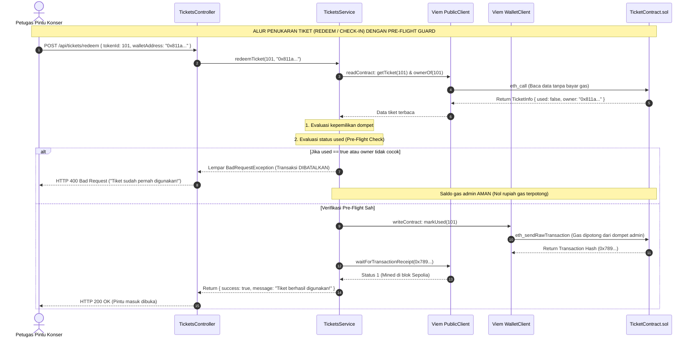

# Desain dan spesifikasi teknis TicketsService relayer transaksi blockchain gasless

**Spesifikasi teknis jembatan backend NestJS ke Ethereum Sepolia, pemisahan PublicClient dan WalletClient Viem, proteksi pre-flight gas, dan integrasi pembayaran Snap**

| Parameter | Deskripsi |
| :--- | :--- |
| **Status** | Spesifikasi arsitektur relayer transaksi gasless final |
| **Penyusun** | Benedictus Leonardo Edward Stephen Sugianto (NRP: 160423176) |
| **Ruang lingkup** | Arsitektur relayer sponsor gas, manajemen klien ganda Viem, pre-flight gas guard pada `redeemTicket`, pembuatan sesi Midtrans Snap API, ekstraksi tanda terima on-chain, dan pelacakan indeks kursi sequential |
| **Dokumen terkait** | [06-smart-contract-fundamentals-and-mint-flow.md](file:///d:/STEVE/Project-TA-NFT-Marketplace/explanation/06-smart-contract-fundamentals-and-mint-flow.md), [09-viem-integration-dto-validation-and-contract-abi.md](file:///d:/STEVE/Project-TA-NFT-Marketplace/explanation/09-viem-integration-dto-validation-and-contract-abi.md), [21-midtrans-payment-gateway-integration.md](file:///d:/STEVE/Project-TA-NFT-Marketplace/explanation/21-midtrans-payment-gateway-integration.md), [22-eip712-structured-data-signatures.md](file:///d:/STEVE/Project-TA-NFT-Marketplace/explanation/22-eip712-structured-data-signatures.md) |
| **Sasaran pembaca** | Penguji sidang tugas akhir, pembimbing, dan perekayasa perangkat lunak |

---

## 1. Ringkasan eksekutif

Sistem *NFTix* mengatasi hambatan adopsi Web3 terbesar bagi penonton konser umum melalui penerapan **Gasless Relayer Architecture**. Penonton konser umum tidak diwajibkan memiliki dompet kripto pihak ketiga (seperti MetaMask), tidak perlu memahami mekanisme biaya bahan bakar (*gas fee*), dan tidak perlu membeli saldo cryptocurrency (ETH) untuk bertransaksi.

Seluruh transaksi pencatatan hak milik dan pembaruan status tiket di smart contract `TicketContract.sol` (pada jaringan Ethereum Sepolia Testnet) ditangani oleh modul backend relayer [`TicketsService`](file:///d:/STEVE/Project-TA-NFT-Marketplace/backend/src/tickets/tickets.service.ts). Backend bertindak sebagai penjamin biaya transaksi (*gas sponsor*) menggunakan akun administratif yang diisolasi di lingkungan peladen.

Untuk menjamin efisiensi dan keamanan, modul ini membagi kanal komunikasi blockchain menjadi dua klien terpisah menggunakan pustaka Viem: `publicClient` untuk operasi pembacaan bebas gas dan pengawasan tanda terima blok, serta `walletClient` untuk penandatanganan mutasi state on-chain. Selain itu, sistem menerapkan mekanisme proteksi awal (*pre-flight verification*) untuk mencegah pemborosan gas relayer pada tiket yang telah digunakan atau tidak valid, serta menjembatani proses transaksi fiat rupiah melalui integrasi Midtrans Snap API.

---

## 2. Sumber fakta dan acuan kode

Spesifikasi implementasi ini bersumber pada berkas repositori aktif berikut:

| Komponen | Berkas sumber | Lokasi baris | Perilaku terverifikasi |
| :--- | :--- | :--- | :--- |
| Inisialisasi Klien Viem | [tickets.service.ts](file:///d:/STEVE/Project-TA-NFT-Marketplace/backend/src/tickets/tickets.service.ts) | 22 - 49 | Konfigurasi `publicClient`, `walletClient`, dan derivasi akun dari `ADMIN_PRIVATE_KEY` |
| Pencetakan Tiket Relayer | [tickets.service.ts](file:///d:/STEVE/Project-TA-NFT-Marketplace/backend/src/tickets/tickets.service.ts) | 51 - 168 | Validasi kuota per dompet (`MAX_PER_WALLET`), penulisan transaksi, dan ekstraksi `tokenId` |
| Penukaran Tiket Fisik | [tickets.service.ts](file:///d:/STEVE/Project-TA-NFT-Marketplace/backend/src/tickets/tickets.service.ts) | 170 - 228 | Pre-flight guard kepemilikan dan status `used`, eksekusi `markUsed`, dan konfirmasi blok |
| Pembacaan Data On-Chain | [tickets.service.ts](file:///d:/STEVE/Project-TA-NFT-Marketplace/backend/src/tickets/tickets.service.ts) | 229 - 291 | Pembacaan struct `getTicket`, verifikasi `ownerOf`, dan pelacakan indeks kursi sequential |
| Pembuatan Sesi Pembayaran | [tickets.service.ts](file:///d:/STEVE/Project-TA-NFT-Marketplace/backend/src/tickets/tickets.service.ts) | 293 - 373 | Validasi harga basis data MySQL, kalkulasi `grossAmount`, dan pemanggilan Midtrans Snap API |
| Controller Endpoint | [tickets.controller.ts](file:///d:/STEVE/Project-TA-NFT-Marketplace/backend/src/tickets/tickets.controller.ts) | 1 - 55 | Penyedia antarmuka REST API `/api/tickets/mint`, `/redeem`, `/user/:address`, dan `/create-snap` |

---

## 3. Tujuan dan batasan sistem

### 3.1 Tujuan
1. Menghilangkan kebutuhan kepemilikan saldo kripto bagi penonton konser dengan memindahkan beban gas ke akun relayer backend.
2. Memisahkan operasi baca (*read-only*) dari operasi tulis (*state mutation*) guna menghemat sumber daya komputasi dan kuota RPC.
3. Mencegah terjadinya pembakaran biaya gas relayer (*gas fee burn*) yang sia-sia saat verifikator memindai tiket yang sudah kadaluarsa atau tiket palsu.
4. Menghubungkan alur pembayaran mata uang Rupiah secara langsung dengan proses pencetakan tiket di jaringan blockchain.

### 3.2 Batasan (non-goals)
1. Tidak menyimpan kunci privat administratif `ADMIN_PRIVATE_KEY` di lapisan peramban client.
2. Tidak mengizinkan relayer melakukan pencetakan tiket tanpa verifikasi ketersediaan kuota pada basis data acara.
3. Tidak mendukung pemulihan gas otomatis jika transaksi on-chain mengalami revert akibat lonjakan gas jaringan (*out of gas*).

---

## 4. Diagram desain sistem dan batas arsitektur relayer

Diagram blok berikut menggambarkan pembagian tier sistem relayer, batas isolasi kunci rahasia, serta aliran data antar-komponen:

```mermaid
graph TB
    subgraph ClientBrowserTier ["1. Client Browser Tier (Next.js Application)"]
        UIBuy["Komponen Pembelian Tiket (BuyTicketCard.tsx)"]
        UIVerify["Komponen Gerbang Masuk Konser (verify/page.tsx)"]
        SnapModal["Midtrans Snap Modal (window.snap.pay)"]
        UIBuy --> SnapModal
    end

    subgraph BackendRelayerTier ["2. Backend Relayer Tier (NestJS tickets.service.ts)"]
        Controller["TicketsController (REST API Endpoints)"]
        Service["TicketsService Core Orchestrator"]
        Config["ConfigService (.env Environment Store)"]
        
        subgraph ViemDualClients ["Arsitektur Klien Ganda Viem"]
            PublicClient["publicClient (HTTP Transport: SEPOLIA_RPC_URL) - READ-ONLY"]
            WalletClient["walletClient (HTTP Transport: SEPOLIA_RPC_URL) - MUTASI STATE"]
            AdminSigner["Account Signer (privateKeyToAccount via ADMIN_PRIVATE_KEY)"]
            AdminSigner --> WalletClient
        end

        Controller --> Service
        Config -.-> Service
        Service --> PublicClient
        Service --> WalletClient
    end

    subgraph DatabaseTier ["3. Persistent Storage Tier (MySQL: nft-marketplace)"]
        TableEvents[("events (Metadata Konser & max_per_wallet)")]
        TableCategories[("ticket_categories (Harga Tiket Resmi & Kuota)")]
        Service -->|Query Validasi Kuota| TableEvents
        Service -->|Query Validasi Harga| TableCategories
    end

    subgraph ExternalPaymentGateway ["4. External Payment Tier (Midtrans Sandbox Cloud)"]
        MidtransSnap["Snap Transactions API (POST /snap/v1/transactions)"]
        Service -->|Basic Auth RFC 7617| MidtransSnap
    end

    subgraph BlockchainNetworkTier ["5. Blockchain Network Tier (Ethereum Sepolia Testnet)"]
        RPCNode["Sepolia RPC Node (Alchemy Infrastructure)"]
        TicketContract["TicketContract.sol (0x4A6e...F9b3)"]
        
        PublicClient -->|eth_call / getLogs (Gratis Gas)| RPCNode
        WalletClient -->|eth_sendRawTransaction (Bayar Gas Admin)| RPCNode
        RPCNode <--> TicketContract
    end

    UIBuy -->|HTTP POST /create-snap| Controller
    UIBuy -->|HTTP POST /mint| Controller
    UIVerify -->|HTTP POST /redeem| Controller
```

---

## 5. Diagram alur sekuensial eksekusi minting dan penukaran tiket

Diagram alur berikut menguraikan interaksi dua fungsi inti relayer: alur pencetakan tiket dengan verifikasi kuota dan alur penukaran tiket di gerbang konser dengan proteksi pre-flight gas:



---

## 6. Arsitektur dua klien Viem: PublicClient vs WalletClient

Untuk mengoptimalkan efisiensi komputasi, keamanan, dan alokasi biaya, `TicketsService` mengonfigurasi dua instance klien yang memiliki spesialisasi peran berbeda:

```typescript
// backend/src/tickets/tickets.service.ts (Baris 33 - 48)
this.account = privateKeyToAccount(privateKey);

// 1. Klien Pengawas Baca (Read-Only)
this.publicClient = createPublicClient({
  chain: sepolia,
  transport: http(RPC_URL),
});

// 2. Klien Eksekutor Tulis (State Mutation)
this.walletClient = createWalletClient({
  account: this.account,
  chain: sepolia,
  transport: http(RPC_URL),
});
```

| Parameter komparasi | Viem `publicClient` | Viem `walletClient` |
| :--- | :--- | :--- |
| **Sifat operasi** | Hanya membaca (*read-only*) | Melakukan mutasi penyimpanan on-chain (*write*) |
| **Metode RPC yang dipanggil** | `eth_call`, `eth_getTransactionReceipt`, `eth_getLogs` | `eth_sendRawTransaction` |
| **Kebutuhan kunci privat** | Tidak memerlukan kunci privat | Wajib terikat dengan `privateKeyToAccount` |
| **Konsumsi biaya gas** | **100% Gratis** | **Membayar gas Sepolia ETH dari akun admin** |
| **Tugas utama di service** | `getTicket`, `ownerOf`, `simulateContract`, `waitForTransactionReceipt` | `mintTicket`, `markUsed` |

Pemisahan ini memastikan bahwa operasi pembacaan data, seperti pengecekan status tiket atau kepemilikan token, tidak pernah memicu penandatanganan kriptografis maupun pemotongan saldo gas.

---

## 7. Tabel pemetaan parameter komprehensif

Tabel berikut menyajikan pemetaan menyeluruh aliran parameter dari antarmuka controller backend hingga eksekusi fungsi smart contract Solidity:

| Metode di Service | Parameter Input | Tipe Data TypeScript | Berkas Asal Definisi | Target Fungsi di Smart Contract | Pemetaan di ABI (`ticket-abi.ts`) |
| :--- | :--- | :--- | :--- | :--- | :--- |
| **`mintTicket`** | `dto.walletAddress` | `string` (`address`) | [`mint-ticket.dto.ts`](file:///d:/STEVE/Project-TA-NFT-Marketplace/backend/src/tickets/dto/mint-ticket.dto.ts) | `TicketContract.mintTicket(to, ...)` | `{ name: "to", type: "address" }` |
| | `dto.eventId` | `number` -> `bigint` | [`mint-ticket.dto.ts`](file:///d:/STEVE/Project-TA-NFT-Marketplace/backend/src/tickets/dto/mint-ticket.dto.ts) | `TicketContract.mintTicket(..., eventId, ...)` | `{ name: "eventId", type: "uint256" }` |
| | `dto.categoryId` | `number` -> `bigint` | [`mint-ticket.dto.ts`](file:///d:/STEVE/Project-TA-NFT-Marketplace/backend/src/tickets/dto/mint-ticket.dto.ts) | `TicketContract.mintTicket(..., categoryId)` | `{ name: "categoryId", type: "uint256" }` |
| **`redeemTicket`** | `tokenId` | `number` -> `bigint` | URL Parameter / Body | `TicketContract.markUsed(tokenId)` | `{ name: "tokenId", type: "uint256" }` |
| | `walletAddress` | `string` (`address`) | Body JSON | Dicocokkan via `TicketContract.ownerOf` | `{ name: "ownerOf", type: "function" }` |
| **`getTicket`** | `tokenId` | `number` -> `bigint` | URL Parameter | `TicketContract.getTicket(tokenId)` | `{ name: "getTicket", type: "function" }` |
| **`createSnap`** | `dto.eventId` | `number` | [`create-snap.dto.ts`](file:///d:/STEVE/Project-TA-NFT-Marketplace/backend/src/tickets/dto/create-snap.dto.ts) | Validasi ke tabel basis data `events` | Relasional MySQL |
| | `dto.categoryId` | `number` | [`create-snap.dto.ts`](file:///d:/STEVE/Project-TA-NFT-Marketplace/backend/src/tickets/dto/create-snap.dto.ts) | Validasi ke tabel basis data `ticket_categories` | Relasional MySQL |

---

## 8. Bedah mekanisme logika fungsi inti

### 8.1 Fungsi mintTicket: Validasi kuota dan ekstraksi tokenId
Fungsi `mintTicket` bertanggung jawab mencetak tiket baru atas nama pembeli:
1. Mengambil batas kepemilikan maksimum (`MAX_PER_WALLET`) dari tabel `events` basis data MySQL.
2. Memeriksa riwayat tiket yang telah dimiliki oleh dompet pengguna untuk acara terkait via `getUserTickets`. Jika kuota terlampaui, permintaan ditolak dengan melempar `BadRequestException`.
3. Mengirimkan transaksi penulisan ke smart contract:
   ```typescript
   const hash = await this.walletClient.writeContract({
       address: this.contractAddress,
       abi: TICKET_CONTRACT_ABI,
       functionName: 'mintTicket',
       args: [dto.walletAddress as `0x${string}`, BigInt(dto.eventId), BigInt(dto.categoryId)],
   });
   ```
4. Menunggu konfirmasi penambangan blok via `publicClient.waitForTransactionReceipt({ hash })`.
5. Mengekstrak event log `TicketMinted` dari tanda terima blok untuk mengidentifikasi nomor urut `tokenId` resmi yang baru diterbitkan.

### 8.2 Fungsi redeemTicket: Proteksi pre-flight gas guard
Pada arsitektur relayer biasa, jika petugas gerbang memindai tiket yang sudah pernah ditukarkan, transaksi akan langsung dikirim ke blockchain dan berakhir dengan revert di smart contract (`error TicketAlreadyUsed()`). Akibatnya, **biaya gas relayer tetap hangus terpotong** oleh validator meskipun transaksi gagal.

Untuk mengatasi kerentanan ini, `TicketsService` menerapkan *Pre-Flight Gas Guard* ([tickets.service.ts](file:///d:/STEVE/Project-TA-NFT-Marketplace/backend/src/tickets/tickets.service.ts) baris 179 - 193):
```typescript
const ticket = await this.getTicket(tokenId);

// 1. Validasi kepemilikan dompet secara lokal
if (ticket.owner.toLowerCase() !== walletAddress.toLowerCase()) {
    throw new BadRequestException('Validasi gagal: Alamat dompet tidak cocok dengan pemilik tiket');
}

// 2. Cegah pengiriman transaksi jika tiket telah berstatus used == true
if (ticket.used === true) {
    throw new BadRequestException('Validasi gagal: Tiket ini sudah pernah digunakan');
}
```
Pemeriksaan gratis ini membatalkan transaksi di tingkat memori peladen sebelum instruksi `writeContract` dipanggil, menjamin bahwa saldo gas admin terlindungi secara total dari pemborosan akibat percobaan pemindaian ganda (*double-redemption*).

### 8.3 Fungsi createSnapTransaction: Otentikasi Midtrans Snap API
Fungsi ini menyusun tagihan pembayaran resmi dalam mata uang Rupiah:
1. Membaca harga resmi kategori langsung dari basis data backend: `Math.round(Number(category.price) * qty)`.
2. Menyusun string otentikasi Basic Auth RFC 7617 dengan menyertakan tanda titik dua (*trailing colon*) wajib:
   ```typescript
   const basicAuth = Buffer.from(`${serverKey}:`).toString('base64');
   ```
3. Mengirim permintaan HTTP POST ke endpoint resmi Midtrans Sandbox: `https://app.sandbox.midtrans.com/snap/v1/transactions`.
4. Mengembalikan Snap Token dan URL kasir ke peramban pengguna.

---

## 9. Matriks analisis risiko keamanan relayer

| Skenario ancaman | Dampak risiko | Mekanisme mitigasi terpasang |
| :--- | :--- | :--- |
| **Kebocoran ADMIN_PRIVATE_KEY** | Pengambilalihan kendali kontrak dan pencurian saldo ETH admin | Kunci diisolasi pada berkas `backend/.env`, tidak pernah dikirim ke client, dan file `.env` diabaikan oleh Git via `.gitignore` |
| **Gas Draining Attack (DDoS Revert)** | Penyerang mengirim ribuan tiket palsu untuk menguras saldo ETH relayer | Mekanisme *Pre-Flight Read Check* memeriksa status kepemilikan dan flag `used` secara gratis sebelum transaksi dikirim |
| **Nonce Desynchronization** | Transaksi relayer macet di mempool akibat konflik nomor urut transaksi | Pustaka Viem mengelola antrean nonce internal secara otomatis pada instance `walletClient` |
| **Penipuan Nominal Pembayaran** | Pembeli memodifikasi nominal harga tiket dari peramban client | Penentuan harga `grossAmount` dihitung secara eksklusif di backend berdasarkan tabel `ticket_categories` di MySQL |

---

## 10. Referensi standar terbuka

1. **RFC 7617:** The 'Basic' HTTP Authentication Scheme. [https://datatracker.ietf.org/doc/html/rfc7617](https://datatracker.ietf.org/doc/html/rfc7617).
2. **Viem Core Reference:** Public and Wallet Client Architecture. [https://viem.sh/docs/clients/intro.html](https://viem.sh/docs/clients/intro.html).
3. **Midtrans Official Documentation:** Snap API Integration Guidelines. [https://docs.midtrans.com/docs/midtrans-account](https://docs.midtrans.com/docs/midtrans-account).
4. **Ethereum Improvement Proposal 721 (EIP-721):** Non-Fungible Token Standard (Ownership Inspection). [https://eips.ethereum.org/EIPS/eip-721](https://eips.ethereum.org/EIPS/eip-721).
