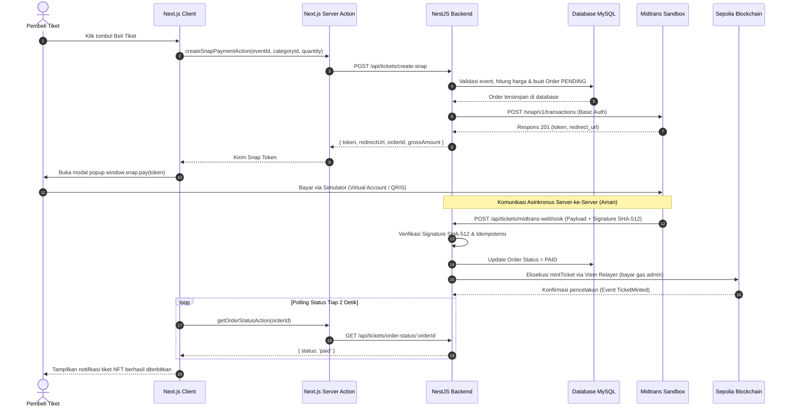

# Desain dan spesifikasi integrasi Midtrans Snap API

**Spesifikasi teknis alur pembayaran fiat rupiah untuk penerbitan tiket NFT berbasis relayer**

| Parameter | Deskripsi |
| :--- | :--- |
| **Status** | Spesifikasi implementasi final |
| **Penyusun** | Benedictus Leonardo Edward Stephen Sugianto (NRP: 160423176) |
| **Ruang lingkup** | Pembuatan sesi transaksi Snap, otentikasi Basic Auth, validasi nominal server-side, dan penanganan status pembayaran |
| **Dokumen terkait** | [tickets-service-relayer-deep-dive.md](file:///d:/STEVE/Project-TA-NFT-Marketplace/explanation/10-tickets-service-relayer-deep-dive.md), [22-eip712-structured-data-signatures.md](file:///d:/STEVE/Project-TA-NFT-Marketplace/explanation/22-eip712-structured-data-signatures.md), [24-buyer-flow-behind-the-scene-midtrans-hooks.md](file:///d:/STEVE/Project-TA-NFT-Marketplace/explanation/24-buyer-flow-behind-the-scene-midtrans-hooks.md) |
| **Sasaran pembaca** | Penguji sidang tugas akhir, pembimbing, dan perekayasa perangkat lunak |

---

## 1. Ringkasan eksekutif

Sistem *NFTix* menggunakan Midtrans Snap API pada lingkungan Sandbox untuk memproses pembayaran tiket dalam mata uang Rupiah (IDR). Tiket NFT pada jaringan Ethereum Sepolia Testnet dicetak oleh backend relayer hanya setelah status transaksi di Midtrans terkonfirmasi lunas.

Pengguna akhir tidak memerlukan dompet Web3 pihak ketiga seperti MetaMask maupun saldo cryptocurrency (ETH) untuk membeli tiket. Seluruh interaksi pembayaran diselesaikan melalui kanal fiat lokal (Virtual Account bank dan QRIS), sementara pencatatan hak milik tiket di smart contract ditangani di latar belakang oleh backend relayer.

---

## 2. Sumber fakta dan acuan kode

Spesifikasi ini disusun berdasarkan implementasi kode aktif pada repositori:

| Komponen | Berkas sumber | Lokasi baris | Perilaku terverifikasi |
| :--- | :--- | :--- | :--- |
| Backend service | [tickets.service.ts](file:///d:/STEVE/Project-TA-NFT-Marketplace/backend/src/tickets/tickets.service.ts) | 292 - 365 | Mengambil harga dari database, menghitung `grossAmount`, menyusun Basic Auth header, dan memanggil endpoint Midtrans |
| Backend controller | [tickets.controller.ts](file:///d:/STEVE/Project-TA-NFT-Marketplace/backend/src/tickets/tickets.controller.ts) | 48 - 53 | Menangani request `POST /api/tickets/create-snap` dengan validasi DTO |
| Data transfer object | [create-snap.dto.ts](file:///d:/STEVE/Project-TA-NFT-Marketplace/backend/src/tickets/dto/create-snap.dto.ts) | 1 - 20 | Memvalidasi tipe data `eventId`, `categoryId`, `quantity`, dan `walletAddress` |
| Server action | [actions.ts](file:///d:/STEVE/Project-TA-NFT-Marketplace/frontend/src/app/dashboard/buy/actions.ts) | 161 - 220 | Memanggil endpoint backend dari sisi server Next.js (BFF pattern) |
| Antarmuka pembeli | [BuyTicketCard.tsx](file:///d:/STEVE/Project-TA-NFT-Marketplace/frontend/src/app/dashboard/buy/BuyTicketCard.tsx) | 225 - 267 | Menangani state pemesanan tiket dan memicu modal kasir Snap |
| Entitas database | [ticket-category.entity.ts](file:///d:/STEVE/Project-TA-NFT-Marketplace/backend/src/events/entities/ticket-category.entity.ts) | 12 - 13 | Kolom `price` sebagai acuan tunggal perhitungan total tagihan |

---

## 3. Tujuan dan batasan sistem

### 3.1 Tujuan
1. Menghilangkan kebutuhan kepemilikan aset kripto dan pembayaran gas fee bagi penonton konser umum.
2. Memusatkan otoritas penentuan harga di database backend guna mencegah manipulasi nominal dari peramban client.
3. Menjamin keunikan nomor transaksi (`order_id`) untuk mencegah duplikasi pembayaran pada kategori tiket yang sama.
4. Menyediakan antarmuka pembayaran langsung di dalam aplikasi (in-app modal checkout) tanpa redirect keluar domain.

### 3.2 Batasan (non-goals)
1. Tidak melayani transaksi langsung dengan aset kripto (ETH, USDT). Sistem tunduk pada Undang-Undang Mata Uang No. 7 Tahun 2011 yang mewajibkan transaksi di wilayah Indonesia menggunakan Rupiah.
2. Tidak mengimplementasikan pengembalian dana (refund) otomatis on-chain pada fase Sandbox.
3. Tidak mendukung konversi multi-valuta (kurs asing). Seluruh perhitungan menggunakan denominasi IDR integer.

---

## 4. Diagram desain sistem dan batas arsitektur komponen

Diagram blok berikut memetakan pembagian tier arsitektur, batasan jaringan (network boundary), distribusi kunci rahasia, dan aliran data antar-komponen dalam modul pembayaran Midtrans:

```mermaid
graph TB
    subgraph ClientTier ["1. Client Tier (Peramban Pengguna / Next.js)"]
        UI["Komponen BuyTicketCard.tsx"]
        SnapSDK["Midtrans Snap JS SDK (window.snap.pay)"]
        ClientEnv["NEXT_PUBLIC_MIDTRANS_CLIENT_KEY"]
        ClientEnv -.-> SnapSDK
        UI -->|Picu Popup Kasir| SnapSDK
    end

    subgraph BFFTier ["2. BFF Tier (Next.js Server Actions)"]
        ActionSnap["createSnapPaymentAction(eventId, catId, qty)"]
        ActionBuy["buyTicketAction(eventId, catId, qty)"]
        SessionStore["JWT Cookie Session (walletAddress, userId)"]
        SessionStore -.-> ActionSnap
        SessionStore -.-> ActionBuy
    end

    subgraph BackendTier ["3. Backend Tier (NestJS Relayer Application)"]
        Controller["TicketsController (@Post 'create-snap')"]
        Service["TicketsService (createSnapTransaction)"]
        EventsSvc["EventsService (findOne)"]
        ConfigSvc["ConfigService (MIDTRANS_SERVER_KEY)"]
        RelayerWallet["Viem WalletClient (Account Admin / Gas Sponsor)"]
        
        Controller --> Service
        Service --> EventsSvc
        ConfigSvc -.-> Service
        Service --> RelayerWallet
    end

    subgraph StorageTier ["4. Storage Tier (Database MySQL)"]
        TableCategories[("ticket_categories (Kolom price - Sumber Kebenaran)")]
        TableEvents[("events (Metadata Acara & max_per_wallet)")]
        EventsSvc -->|Query Relasional| TableCategories
        EventsSvc -->|Query Relasional| TableEvents
    end

    subgraph ExternalPaymentTier ["5. External Payment Gateway (Midtrans Sandbox Cloud)"]
        SnapAPI["Snap Transaction API (POST /snap/v1/transactions)"]
        Simulator["Payment Simulator Engine (BCA VA / QRIS / GoPay)"]
        SnapAPI --> Simulator
    end

    subgraph BlockchainTier ["6. Blockchain Tier (Ethereum Sepolia Testnet)"]
        RPC["Alchemy Sepolia RPC Node"]
        Contract["TicketContract.sol (ERC-721 Smart Contract)"]
        RelayerWallet -->|eth_sendRawTransaction| RPC
        RPC -->|Eksekusi mintTicket| Contract
    end

    %% Network Connections
    UI -->|Panggil Server Action| ActionSnap
    ActionSnap -->|HTTP POST JSON| Controller
    Service -->|HTTPS Basic Auth (Base64)| SnapAPI
    SnapAPI -.->|Return snapToken & redirectUrl| Service
    Service -.->|Return Paket Transaksi| ActionSnap
    ActionSnap -.->|Kirim Token| UI

    SnapSDK -->|Simulasi Pembayaran Selesai| Simulator
    Simulator -->|Kirim Webhook Notifikasi HTTP POST| Controller
    Controller -->|handleMidtransWebhook & mintTicket| RelayerWallet
    UI -->|Polling Status Pesanan /api/tickets/order-status| ActionSnap
```

---

## 5. Alur sekuensial transaksi pembayaran



> [!NOTE]
> Rincian verifikasi kriptografi SHA-512, penanganan status ganda (`settlement` vs `capture`), proteksi idempotensi, dan trigger relayer dibahas secara mendalam pada [24-buyer-flow-behind-the-scene-midtrans-hooks.md](file:///d:/STEVE/Project-TA-NFT-Marketplace/explanation/24-buyer-flow-behind-the-scene-midtrans-hooks.md).

---

## 6. Spesifikasi kontrak data antarmuka (BFF ke backend)

Komunikasi antara antarmuka Next.js dan backend NestJS diatur secara ketat melalui kontrak Data Transfer Object (DTO) pada berkas [create-snap.dto.ts](file:///d:/STEVE/Project-TA-NFT-Marketplace/backend/src/tickets/dto/create-snap.dto.ts) dan Server Action pada [actions.ts](file:///d:/STEVE/Project-TA-NFT-Marketplace/frontend/src/app/dashboard/buy/actions.ts):

### 6.1 Parameter permintaan (request payload) ke `/api/tickets/create-snap`

Fungsi `createSnapPaymentAction` mengirimkan tepat 4 parameter ke endpoint backend:

| Nama Parameter | Tipe Data | Sumber Nilai di Frontend | Alasan Rekayasa & Validasi DTO |
| :--- | :--- | :--- | :--- |
| `eventId` | `number` | State pemilihan acara (`EVENT_ID`) | Mengidentifikasi acara konser dan batas `maxPerWallet` di database. Divalidasi oleh `@IsNumber() @IsNotEmpty()`. |
| `categoryId` | `number` | State kategori terpilih (`selectedCategoryId`) | Menjadi acuan pembacaan harga resmi dari tabel `ticket_categories`. Divalidasi oleh `@IsNumber() @IsNotEmpty()`. |
| `quantity` | `number` | State jumlah tiket (`safeQuantity`) | Menentukan kuantitas tiket yang dipesan untuk kalkulasi `grossAmount`. Divalidasi oleh `@IsNumber() @Min(1)`. |
| `walletAddress` | `string` | Sesi terotentikasi (`session.walletAddress`) | Alamat dompet ERC-4337 penerima tiket untuk validasi kuota kepemilikan saat ini. Divalidasi oleh `@IsString() @IsNotEmpty()`. |

**Mengapa Parameter Harga dan Profil Pengguna Tidak Dikirimkan?**
1. **Pencegahan Manipulasi Harga (*Price Tampering*):** Nilai nominal rupiah tidak pernah dikirim dari peramban pengguna. Parameter harga dibaca langsung dari database MySQL oleh backend. Jika frontend mengirim parameter `price`, pipa validasi NestJS (`ValidationPipe` dengan opsi `whitelist: true`) otomatis membuang properti tersebut.
2. **Pencegahan Pemalsuan Identitas:** Data nama dan email pembeli tidak diambil dari input form yang dapat dipalsukan, melainkan diambil secara relasional oleh backend dari tabel `users` berdasarkan data sesi `walletAddress`.

### 6.2 Kontrak respons backend dan pemetaan return type Server Action

Backend mereturn objek JSON dari fungsi `createSnapTransaction` yang kemudian dipetakan ke dalam antarmuka TypeScript pada Server Action:

```typescript
Promise<{
  success: boolean;
  token?: string;
  redirectUrl?: string;
  orderId?: string;
  grossAmount?: number;
  message?: string;
}>
```

Peran dan urgensi masing-masing properti pada sisi peramban:

| Properti Respons | Sumber Asal Nilai | Fungsi dan Urgensi di Sisi Frontend |
| :--- | :--- | :--- |
| `success` | Ditentukan oleh Server Action (`true`/`false`) | Menjadi penentu alur logika antarmuka untuk memutuskan apakah peramban membuka popup kasir atau menampilkan pesan kegagalan. |
| `token` | Diterbitkan oleh server Midtrans | Kunci sesi transaksi yang wajib dimasukkan ke dalam pemanggilan pustaka klien `window.snap.pay(token)`. Tanpa token ini, jendela kasir pembayaran tidak dapat dimuat. |
| `orderId` | Dihasilkan oleh backend (`UUID`) | Kunci pelacakan pesanan. Frontend menggunakan nomor ini untuk melakukan *polling* berkala ke endpoint `GET /api/tickets/order-status/:orderId` setiap 2 detik guna mendeteksi konfirmasi pelunasan dari webhook Midtrans. |
| `redirectUrl` | Diterbitkan oleh server Midtrans | Tautan cadangan jika peramban pengguna memblokir jendela popup iframe Snap. |
| `grossAmount` | Dihitung oleh backend (Harga tiket + Biaya admin) | Menampilkan rincian tagihan final pada struk pembayaran antarmuka sebelum penonton menyelesaikan transaksi. |
| `message` | Ditangkap dari respons error backend atau blok *catch* | Menampilkan informasi penjelasan yang mudah dipahami jika pesanan ditolak (misalnya kuota tiket habis). |

---

## 7. Keputusan arsitektur (why and what)

> **Why & What - Pemanggilan native fetch dibanding library pihak ketiga**
>
> **What:** Menggunakan fungsi native `fetch` bawaan Node.js dengan header HTTP Basic Auth standar, tanpa memasang paket npm `midtrans-client`.
>
> **Why:** Paket `midtrans-client` menambahkan dependensi pihak ketiga yang jarang diperbarui dan menambah ukuran `node_modules`. Pemanggilan native fetch membuat seluruh struktur header dan payload HTTP transparan sesuai dokumentasi resmi Midtrans. Hal ini mempermudah audit kode dan eliminasi dependensi usang. Pilihan ini tidak menyediakan helper bawaan untuk fitur kompleks seperti recurring billing atau mass payout.
>
> **Alternatives considered:**
> - *Paket `midtrans-client`:* Menyediakan wrapper siap pakai, namun menyembunyikan detail protokol HTTP dan memiliki dependensi transitif yang tidak terpakai.
>
> **Fallback:** Mengenkapsulasi pemanggilan fetch ke dalam service helper internal jika di masa depan terdapat penambahan gateway pembayaran lain.

---

> **Why & What - Pembatasan parameter DTO create-snap**
>
> **What:** Membatasi payload pembuatan transaksi Snap hanya pada 4 parameter teknis (`eventId`, `categoryId`, `quantity`, `walletAddress`) tanpa menerima nominal harga dari client.
>
> **Why:** Menutup celah eksploitasi peramban di mana penyerang dapat mengubah nilai harga tiket menjadi Rp 1 via manipulasi DOM atau intersepsi HTTP proxy. Keputusan ini membebankan backend untuk melakukan kueri harga ke MySQL pada setiap inisiasi transaksi.
>
> **Alternatives considered:**
> - *Menerima total tagihan dari frontend:* Menghemat satu kueri database pada backend, namun memberikan celah manipulasi finansial fatal bagi penyerang luar.
>
> **Fallback:** Backend melempar eksepsi HTTP 400 Bad Request jika kategori tiket tidak ditemukan atau kuota telah habis.

---

> **Why & What - Format Basic Auth RFC 7617 dengan pemisah titik dua**
>
> **What:** Menyusun string otorisasi dengan menambahkan titik dua setelah Server Key sebelum dikonversi ke Base64: `Buffer.from(`${serverKey}:`).toString('base64')`.
>
> **Why:** Standar RFC 7617 mendefinisikan format kredensial Basic Authentication sebagai `username:password`. Pada arsitektur Midtrans, nilai Server Key berperan sebagai username, sedangkan password dikosongkan. Tanda titik dua `:` wajib hadir sebagai pemisah. Tanpa tanda ini, server Midtrans gagal mengurai kredensial dan menolak request dengan kode `HTTP 401 Unauthorized`.
>
> **Alternatives considered:**
> - *Bearer token:* Tidak didukung oleh antarmuka otentikasi Midtrans server-to-server.
>
> **Fallback:** Pengecekan assertion pada konfigurasi service untuk memverifikasi `MIDTRANS_SERVER_KEY` terdefinisi sebelum request dikirim.

---

> **Why & What - Penomoran order ID deterministik berbasis waktu**
>
> **What:** Format order ID disusun menggunakan pola `NFTIX-EV{eventId}-CAT{categoryId}-{timestamp}`.
>
> **Why:** Midtrans mewajibkan nilai `order_id` unik untuk setiap transaksi baru. Menggabungkan ID event, ID kategori, dan stempel waktu milidetik menghasilkan identifikasi unik tanpa tabrakan data (collision-free), sekaligus menyederhanakan penelusuran transaksi saat audit rekonsiliasi.
>
> **Alternatives considered:**
> - *UUID acak (v4):* Unik secara matematis, namun tidak mengandung konteks event dan kategori tiket saat dilihat sekilas pada dashboard transaksi.
>
> **Fallback:** Penolakan pembuatan token jika terdapat order ID duplikat dari gateway Midtrans.

---

## 8. Pertahanan manipulasi data dan batas keamanan

1. **Pencegahan manipulasi harga (price tampering)**: Parameter yang diterima endpoint backend hanya berupa `eventId`, `categoryId`, dan `quantity`. Nominal rupiah tidak pernah diterima dari input client peramban. Nilai tagihan dihitung murni dari tabel `ticket_categories` pada database MySQL.
2. **Pemisahan kredensial (secret key isolation)**: Nilai `MIDTRANS_SERVER_KEY` disimpan eksklusif pada file konfigurasi backend ([backend/.env](file:///d:/STEVE/Project-TA-NFT-Marketplace/backend/.env)) dan tidak pernah diekspos ke lingkungan frontend Next.js. Frontend hanya memegang `NEXT_PUBLIC_MIDTRANS_CLIENT_KEY` untuk kebutuhan rendering modal kasir.
3. **Pengecekan sisa kuota sebelum transaksi**: Backend memeriksa ketersediaan kuota tiket dan batasan `maxPerWallet` sebelum menerbitkan sesi Snap, mencegah penonton membayar tiket yang kuotanya sudah habis.
4. **Pembatas Gerbang API (`InternalApiGuard` vs `@Public()` Webhook)**: `TicketsController` diproteksi `@UseGuards(InternalApiGuard)` sehingga endpoint inisiasi Snap/resale hanya bisa dipanggil oleh server Next.js, sedangkan `POST /api/tickets/midtrans-webhook` ditandai `@Public()` agar notifikasi server-to-server Midtrans tetap masuk (dan diverifikasi via `signature_key` SHA-512). Rincian arsitektur di [27-backend-trust-boundary-and-internal-api-guard.md](file:///d:/STEVE/Project-TA-NFT-Marketplace/explanation/27-backend-trust-boundary-and-internal-api-guard.md).

### Alur Kerja Dua Jalur pada `TicketsController`

1. **Jalur Inisiasi Pembayaran (`POST /api/tickets/create-snap`):**
   - Server Action Next.js memanggil backend sambil melampirkan header `x-internal-key`.
   - `InternalApiGuard` memvalidasi kunci secara *constant-time* (`timingSafeEqual`); request langsung dari luar tanpa kunci ditolak `401 Unauthorized` sebelum menyentuh DTO `CreateSnapDto`.
   - Jika lolos, `TicketsService` menghitung harga resmi dari MySQL dan meminta Snap Token ke Midtrans.
2. **Jalur Callback Eksternal (`POST /api/tickets/midtrans-webhook`):**
   - Server Midtrans mengirim notifikasi pelunasan tanpa header `x-internal-key`.
   - `InternalApiGuard` membaca metadata `@Public()` via `Reflector` dan melewatkan pengecekan `x-internal-key`.
   - Keamanan tetap terjaga karena `TicketsService` memverifikasi `signature_key` (`SHA-512(order_id + status_code + gross_amount + MIDTRANS_SERVER_KEY)`) sebelum mencetak NFT on-chain.

---

## 9. Manfaat dan konsekuensi

### 9.1 Manfaat
- Pengalaman pengguna setara aplikasi e-commerce konvensional tanpa hambatan teknis Web3.
- Mendukung metode pembayaran standar Indonesia seperti QRIS dan Virtual Account perbankan.
- Memisahkan domain pembayaran perbankan dengan domain pencatatan hak milik blockchain.

### 9.2 Konsekuensi
- Keberhasilan proses checkout bergantung pada uptime layanan API Midtrans.
- Terdapat dua tahap latensi: latensi API payment gateway (300 - 800 ms) dan latensi konfirmasi blok blockchain Sepolia (10 - 15 detik).
- Rekonsiliasi status pembayaran membutuhkan mekanisme penanganan timeout jika pengguna menutup peramban sebelum transaksi selesai.

---

## 10. Risiko sisa dan larangan implementasi

- **Dilarang** menaruh nilai `MIDTRANS_SERVER_KEY` pada repositori frontend atau variabel berawalan `NEXT_PUBLIC_`.
- **Dilarang** mengeksekusi pencetakan tiket on-chain sebelum verifikasi status transaksi lunas dikonfirmasi.
- **Dilarang** mempercayai konfirmasi status pembayaran dari sisi client peramban tanpa validasi ulang di sisi server.
- **Risiko sisa**: Jika penonton menyelesaikan pembayaran di ATM atau m-Banking namun menutup jendela peramban sebelum kembali ke aplikasi, callback client tidak terpanggil. Kondisi ini memerlukan endpoint webhook asynchronous sebagai penangkap notifikasi mandiri dari server Midtrans.

---

## 11. Pertanyaan dan jawaban ujian sidang

**Pertanyaan 1:** Mengapa aplikasi tiket berbasis NFT ini menggunakan pembayaran Rupiah via Midtrans dan bukan transaksi mata uang kripto (ETH)?

**Jawaban:** Penggunaan Rupiah didasarkan pada dua landasan utama. Pertama, landasan hukum UU No. 7 Tahun 2011 tentang Mata Uang yang mewajibkan seluruh transaksi pembayaran di Indonesia menggunakan Rupiah. Kedua, penyelesaian masalah adopsi pengguna. Memaksa pengguna awam membeli ETH dan menanggung volatilitas gas fee menciptakan friksi tinggi. Sistem kami memisahkan layer pembayaran (fiat Web2) dengan layer pencatatan hak milik tiket (smart contract Web3), sehingga pengguna mendapatkan kemudahan transaksi e-commerce umum sekaligus memperoleh jaminan tiket anti-pemalsuan dan anti-calo on-chain.

**Pertanyaan 2:** Mengapa frontend tidak mengirimkan nominal harga tiket (`price`) saat meminta sesi pembayaran Midtrans?

**Jawaban:** Pengiriman nominal harga dari sisi frontend adalah kelemahan keamanan kritis dalam rekayasa aplikasi web komersial. Jika peramban mengirimkan nominal rupiah, pengguna dapat membuka Developer Tools atau menggunakan alat inspeksi HTTP seperti Burp Suite untuk mengubah harga tiket dari Rp 1.000.000 menjadi Rp 1 sebelum request dikirim ke backend. Pada sistem kami, frontend hanya mengirimkan ID kategori dan jumlah tiket. Backend bertindak sebagai *single source of truth* yang menghitung total tagihan murni dari data harga resmi di tabel `ticket_categories` database MySQL.

**Pertanyaan 3:** Mengapa Server Action `createSnapPaymentAction` mengembalikan properti `orderId` ke antarmuka peramban?

**Jawaban:** Properti `orderId` diperlukan oleh peramban pengguna untuk menjalankan mekanisme *polling* status pembayaran asinkronus. Karena sistem kami tidak mengandalkan konfirmasi dari peramban melainkan menunggu webhook resmi server-to-server dari Midtrans, frontend membutuhkan `orderId` untuk secara berkala (tiap 2 detik) menanyakan status pesanan ke endpoint `GET /api/tickets/order-status/:orderId`. Ketika webhook berhasil memverifikasi pembayaran dan menyelesaikan pencetakan tiket on-chain, endpoint polling tersebut merespons dengan status `paid`, memicu antarmuka untuk memperbarui state kepemilikan tiket pengguna.
