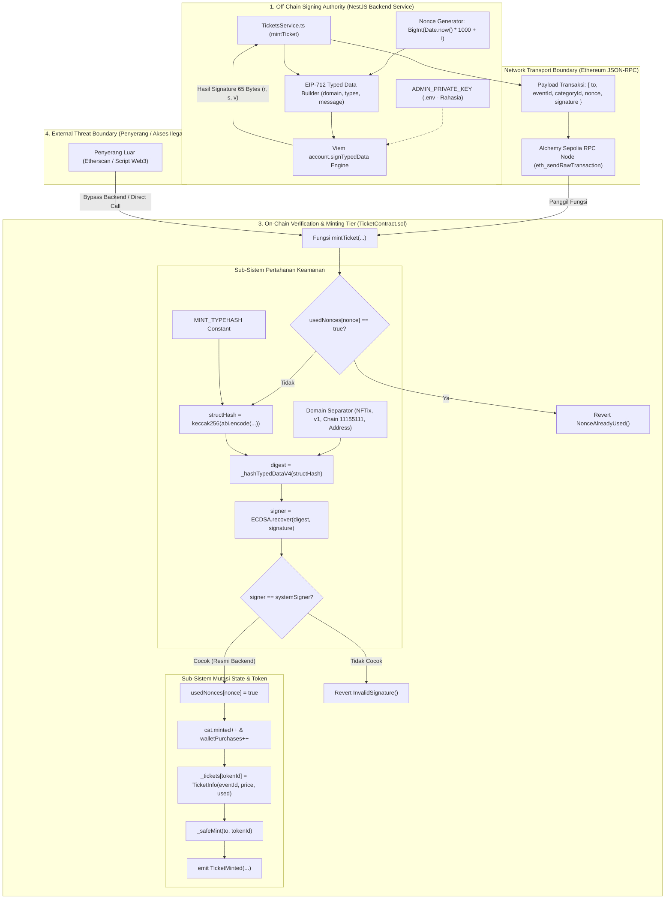
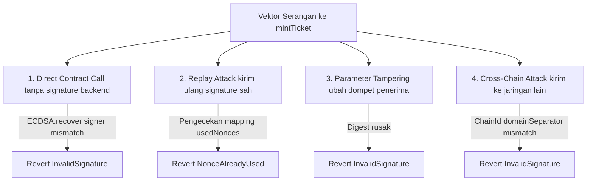

# Desain dan spesifikasi tanda tangan terstruktur EIP-712

**Mekanisme otorisasi off-chain dan pencegahan replay attack pada smart contract relayer**

| Parameter | Deskripsi |
| :--- | :--- |
| **Status** | Spesifikasi implementasi final |
| **Penyusun** | Benedictus Leonardo Edward Stephen Sugianto (NRP: 160423176) |
| **Ruang lingkup** | Konstruksi EIP-712 domain separator, pembuatan typeHash, verifikasi signature on-chain, dan pelacakan nonce anti-replay |
| **Dokumen terkait** | [smart-contract-fundamentals-and-mint-flow.md](file:///d:/STEVE/Project-TA-NFT-Marketplace/explanation/06-smart-contract-fundamentals-and-mint-flow.md), [tickets-service-relayer-deep-dive.md](file:///d:/STEVE/Project-TA-NFT-Marketplace/explanation/10-tickets-service-relayer-deep-dive.md), [21-midtrans-payment-gateway-integration.md](file:///d:/STEVE/Project-TA-NFT-Marketplace/explanation/21-midtrans-payment-gateway-integration.md) |
| **Sasaran pembaca** | Penguji sidang tugas akhir, pembimbing, dan auditor keamanan smart contract |

---

## 1. Ringkasan eksekutif

Sistem *NFTix* menerapkan standar Ethereum Improvement Proposal 712 (EIP-712) untuk mengamankan fungsi pencetakan tiket (`mintTicket`) pada smart contract `TicketContract.sol`. 

Fungsi `mintTicket` tidak dapat dipanggil secara bebas oleh publik. Kontrak mewajibkan parameter tanda tangan kriptografis digital (`signature`) yang diterbitkan oleh alamat otoritatif backend (`systemSigner`). Mekanisme ini menjamin bahwa hanya pesanan yang telah tervalidasi secara off-chain (kuota tersedia, batas kepemilikan dompet valid, dan pembayaran telah diselesaikan) yang dapat dicetak menjadi token ERC-721 di blockchain Sepolia Testnet.

---

## 2. Sumber fakta dan acuan kode

Spesifikasi ini disusun berdasarkan implementasi kode aktif pada repositori (commit `d578d07`):

| Komponen | Berkas sumber | Lokasi baris | Konstruk teknis terverifikasi |
| :--- | :--- | :--- | :--- |
| Inisialisasi EIP-712 | [TicketContract.sol](file:///d:/STEVE/Project-TA-NFT-Marketplace/contracts/src/TicketContract.sol) | 9, 78 | Pewarisan `EIP712("NFTix", "1")` dari OpenZeppelin |
| Definisi TypeHash | [TicketContract.sol](file:///d:/STEVE/Project-TA-NFT-Marketplace/contracts/src/TicketContract.sol) | 58 - 60 | `keccak256("MintAuth(address to,uint256 eventId,uint256 categoryId,uint256 nonce)")` |
| Verifikasi on-chain | [TicketContract.sol](file:///d:/STEVE/Project-TA-NFT-Marketplace/contracts/src/TicketContract.sol) | 188 - 198 | Pembuatan digest via `_hashTypedDataV4` dan pemulihan penandatangan via `ECDSA.recover` |
| Penyimpanan nonce | [TicketContract.sol](file:///d:/STEVE/Project-TA-NFT-Marketplace/contracts/src/TicketContract.sol) | 63, 184 - 186 | `mapping(uint256 => bool) private usedNonces` dan revert `NonceAlreadyUsed` |
| Penandatangan backend | [tickets.service.ts](file:///d:/STEVE/Project-TA-NFT-Marketplace/backend/src/tickets/tickets.service.ts) | 99 - 121 | Eksekusi `signTypedData` menggunakan library Viem dengan skema domain dan types eksplisit |
| Antarmuka ABI | [ticket-abi.ts](file:///d:/STEVE/Project-TA-NFT-Marketplace/backend/src/tickets/ticket-abi.ts) | 30 - 41 | Definisi fungsi `mintTicket(address,uint256,uint256,uint256,bytes)` |

---

## 3. Tujuan dan batasan sistem

### 3.1 Tujuan
1. Menutup akses pemanggilan langsung ke fungsi `mintTicket` dari akun penyerang luar tanpa melewati alur resmi backend.
2. Mencegah serangan pengiriman ulang transaksi (replay attack) menggunakan nonce unik per pencetakan.
3. Mengikat validitas tanda tangan secara ketat pada chain ID Sepolia (11155111) dan alamat kontrak spesifik untuk mencegah serangan lintas jaringan (cross-chain replay).
4. Menyediakan struktur data otorisasi yang dapat dibaca manusia (human-readable) saat proses penandatanganan berlangsung.

### 3.2 Batasan (non-goals)
1. EIP-712 pada modul ini digunakan untuk otorisasi sistem backend ke smart contract, bukan untuk verifikasi identitas fisik penonton di gerbang venue (verifikasi fisik menggunakan dynamic QR berbasis WebAuthn Passkey).
2. Tanda tangan EIP-712 tidak mengenkripsi data tiket. Seluruh parameter (`to`, `eventId`, `categoryId`, `nonce`) tetap berstatus publik di ledger EVM.

---

## 4. Diagram desain sistem dan arsitektur verifikasi EIP-712

Diagram blok berikut memetakan pembagian tier off-chain penandatangan di backend, batas transportasi jaringan JSON-RPC, sub-sistem verifikasi on-chain di smart contract, dan isolasi ancaman eksternal:



---

## 5. Landasan matematis dan alur verifikasi

Verifikasi signature EIP-712 dilakukan melalui rekonstruksi hash berlapis sesuai spesifikasi Ethereum:

$$\text{Digest} = \text{keccak256}(\texttt{"\textbackslash x19\textbackslash x01"} \parallel \text{DomainSeparator} \parallel \text{StructHash})$$

### 5.1 Konstruksi domain separator
Domain separator mencegah tabrakan signature antar-kontrak dan antar-jaringan:

$$\text{DomainSeparator} = \text{keccak256}(\text{abi.encode}(\text{TYPE\_HASH}, \text{nameHash}, \text{versionHash}, \text{chainId}, \text{verifyingContract}))$$

Parameter resmi sistem:
- `name`: `"NFTix"`
- `version`: `"1"`
- `chainId`: `11155111` (Sepolia Testnet)
- `verifyingContract`: `0x4A6e85fACA6df9eb2dB5BA832B4B48790D60F9b3`

### 5.2 Konstruksi struct hash
Struktur data dienkapsulasi menggunakan typeHash:

```solidity
bytes32 public constant MINT_TYPEHASH = keccak256(
    "MintAuth(address to,uint256 eventId,uint256 categoryId,uint256 nonce)"
);
```

Nilai struct hash dihitung secara deterministik dari parameter fungsi:

```solidity
bytes32 structHash = keccak256(
    abi.encode(MINT_TYPEHASH, to, eventId, categoryId, nonce)
);
```

### 5.3 Pemulihan penandatangan (ECDSA recovery)
Smart contract menghitung digest akhir menggunakan fungsi bawaan OpenZeppelin `_hashTypedDataV4(structHash)`. Pemulihan alamat penandatangan dijalankan melalui operasi kriptografi kurva eliptik secp256k1:

```solidity
bytes32 digest = _hashTypedDataV4(structHash);
address signer = ECDSA.recover(digest, signature);
if (signer != systemSigner) {
    revert InvalidSignature();
}
```

Jika terjadi perubahan satu karakter pada parameter input, digest yang dihasilkan akan berbeda. Pemulihan kunci publik menghasilkan alamat acak yang tidak sama dengan `systemSigner`, memicu pembatalan eksekusi transaksi (revert).

---

### 5.4 Pertimbangan desain parameter MintAuth

Struktur data `MintAuth` dirancang menggunakan prinsip hak akses minimum (*principle of least privilege*). Keempat parameter di dalamnya mengunci empat domain otorisasi yang berbeda:

1. **Parameter `address to` (Penguncian Identitas Penerima Hak Milik)**
   * **Fungsi:** Mengikat secara permanen alamat dompet penonton yang berhak menerima pencetakan token NFT.
   * **Ancaman yang dimitigasi:** Serangan penyadapan *mempool* (*mempool sniffing*) dan *front-running*. Pada jaringan publik Ethereum, transaksi relayer melayang di *mempool* sebelum divalidasi ke dalam blok. Jika parameter `to` tidak dienkapsulasi di dalam tanda tangan, penyerang dapat menyalin calldata transaksi, mengganti alamat penerima ke alamat dompet milik penyerang, lalu mengirimkan transaksi baru dengan biaya gas (*priority fee*) lebih tinggi.
   * **Konsekuensi matematis:** Jika penyerang memodifikasi 1 bit dari alamat `to`, fungsi `keccak256` menghasilkan `structHash` yang berbeda. Operasi `ECDSA.recover` pada smart contract memulihkan alamat acak yang tidak identik dengan `systemSigner`. Eksekusi seketika dibatalkan dengan custom error `InvalidSignature()`.

2. **Parameter `uint256 eventId` (Penguncian Konteks Konser)**
   * **Fungsi:** Mengisolasi otoritas pencetakan pada arsitektur kontrak multi-acara (*multi-event master contract*).
   * **Ancaman yang dimitigasi:** Serangan substitusi identitas acara (*event substitution attack*). Sistem *NFTix* menggunakan satu smart contract master untuk mengelola tiket dari berbagai acara promotor yang berbeda. Misalnya, Event #1 adalah festival musik kampus berharga tiket Rp 50.000, sedangkan Event #2 adalah konser artis internasional berharga tiket Rp 3.500.000.
   * **Konsekuensi matematis:** Tanpa parameter `eventId`, penonton yang membayar tiket murah untuk Event #1 dapat menggunakan tanda tangan yang sama untuk mencetak tiket mahal pada Event #2. Penyertaan `eventId` memastikan bahwa izin pencetakan terkunci secara absolut pada ID acara yang dibayar di payment gateway.

3. **Parameter `uint256 categoryId` (Penguncian Kelas Tiket dan Kuota)**
   * **Fungsi:** Mengunci kelas kursi (*seating tier*) dan membatasi eskalasi hak istimewa (*privilege escalation*).
   * **Ancaman yang dimitigasi:** Serangan eskalasi kelas tiket. Di dalam satu acara yang sama, terdapat ragam kategori dengan harga dan kuota berbeda (seperti Festival, Tribune, dan VIP).
   * **Konsekuensi matematis:** Parameter `categoryId` memaksa smart contract membaca kuota kuantitas (`cat.minted < cat.quota`) dan harga asli (`originalPrice = cat.price`) dari kategori yang sah. Penonton yang membayar kategori Festival tidak dapat memanipulasi calldata untuk mencetak tiket kategori VIP.

4. **Parameter `uint256 nonce` (Pemberantasan Penggunaan Berulang / Anti-Replay)**
   * **Fungsi:** Menjamin bahwa tanda tangan bersifat sekali pakai (*single-use authorization token*).
   * **Ancaman yang dimitigasi:** Serangan pengiriman ulang (*replay attack*). Tanpa parameter `nonce`, tanda tangan yang sah bersifat abadi. Pembeli yang telah menyelesaikan 1 kali pembayaran dapat menyalin tanda tangan tersebut dan mengeksekusinya 100 kali berturut-turut untuk menghabiskan kuota tiket acara tanpa membayar lagi.
   * **Konsekuensi matematis:** Begitu verifikasi signature berhasil, smart contract langsung menuliskan `usedNonces[nonce] = true` ke slot storage on-chain. Jika signature yang sama dikirimkan untuk kedua kalinya, kontrak mendeteksi nilai `true` dan seketika membatalkan transaksi dengan revert `NonceAlreadyUsed(nonce)`.

---

### 5.5 Analisis eliminasi parameter (design exclusion rationale)

Desain rekayasa yang baik dicirikan bukan dari seberapa banyak variabel yang disertakan, melainkan dari eliminasi variabel yang redundan atau membuka celah kerentanan baru:

1. **Alasan Tidak Menyertakan Parameter `price` (Harga Tiket)**
   * **Justifikasi:** Nilai harga tiket adalah *state on-chain* otoritatif yang telah tersimpan di dalam struct `TicketCategory` pada smart contract saat promotor membuat acara. Memasukkan parameter harga ke dalam tanda tangan EIP-712 membuka celah desinkronisasi (*split-brain risk*) antara database backend dan state blockchain. Selain itu, penambahan parameter 32-byte pada struktur EIP-712 menambah konsumsi gas calldata dan komputasi hashing sebesar 480 gas tanpa memberikan peningkatan keamanan tambahan.

2. **Alasan Tidak Menyertakan Parameter `quantity` (Jumlah Tiket)**
   * **Justifikasi:** Standar token ERC-721 mencetak token individual secara atomik melalui fungsi `_safeMint(to, tokenId)`. Menyertakan parameter `quantity` dalam satu tanda tangan akan membutuhkan loop internal on-chain dan kalkulasi kuota bertingkat yang rawan serangan *integer overflow* atau *gas exhaustion*. Sistem *NFTix* memilih pendekatan *1 token 1 signature*: jika pembeli membeli 3 tiket, backend menerbitkan 3 paket tanda tangan individual dengan 3 nonce berurutan (`Date.now() * 1000 + i`). Setiap lembar tiket memiliki audit trail kriptografis yang mandiri.

3. **Alasan Tidak Menyertakan Parameter `deadline` / `expiry` (Masa Kedaluwarsa)**
   * **Justifikasi:** Tanda tangan EIP-712 pada arsitektur *NFTix* tidak diserahkan ke peramban pengguna untuk disimpan atau dibroadcast secara mandiri. Tanda tangan dibuat secara privat di memori backend dan seketika dieksekusi ke jaringan RPC Sepolia dalam satu siklus runtime webhook Midtrans. Karena latensi eksekusi berada dalam rentang milidetik dan parameter `nonce` telah mematikan risiko pengulangan transaksi secara permanen, penambahan parameter `deadline` hanya akan menambah operasi perbandingan `block.timestamp` di EVM tanpa faedah keamanan nyata.

---

### 5.6 Rasional keamanan penggunaan `_safeMint` pada dompet smart contract ERC-4337

Pada baris 219 di `TicketContract.sol`, pencetakan token menggunakan fungsi internal `_safeMint(to, tokenId)`, bukan fungsi `_mint(to, tokenId)` biasa:

1. **Bahaya Pemanggilan `_mint` Biasa:**
   * Fungsi `_mint` standar hanya memperbarui pemetaan saldo (`_balances`) dan kepemilikan token (`_owners`) pada kontrak ERC-721.
   * Pada sistem *NFTix*, penonton bertransaksi menggunakan dompet pintar berbasis ERC-4337 Account Abstraction (ZeroDev Kernel). Dompet penonton adalah kontrak pintar (*smart contract account*), bukan akun kunci privat biasa (*Externally Owned Account* / EOA).
   * Jika token NFT dikirimkan ke alamat kontrak pintar yang tidak memiliki kode untuk mengelola token ERC-721, token tersebut akan terkunci selamanya di dalam alamat tersebut (*stuck token*). Token tidak akan pernah bisa ditransfer, diverifikasi di gerbang acara, atau dijual kembali.

2. **Mekanisme Perlindungan `_safeMint`:**
   * Sebelum menyelesaikan pencetakan, `_safeMint` memeriksa apakah alamat penerima `to` memiliki kode kontrak melalui pemeriksaan ukuran runtime bytecode.
   * Jika alamat `to` adalah kontrak pintar, `_safeMint` memanggil fungsi antarmuka `IERC721Receiver.onERC721Received` pada kontrak penerima tersebut.
   * Transaksi hanya berhasil jika kontrak dompet merespons dengan nilai selektor yang sah (`0x150b7a02`).
   * Jika kontrak tujuan menolak atau tidak mengimplementasikan fungsi tersebut, eksekusi seketika dibatalkan dengan pembalikan transaksi (*revert*). Mekanisme ini menjamin bahwa tiket NFT hanya diterbitkan ke dompet pintar yang terbukti mampu menerima dan mengelola aset ERC-721.

---

### 5.7 Sifat atomisitas transaksi EVM dan penanganan kegagalan runtime

Urutan eksekusi di dalam fungsi `mintTicket` berjalan dari validasi input, verifikasi kriptografis, mutasi kuota, penyimpanan metadata `_tickets`, hingga eksekusi `_safeMint`. Seluruh rangkaian instruksi tersebut terikat pada sifat atomisitas Ethereum Virtual Machine (EVM):

1. **Prinsip Eksekusi Atomik (All-or-Nothing):**
   * Seluruh perubahan state di dalam satu transaksi EVM bersifat atomik.
   * Jika eksekusi gagal di titik mana pun (misalnya verifikasi `_safeMint` gagal atau kuota habis), EVM membatalkan seluruh mutasi data secara instan (*atomic state rollback*).
   * Nilai `usedNonces[nonce]` batal menjadi `true`, penambahan `cat.minted` dibatalkan, dan data `_tickets[tokenId]` tidak pernah tersimpan di buku besar blockchain.
   * State smart contract kembali bersih seperti sebelum transaksi dipanggil, seolah-olah transaksi tidak pernah terjadi.

2. **Mitigasi Gangguan Jaringan dan Node RPC Mati:**
   * Jika simpul RPC (Alchemy) mengalami gangguan atau koneksi internet backend terputus sebelum transaksi ditambang ke dalam blok, transaksi tidak pernah masuk ke ledger Sepolia.
   * Jika transaksi gagal di blockchain, backend menangkap galat tersebut melalui blok `try...catch` dan mencatat status pesanan di database MySQL sebagai `paid_minting_failed`.
   * Karena transaksi di blockchain mengalami rollback penuh atau tidak pernah terjadi, nomor `nonce` tersebut tidak pernah terkunci di pemetaan `usedNonces`.
   * Sistem backend atau pengelola acara dapat memicu ulang fungsi `mintTicket` untuk nomor pesanan tersebut secara aman tanpa terbentur pesan kesalahan `NonceAlreadyUsed`.

---

## 6. Keputusan arsitektur (why and what)

> **Why & What - EIP-712 typed data dibanding plain hash (eth_sign)**
>
> **What:** Menggunakan standar data terstruktur EIP-712 dibanding penandatanganan hash biner biasa via `eth_sign` atau `keccak256(abi.encodePacked(...))`.
>
> **Why:** Penandatanganan hash biner biasa rentan terhadap serangan penandatanganan buta (blind signing) dan tabrakan hash pada tipe data dinamis. EIP-712 menyertakan domain separator yang mengunci chainId dan verifyingContract secara built-in, serta menambahkan prefix `\x19\x01` untuk membedakan data aplikasi dari transaksi Ethereum reguler.
>
> **Alternatives considered:**
> - *Plain Keccak256:* Ukuran byte lebih kecil, namun tidak memiliki domain isolation bawaan dan tidak mematuhi standar de facto tooling audit smart contract.
>
> **Fallback:** Smart contract melempar custom error `InvalidSignature()` dan membatalkan seluruh perubahan state jika verifikasi gagal.

---

> **Why & What - Isolasi parameter minimalis struct MintAuth**
>
> **What:** Membatasi isi struct otorisasi hanya pada empat parameter: `to`, `eventId`, `categoryId`, dan `nonce`.
>
> **Why:** Mengurangi kompleksitas hashing calldata dan gas execution di EVM, sekaligus meniadakan risiko desinkronisasi data harga dan kuota antara backend dengan state contract. Pilihan ini mewajibkan backend menerbitkan signature jamak saat pengguna membeli lebih dari satu tiket.
>
> **Alternatives considered:**
> - *Menyertakan field price dan quantity:* Memungkinkan 1 signature untuk multi-tiket sekaligus, namun membuka celah manipulasi harga off-chain jika database backend diretas dan memperbesar ukuran calldata on-chain.
>
> **Fallback:** Penolakan transaksi jika salah satu dari keempat parameter tidak cocok dengan tanda tangan digital `systemSigner`.

---

> **Why & What - Nonce unik berbasis stempel waktu mikrodetik**
>
> **What:** Membentuk nilai nonce dari formula `BigInt(Date.now() * 1000 + i)` dan mencatat statusnya pada `usedNonces[nonce] = true`.
>
> **Why:** Mencegah serangan replay di mana penyerang mengirimkan kembali tanda tangan yang sah untuk mencetak tiket kedua tanpa izin. Penggunaan waktu mikrodetik ditambah indeks loop menjamin nilai nonce selalu unik (collision-free) pada transaksi batch, tanpa membutuhkan pembacaan counter global on-chain yang rentan race condition jika beberapa pengguna membeli tiket bersamaan.
>
> **Alternatives considered:**
> - *Counter sekuensial on-chain:* Mengharuskan backend membaca counter terakhir on-chain sebelum menandatangani pesan. Jika dua proses pembelian berjalan bersamaan, proses kedua akan gagal akibat nonce collision.
>
> **Fallback:** Kontrak memeriksa `if (usedNonces[nonce]) revert NonceAlreadyUsed(nonce);` sebelum melakukan mutasi kuota atau pencetakan token.

---

## 7. Analisis vektor serangan dan mekanisme pertahanan



| Vektor serangan | Deskripsi percobaan serangan | Pertahanan smart contract | Hasil akhir |
| :--- | :--- | :--- | :--- |
| **Pemanggilan langsung** | Penyerang memanggil fungsi `mintTicket` melalui block explorer tanpa proses pembayaran di backend. | Kontrak memvalidasi `signer == systemSigner`. Penyerang tidak memiliki private key backend untuk membentuk signature valid. | Revert `InvalidSignature` |
| **Pengiriman ulang (replay)** | Penyerang menyalin signature sah dari transaksi yang sudah berhasil di mempool untuk mencetak tiket kedua. | Kontrak memeriksa status `usedNonces[nonce]`. Nonce langsung ditandai `true` pada transaksi pertama. | Revert `NonceAlreadyUsed` |
| **Manipulasi parameter** | Penyerang mengganti parameter alamat `to` menjadi dompet miliknya sendiri pada pesan yang sudah ditandatangani. | Rekonstruksi `structHash` menghasilkan digest yang berbeda, sehingga alamat yang dipulihkan tidak cocok dengan `systemSigner`. | Revert `InvalidSignature` |
| **Penyalahgunaan lintas chain** | Penyerang menggunakan signature Sepolia pada smart contract yang sama di jaringan Polygon atau Mainnet. | Domain separator menyertakan `chainId: 11155111`. Pada chain dengan ID berbeda, digest yang dihasilkan tidak valid. | Revert `InvalidSignature` |

---

## 8. Manfaat dan konsekuensi

### 8.1 Manfaat
- Kontrol akses pencetakan ditegakkan pada tingkat EVM, bukan hanya bergantung pada proteksi endpoint HTTP backend.
- Biaya verifikasi on-chain sangat rendah (operasi `ecrecover` memakan sekitar 3.000 gas).
- Tanda tangan dibuat secara off-chain (0 gas), menjaga efisiensi operasional sistem.

### 8.2 Konsekuensi
- Konsumsi gas meningkat sebesar 20.000 gas per transaksi akibat penulisan slot storage baru untuk penandaan `usedNonces[nonce] = true`.
- Kunci privat `ADMIN_PRIVATE_KEY` milik `systemSigner` menjadi titik kritis keamanan backend yang wajib dilindungi.

---

## 9. Risiko sisa dan larangan implementasi

- **Dilarang** mengekspos `ADMIN_PRIVATE_KEY` ke lingkungan peramban pengguna atau repositori publik.
- **Dilarang** menggunakan nilai nonce statis yang dapat ditebak.
- **Dilarang** menghilangkan parameter `verifyingContract` atau `chainId` pada domain separator.
- **Risiko sisa**: Jika server backend mengalami kemunduran waktu jam sistem (clock rollback) yang signifikan, terdapat peluang kecil nilai nonce berulang. Mitigasi: penambahan validasi internal pada backend agar stempel waktu selalu monotonik naik.

---

## 10. Pertanyaan dan jawaban ujian sidang

**Pertanyaan 1:** Karena transaksi pencetakan tiket dibiayai oleh relayer, bagaimana Anda mencegah seseorang memanggil fungsi pencetakan langsung ke smart contract Sepolia tanpa membayar?

**Jawaban:** Kami menutup celah tersebut menggunakan otorisasi kriptografi standar EIP-712. Fungsi `mintTicket` di smart contract `TicketContract.sol` mewajibkan parameter tanda tangan digital yang hanya bisa dihasilkan oleh `systemSigner` backend. Jika penyerang mencoba memanggil fungsi ini langsung melalui Etherscan atau script Web3 eksternal, smart contract akan menghitung ulang digest EIP-712 dan menjalankan operasi `ECDSA.recover`. Karena penyerang tidak memiliki private key `systemSigner`, alamat yang dipulihkan tidak akan cocok, dan transaksi seketika dibatalkan di tingkat blockchain dengan custom error `InvalidSignature()`.

**Pertanyaan 2:** Mengapa parameter harga tiket (`price`) tidak dimasukkan ke dalam struct `MintAuth` EIP-712?

**Jawaban:** Harga tiket merupakan data on-chain otoritatif yang sudah tersimpan di dalam smart contract pada struct `TicketCategory` sejak promotor menginisialisasi acara. Memasukkan harga ke dalam tanda tangan EIP-712 menimbulkan redundansi data dan membuka risiko desinkronisasi (*split-brain risk*) antara nilai di backend dengan kontrak. Selain itu, penambahan parameter 32-byte memboroskan gas hashing dan calldata. Smart contract secara otomatis mengunci `originalPrice = cat.price` berdasarkan parameter `categoryId` yang sudah tervalidasi.

**Pertanyaan 3:** Mengapa sistem tidak menyertakan batas waktu kedaluwarsa (`deadline`) pada tanda tangan EIP-712 seperti pada standar permit ERC-20?

**Jawaban:** Pada standar permit ERC-20, pengguna menandatangani izin secara mandiri dan dapat menahan tanda tangan tersebut di dompet untuk diserahkan ke pihak ketiga berhari-hari kemudian, sehingga parameter `deadline` wajib ada untuk mencegah eksploitasi di masa depan. Pada sistem *NFTix*, backend kami bertindak sebagai *direct relayer*. Tanda tangan dibuat secara privat di server dan langsung dieksekusi ke jaringan blockchain Sepolia dalam siklus runtime webhook pelunasan Midtrans. Karena masa hidup tanda tangan hanya hitungan milidetik dan parameter `nonce` telah menjamin konsumsi sekali pakai (*single-use*), penambahan parameter `deadline` tidak memberikan faedah keamanan tambahan dan hanya akan menambah komparasi gas opcode `block.timestamp` yang sia-sia.

**Pertanyaan 4:** Mengapa fungsi `mintTicket` menggunakan `_safeMint` alih-alih `_mint` biasa, dan apa dampaknya bagi pengguna Smart Account ERC-4337?

**Jawaban:** Pengguna pada platform *NFTix* tidak menggunakan akun EOA biasa, melainkan Smart Contract Account berbasis ERC-4337 (ZeroDev Kernel). Jika menggunakan `_mint` standar dan token dikirim ke kontrak yang tidak memiliki fungsi penerima token NFT, tiket akan terkunci selamanya tanpa bisa dipindahkan. Fungsi `_safeMint` memvalidasi keberadaan antarmuka `IERC721Receiver.onERC721Received` pada alamat dompet tujuan sebelum menyelesaikan transaksi. Jika dompet pintar tujuan tidak mendukung penerimaan token NFT, transaksi otomatis dibatalkan (*revert*), melindungi aset tiket dari risiko kehilangan permanen.

**Pertanyaan 5:** Apa yang terjadi jika node RPC atau server backend mati saat penulisan metadata tiket baru saja dieksekusi di smart contract?

**Jawaban:** Sifat atomisitas transaksi Ethereum Virtual Machine (EVM) menjamin prinsip *All-or-Nothing*. Jika transaksi gagal di tengah eksekusi, seluruh mutasi state—termasuk penandaan `usedNonces[nonce] = true`, penambahan kuota `cat.minted`, dan penulisan struct `_tickets`—dibatalkan 100% (*atomic rollback*). State blockchain kembali ke kondisi awal sebelum fungsi dipanggil. Backend kami mencatat pesanan tersebut dengan status `paid_minting_failed`. Karena nonce di smart contract tidak pernah terkunci akibat pembatalan transaksi, sistem dapat memicu ulang fungsi `mintTicket` secara aman tanpa menimbulkan kegagalan *NonceAlreadyUsed*.
