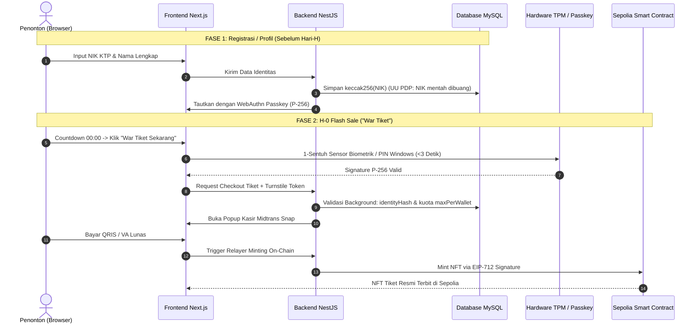

# 23. Arsitektur Flash Sale (War Tiket) & Audit Keamanan Backend Skala Besar

> **Status Dokumen:** Keputusan Arsitektur Resmi & Panduan Perbaikan Backend (Tugas Akhir)  
> **Penulis / Peran:** Senior Backend Architect & Security Auditor  
> **Tanggal Keputusan:** 23 Oktober 2026  
> **Komponen Relevan:** Next.js Frontend (BFF), NestJS Relayer, TypeORM (MySQL), Smart Contract (Sepolia), Midtrans Gateway  

---

## BAGIAN 1: Keputusan Desain Halaman Flash Sale (Opsi B: Passkey Fast-Pass)

Berdasarkan hasil wawancara calo tiket dan kebutuhan pengalaman pengguna (*User Experience*) di saat "war tiket", sistem menetapkan **Opsi B (Passkey Fast-Pass)** sebagai standar alur flash sale resmi:



### Keunggulan Arsitektur Opsi B:
1. **Zero Stress saat War**: Penonton asli tidak dipaksa mengetik 16 digit angka NIK secara terburu-buru di saat berebut detik demi detik.
2. **Anti-Calo Akun Pinjaman**: Calo jastip tidak bisa memborong akun orang lain karena saat penukaran di gerbang venue (**Scan 2**), KTP fisik penonton wajib dicocokkan dengan `keccak256(NIK)` yang sudah terkunci di akun tersebut.
3. **Eksekusi Secepat Kilat**: Alur dari penekanan tombol war hingga pembukaan modal kasir berlangsung di bawah 3 detik dengan otentikasi hardware TPM (*Trusted Platform Module*).

---

## BAGIAN 2: Laporan Audit Keamanan & Arsitektur Backend Skala Besar

Sebagai Senior Backend Architect dan Security Auditor, berikut adalah hasil analisis audit komprehensif terhadap tingkat kode (*application layer*) pada codebase backend saat ini:

### 📊 Ringkasan Eksekutif Temuan Audit

| No | Aspek Keamanan & Skalabilitas | Status Saat Ini | Tingkat Risiko | File Terdampak |
| :---: | :--- | :---: | :---: | :--- |
| **1** | **Implementasi Kunci Idempotensi (Idempotency Key)** | ⚠️ **Sebagian** (Aman di Kontrak, Rentan di REST API) | **Sedang (Medium)** | `backend/src/tickets/tickets.service.ts` |
| **2** | **Strategi Penguncian Data (Pessimistic/Optimistic Locking)** | ❌ **Belum Ada** (Hanya dilindungi EVM on-chain) | **Tinggi (High)** | `backend/src/events/events.service.ts` |
| **3** | **Manajemen State Tiket (State Machine Pemesanan)** | ❌ **Belum Ada** (Belum ada tabel orders di DB) | **Tinggi (High)** | `backend/src/tickets/` |
| **4** | **Background Job & Penanganan Timeout Reservasi** | ❌ **Belum Ada** (Tidak ada BullMQ/Schedule) | **Sedang (Medium)** | `backend/package.json` |
| **5** | **Validasi Input & Pencegahan Mass Assignment** | ⚠️ **Sebagian** (Whitelist aman, limit DTO bolong) | **Sedang (Medium)** | `backend/src/tickets/dto/create-snap.dto.ts` |

---

### 🔍 Detail Analisis per Aspek & Rekomendasi Kode

---

### Aspek 1: Implementasi Kunci Idempotensi (Idempotency Key)

#### 1. Temuan Kode:
* **Di Smart Contract (`TicketContract.sol:63, 242`)**:
  Smart contract sudah menerapkan mekanisme anti-replay attack menggunakan mapping `usedNonces[nonce]`. Jika signature yang sama dikirim dua kali, kontrak melempar error `NonceAlreadyUsed`. **(LULUS / AMAN)**.
* **Di Backend NestJS (`tickets.service.ts:308-309`)**:
  ```typescript
  // File: backend/src/tickets/tickets.service.ts (Line 308-309)
  const randomSuffix = Math.random().toString(36).substring(2, 7).toUpperCase();
  const orderId = `NFTIX-${dto.eventId}-${dto.categoryId}-${Date.now()}-${randomSuffix}`;
  ```
  Setiap pemanggilan endpoint `POST /api/tickets/create-snap` selalu menghasilkan `orderId` baru karena mengacak `Date.now()` dan `randomSuffix`. Jika pengguna melakukan *double-click* atau koneksi internet mengalami *retry*, sistem akan mendaftarkan 2 sesi tagihan berbeda ke server Midtrans.

#### 2. Rekomendasi Perbaikan:
Klien harus mengirimkan header `Idempotency-Key` (atau dibuat dari hash deterministik `walletAddress + eventId + categoryId + roundTimestamp`). Jika request dengan key yang sama datang dalam kurun waktu 5 menit, server mengembalikan respon tagihan yang sama tanpa membuat transaksi baru ke Midtrans:

```typescript
// Rekomendasi Snippet: Idempotency Cache / Service
import { Injectable } from '@nestjs/common';

@Injectable()
export class IdempotencyService {
  private cache = new Map<string, { response: any; expiresAt: number }>();

  get(key: string) {
    const item = this.cache.get(key);
    if (!item) return null;
    if (Date.now() > item.expiresAt) {
      this.cache.delete(key);
      return null;
    }
    return item.response;
  }

  set(key: string, response: any, ttlMs = 300000) {
    this.cache.set(key, { response, expiresAt: Date.now() + ttlMs });
  }
}
```

---

### Aspek 2: Strategi Penguncian Data (Application-Level Locking)

#### 1. Temuan Kode:
* **File:** [backend/src/events/events.service.ts:61-71](file:///d:/STEVE/Project-TA-NFT-Marketplace/backend/src/events/events.service.ts#L61-L71)
  ```typescript
  async findOne(id: number) {
    const event = await this.eventRepository.findOne({
      where: { id },
      relations: { ticketCategories: true },
    });
    ...
  }
  ```
* **Evaluasi Efisiensi & Bahaya Overselling:**
  Query di atas adalah `SELECT` polos tanpa penguncian baris (`lock: { mode: 'pessimistic_write' }`).
  Pada momen **Flash Sale** dengan 500 permintaan konkuren:
  1. 500 pengguna membaca kuota tersisa = 1 tiket.
  2. 500 pengguna berhasil membuat sesi tagihan Midtrans dan membayar via QRIS.
  3. Uang 500 pengguna masuk ke rekening penyelenggara.
  4. Ketika relayer mengeksekusi `mintTicket` ke smart contract, transaksi #1 sukses, namun 499 transaksi berikutnya **gagal/revert on-chain** (`QuotaExceeded`).
  5. Terjadi bencana operasional: **Pengguna sudah terlanjur bayar uang, tapi tiket NFT tidak terbit.**

#### 2. Rekomendasi Perbaikan (Pessimistic Locking dengan QueryRunner):
Gunakan transaksi database dengan `SELECT FOR UPDATE` pada baris kategori tiket saat kuota dihitung:

```typescript
// Rekomendasi Snippet: Pessimistic Write Lock pada TicketCategory
async reserveTicketQuota(categoryId: number, quantity: number): Promise<boolean> {
  return await this.dataSource.transaction(async (manager) => {
    // Kunci baris kategori tiket secara eksklusif (SELECT ... FOR UPDATE)
    const category = await manager
      .createQueryBuilder(TicketCategory, 'cat')
      .setLock('pessimistic_write')
      .where('cat.id = :id', { id: categoryId })
      .getOne();

    if (!category) throw new NotFoundException('Kategori tidak ditemukan');

    // Cek sisa kuota yang belum di-hold
    if (category.minted + quantity > category.quota) {
      throw new BadRequestException('Kuota tiket flash sale sudah habis!');
    }

    // Naikkan counter sementara (hold)
    category.minted += quantity;
    await manager.save(category);

    return true;
  });
}
```

---

### Aspek 3: Manajemen State Tiket (State Machine Pemesanan)

#### 1. Temuan Kode:
* Di database MySQL saat ini, **tidak ada entitas/tabel `orders` atau `reservations`**.
* Alur saat ini langsung melompat dari pemanggilan API kasir ke pemanggilan relayer minting.
* Di Smart Contract ([contracts/src/TicketContract.sol:52](file:///d:/STEVE/Project-TA-NFT-Marketplace/contracts/src/TicketContract.sol#L52)), state hanya berupa status biner: `used: false` menjadi `used: true`.

#### 2. Rekomendasi Perbaikan (Order State Machine):
Wajib menambahkan tabel `ticket_orders` di MySQL untuk mengawal lifecycle transaksi:

```
[INITIATED] ──(Midtrans Snap Token)──> [PENDING_PAYMENT]
     │                                         │
 (Timeout 15 Menit)                      (Webhook Lunas)
     │                                         │
     ▼                                         ▼
 [EXPIRED]                               [PAID_CONFIRMED]
                                               │
                                       (Relayer Viem Mint)
                                               │
                                               ▼
                                            [MINTED]
```

```typescript
// Rekomendasi Snippet: Entitas Order dengan Enum Status Kaku
export enum OrderStatus {
  PENDING = 'PENDING',
  PAID = 'PAID',
  MINTED = 'MINTED',
  FAILED = 'FAILED',
  EXPIRED = 'EXPIRED',
}

@Entity('ticket_orders')
export class TicketOrder {
  @PrimaryGeneratedColumn('uuid')
  id: string;

  @Column({ unique: true })
  orderId: string; // NFTIX-EV1-CAT1-...

  @Column()
  walletAddress: string;

  @Column()
  totalAmount: number;

  @Column({ type: 'enum', enum: OrderStatus, default: OrderStatus.PENDING })
  status: OrderStatus;

  @Column({ nullable: true })
  txHash: string; // Hash Sepolia saat status MINTED
}
```

---

### Aspek 4: Background Job & Penanganan Timeout Reservasi

#### 1. Temuan Kode:
* Di [backend/package.json](file:///d:/STEVE/Project-TA-NFT-Marketplace/backend/package.json), tidak ada pustaka worker antrean (`bullmq`, `redis`, atau `@nestjs/schedule`).
* **Kondisi Rentan**: Jika pengguna mendapatkan sesi kasir Midtrans (status kuota di-hold), namun membatalkan transaksi atau menutup peramban, kuota tersebut akan terkunci selamanya jika tidak ada sistem yang melepaskannya kembali.

#### 2. Rekomendasi Perbaikan:
Pasang `@nestjs/schedule` untuk menjalankan cron job ringan setiap 60 detik (atau BullMQ dengan Delayed Jobs 15 menit) guna mengembalikan kuota tiket yang pesanannya sudah kedaluwarsa:

```typescript
// Rekomendasi Snippet: Cron Job Pembersih Reservasi Kedaluwarsa
import { Injectable, Logger } from '@nestjs/common';
import { Cron, CronExpression } from '@nestjs/schedule';

@Injectable()
export class OrderTimeoutWorker {
  private readonly logger = new Logger(OrderTimeoutWorker.name);

  @Cron(CronExpression.EVERY_MINUTE)
  async handleExpiredReservations() {
    const fifteenMinutesAgo = new Date(Date.now() - 15 * 60 * 1000);

    // Cari order PENDING yang umurnya lebih dari 15 menit
    const expiredOrders = await this.orderRepository.find({
      where: {
        status: OrderStatus.PENDING,
        createdAt: LessThan(fifteenMinutesAgo),
      },
    });

    for (const order of expiredOrders) {
      order.status = OrderStatus.EXPIRED;
      await this.orderRepository.save(order);
      // Kembalikan kuota ke tabel ticket_categories (category.minted -= order.quantity)
      this.logger.warn(`Pelepasan kuota untuk order kedaluwarsa: ${order.orderId}`);
    }
  }
}
```

---

### Aspek 5: Validasi Input & Keamanan Parameter

#### 1. Temuan Kode:
* **Pertahanan Bypass Frontend (TERPASANG)**:
  Seluruh controller utama (`AuthController`, `EventsController`, `TicketsController`) diproteksi `@UseGuards(InternalApiGuard)` (*fail-closed*) yang memvalidasi `x-internal-key` sebelum DTO/Controller dieksekusi, dengan pengecualian `@Public()` pada `midtrans-webhook`. Rincian di [27-backend-trust-boundary-and-internal-api-guard.md](file:///d:/STEVE/Project-TA-NFT-Marketplace/explanation/27-backend-trust-boundary-and-internal-api-guard.md).
  - **Alur Kerja Pertahanan Bertingkat:**
    1. Request masuk dicegat `InternalApiGuard`: jika ditembak langsung oleh skrip bot/penyerang tanpa `x-internal-key` server Next.js, langsung ditolak `401 Unauthorized` sebelum alokasi memori DTO atau koneksi database.
    2. Jika berasal dari server Next.js (`x-internal-key` cocok), request masuk ke `ValidationPipe` (`whitelist: true`) untuk membuang field liar (`400 Bad Request` bila invalid).
    3. Setelah lolos DTO, barulah transaksi MySQL (`pessimistic_write`) dan relayer blockchain dijalankan.
* **Pertahanan Mass Assignment (LULUS / AMAN)**:
  Di [backend/src/main.ts:31-36](file:///d:/STEVE/Project-TA-NFT-Marketplace/backend/src/main.ts#L31-L36), `ValidationPipe` global telah dipasang dengan opsi `whitelist: true`. Property tak dikenal yang diselundupkan penyerang otomatis dibuang.
* **Pertahanan Manipulasi Harga (LULUS / AMAN)**:
  Di [backend/src/tickets/tickets.service.ts:305](file:///d:/STEVE/Project-TA-NFT-Marketplace/backend/src/tickets/tickets.service.ts#L305), harga murni diambil dari database server `Number(category.price) * qty`. Parameter harga tidak pernah diterima dari input klien.
* **Celah Validasi Kuantitas & Kuota (PERLU PERBAIKAN)**:
  1. Di [create-snap.dto.ts](file:///d:/STEVE/Project-TA-NFT-Marketplace/backend/src/tickets/dto/create-snap.dto.ts), hanya terdapat `@Min(1)`. Tidak ada batasan `@Max(2)`. Pengguna nakal bisa mengirim `{ quantity: 500 }` dan menerbitkan tagihan borongan di Midtrans.
  2. Endpoint `createSnapTransaction` **tidak memeriksa `maxPerWallet` akun pemohon**. Pengguna yang sudah memiliki 2 tiket masih diizinkan membuat sesi pembayaran baru di Midtrans, dan baru ditolak saat transaksi on-chain dieksekusi.

#### 2. Rekomendasi Perbaikan:
Perketat DTO dan tambahkan pengecekan kuota dompet sebelum memanggil API Midtrans:

```typescript
// File: backend/src/tickets/dto/create-snap.dto.ts
import { IsNotEmpty, IsNumber, IsString, Min, Max } from 'class-validator';

export class CreateSnapDto {
  @IsNumber()
  @IsNotEmpty()
  eventId: number;

  @IsNumber()
  @IsNotEmpty()
  categoryId: number;

  @IsNumber()
  @Min(1, { message: 'Pembelian minimal 1 tiket' })
  @Max(2, { message: 'Pembelian flash sale maksimal 2 tiket per akun' }) // <-- Wajib ditambahkan
  quantity: number;

  @IsString()
  @IsNotEmpty()
  walletAddress: string;
}
```

---

## 📌 Checklist Rencana Implementasi di Sesi Berikutnya

- [ ] **Task 1**: Update [backend/src/tickets/dto/create-snap.dto.ts](file:///d:/STEVE/Project-TA-NFT-Marketplace/backend/src/tickets/dto/create-snap.dto.ts) untuk menambahkan `@Max(2)` dan pengecekan kuota `getUserTickets` sebelum membuat order Snap.
- [ ] **Task 2**: Buat entitas `ticket_orders` dan terapkan state machine (`PENDING -> PAID -> MINTED`).
- [ ] **Task 3**: Pasang Pessimistic Locking (`pessimistic_write`) saat memotong kuota Flash Sale di MySQL.
- [ ] **Task 4**: Pasang `@nestjs/schedule` untuk melepaskan reservasi tiket yang tidak dibayar dalam 15 menit.
- [ ] **Task 5**: Implementasikan UI Halaman Flash Sale (Opsi B: Passkey 1-Klik) di Next.js.
