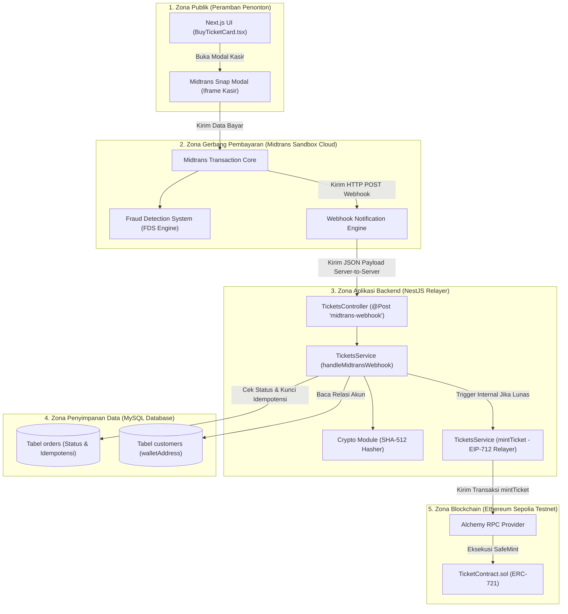
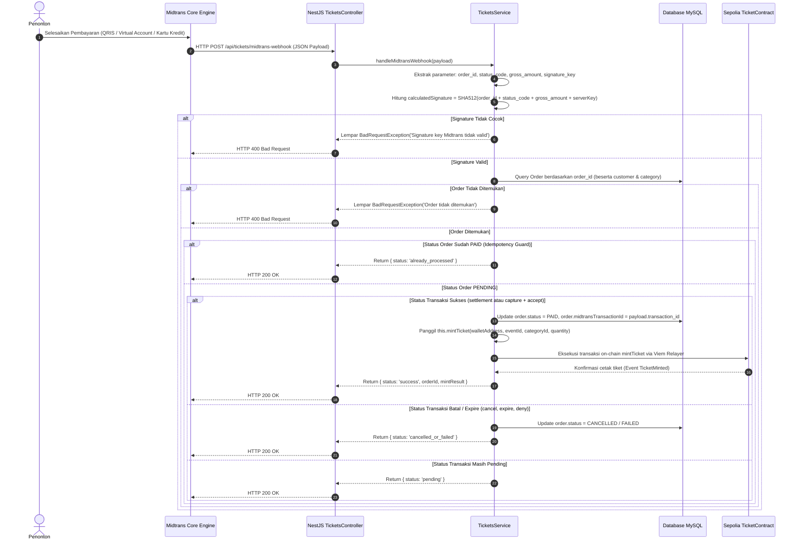

# Desain dan spesifikasi teknis webhook Midtrans dan orkestrasi pencetakan tiket on-chain

**Mekanisme verifikasi kriptografis SHA-512, penegakan idempotensi, dan trigger relayer EIP-712**

| Parameter | Deskripsi |
| :--- | :--- |
| **Status** | Spesifikasi implementasi final |
| **Penyusun** | Benedictus Leonardo Edward Stephen Sugianto (NRP: 160423176) |
| **Ruang lingkup** | Verifikasi keaslian webhook HTTP POST Midtrans, kalkulasi SHA-512 signature, siklus hidup transaksi kartu kredit vs QRIS/VA, penegakan idempotensi database, dan orkestrasi pencetakan tiket on-chain |
| **Dokumen terkait** | [21-midtrans-payment-gateway-integration.md](file:///d:/STEVE/Project-TA-NFT-Marketplace/explanation/21-midtrans-payment-gateway-integration.md), [22-eip712-structured-data-signatures.md](file:///d:/STEVE/Project-TA-NFT-Marketplace/explanation/22-eip712-structured-data-signatures.md), [10-tickets-service-relayer-deep-dive.md](file:///d:/STEVE/Project-TA-NFT-Marketplace/explanation/10-tickets-service-relayer-deep-dive.md) |
| **Sasaran pembaca** | Penguji sidang tugas akhir, pembimbing, perekayasa backend, dan auditor keamanan sistem |

---

## 1. Ringkasan eksekutif

Sistem *NFTix* menggunakan komunikasi asinkronus server-ke-server (*asynchronous webhook*) untuk menerima konfirmasi pelunasan pembayaran dari Midtrans. Pencetakan tiket NFT pada jaringan blockchain Ethereum Sepolia Testnet hanya terjadi setelah backend memvalidasi keaslian tanda terima resmi dari Midtrans.

Arsitektur ini menggantikan pola lama yang mengandalkan callback peramban (*client-side callback* `onSuccess`). Pada pola lama, peramban pembeli mengirim permintaan langsung ke endpoint `POST /api/tickets/mint` setelah modal pembayaran ditutup. Pola client-side tersebut memiliki celah keamanan kritis. Penyerang dapat memodifikasi skrip peramban untuk memalsukan status pembayaran sukses dan mencetak tiket tanpa membayar sepeser pun.

Dengan memindahkan pemicu pencetakan tiket ke endpoint webhook backend (`POST /api/tickets/midtrans-webhook`), otoritas pencetakan tiket dikendalikan sepenuhnya oleh server. Backend memverifikasi tanda tangan kriptografis SHA-512, memeriksa status pembayaran ganda, mengunci status pesanan untuk mencegah pencetakan ganda, lalu mengeksekusi fungsi pencetakan on-chain via relayer Viem.

---

## 2. Sumber fakta dan acuan kode

Spesifikasi teknis ini disusun berdasarkan berkas implementasi aktif pada repositori:

| Komponen | Berkas sumber | Lokasi baris | Konstruk teknis terverifikasi |
| :--- | :--- | :--- | :--- |
| Controller webhook | [tickets.controller.ts](file:///d:/STEVE/Project-TA-NFT-Marketplace/backend/src/tickets/tickets.controller.ts) | 61 - 64 | Endpoint `@Post('midtrans-webhook')` menerima body JSON dari Midtrans |
| Handler webhook | [tickets.service.ts](file:///d:/STEVE/Project-TA-NFT-Marketplace/backend/src/tickets/tickets.service.ts) | 335 - 340 | Pengambilan `MIDTRANS_SERVER_KEY` dari konfigurasi server |
| Ekstraksi parameter | [tickets.service.ts](file:///d:/STEVE/Project-TA-NFT-Marketplace/backend/src/tickets/tickets.service.ts) | 343 - 350 | Destrukturisasi parameter `order_id`, `status_code`, `gross_amount`, `signature_key`, `transaction_status`, `fraud_status` |
| Verifikasi SHA-512 | [tickets.service.ts](file:///d:/STEVE/Project-TA-NFT-Marketplace/backend/src/tickets/tickets.service.ts) | 353 - 362 | Kalkulasi hash SHA-512 dan validasi kecocokan dengan `signature_key` |
| Filter notifikasi tes | [tickets.service.ts](file:///d:/STEVE/Project-TA-NFT-Marketplace/backend/src/tickets/tickets.service.ts) | 365 - 374 | Penanganan simulasi URL notifikasi berawalan `payment_notif_test_` |
| Query pesanan | [tickets.service.ts](file:///d:/STEVE/Project-TA-NFT-Marketplace/backend/src/tickets/tickets.service.ts) | 377 - 389 | Pencarian order di MySQL beserta relasi `customer` dan `ticketCategory` |
| Penjaga idempotensi | [tickets.service.ts](file:///d:/STEVE/Project-TA-NFT-Marketplace/backend/src/tickets/tickets.service.ts) | 392 - 397 | Pengecekan `order.status === OrderStatus.PAID` untuk mencegah pencetakan berulang |
| Evaluasi status sukses | [tickets.service.ts](file:///d:/STEVE/Project-TA-NFT-Marketplace/backend/src/tickets/tickets.service.ts) | 400 | Verifikasi status `settlement` atau `capture` dengan `fraud_status === 'accept'` |
| Mutasi status dan id | [tickets.service.ts](file:///d:/STEVE/Project-TA-NFT-Marketplace/backend/src/tickets/tickets.service.ts) | 403 - 405 | Pembaruan status pesanan menjadi `PAID` dan penyimpanan `midtransTransactionId` |
| Trigger relayer minting | [tickets.service.ts](file:///d:/STEVE/Project-TA-NFT-Marketplace/backend/src/tickets/tickets.service.ts) | 408 - 413 | Pemanggilan internal method `this.mintTicket` dengan parameter dompet pembeli |
| Entitas pesanan | [order.entity.ts](file:///d:/STEVE/Project-TA-NFT-Marketplace/backend/src/tickets/entities/order.entity.ts) | 18 - 74 | Definisi enum `OrderStatus` dan skema tabel `orders` |
| Entitas pelanggan | [customer.entity.ts](file:///d:/STEVE/Project-TA-NFT-Marketplace/backend/src/customers/entities/customer.entity.ts) | 17 - 18 | Definisi kolom `walletAddress` |

---

## 3. Tujuan dan batasan sistem

### 3.1 Tujuan
1. Memastikan keaslian dan integritas pesan notifikasi pembayaran dari Midtrans menggunakan verifikasi tanda tangan digital SHA-512.
2. Mencegah eksploitasi pencetakan tiket tanpa pembayaran dengan meniadakan endpoint pencetakan publik di sisi peramban.
3. Mencegah insiden pencetakan tiket ganda (*double minting*) saat Midtrans mengirimkan notifikasi webhook berulang kali akibat mekanisme *retry*.
4. Mengakomodasi variasi status transaksi perbankan di Indonesia, meliputi verifikasi Fraud Detection System (FDS) kartu kredit serta penyelesaian instan QRIS dan Virtual Account.
5. Mempertahankan ketersediaan sistem dari crash runtime akibat inkonsistensi tipe data saat pengujian di lingkungan sandbox.

### 3.2 Batasan (non-goals)
1. Modul ini tidak menangani pengembalian dana (*refund*) on-chain secara otomatis. Jika tiket gagal dicetak setelah dana terpotong, status pesanan ditandai sebagai `paid_minting_failed` untuk rekonsiliasi administratif.
2. Modul ini tidak menyimpan data sensitif nomor kartu kredit penonton. Seluruh data kartu ditangani langsung pada antarmuka kasir berstandar PCI-DSS milik Midtrans.

---

## 4. Diagram arsitektur dan batasan jaringan

Diagram blok berikut menunjukkan pemisahan jaringan antara peramban publik, gerbang pembayaran Midtrans, backend terisolasi, database relasional, dan simpul blockchain:



---

## 5. Alur sekuensial pemrosesan webhook

Diagram sekuensial berikut menjabarkan pertukaran pesan dari pembayaran penonton hingga pencatatan hak milik on-chain:



---

## 6. Analisis mendalam implementasi teknis

Implementasi fungsi `handleMidtransWebhook` pada berkas [tickets.service.ts](file:///d:/STEVE/Project-TA-NFT-Marketplace/backend/src/tickets/tickets.service.ts) dibangun di atas tujuh pilar rekayasa perangkat lunak berikut:

### 6.1 Asal usul parameter payload webhook

Parameter yang diproses oleh fungsi `handleMidtransWebhook` berasal langsung dari badan permintaan (*HTTP Request Body*) yang dikirimkan server Midtrans.

Pada [tickets.controller.ts](file:///d:/STEVE/Project-TA-NFT-Marketplace/backend/src/tickets/tickets.controller.ts) baris 61-64, framework NestJS menangkap body JSON menggunakan decorator `@Body()`:

```typescript
@Post('midtrans-webhook')
async handleMidtransWebhook(@Body() notificationPayload: any) {
  return this.ticketsService.handleMidtransWebhook(notificationPayload);
}
```

Ketika transaksi diselesaikan oleh pengguna, server Midtrans melakukan HTTP POST ke URL webhook backend. Payload JSON tersebut berisi informasi status pembayaran, rincian nominal, waktu transaksi, dan tanda tangan keamanan.

Di dalam service, baris 343-350 mendestrukturisasi properti penting dari objek `payload` tersebut:

```typescript
const {
  order_id, 
  status_code,
  gross_amount,
  signature_key,
  transaction_status,
  fraud_status,
} = payload;
```

---

### 6.2 Perbedaan objek `payload` dan variabel `signaturePayload`

Perbedaan mendasar antara kedua variabel ini terletak pada struktur data dan fungsinya:

1. **`payload`**: Objek JavaScript hasil deserialisasi JSON lengkap yang dikirimkan oleh Midtrans. Objek ini berisi puluhan informasi kontekstual seperti `transaction_id`, `payment_type`, rincian bank (`va_numbers`), stempel waktu, dan metadata kustom.
2. **`signaturePayload`**: String gabungan murni (*raw concatenated string*) yang disusun secara deterministik oleh backend pada baris 354:
   ```typescript
   const signaturePayload = `${order_id}${status_code}${gross_amount}${serverKey}`;
   ```
   String ini tidak dikirimkan ke pihak mana pun. String ini berfungsi secara eksklusif sebagai input teks bagi fungsi hashing SHA-512 di memori lokal backend.

---

### 6.3 Verifikasi kriptografis SHA-512 dibanding mitos nilai acak

Variabel `signature_key` dari Midtrans **bukan** nilai acak (*crypto random*). SHA-512 adalah algoritma fungsi hash satu arah yang bersifat deterministik (*pure mathematical function*).

Karakteristik deterministik menjamin bahwa input teks yang identik akan selalu menghasilkan intisari heksadesimal (*hash digest*) 128 karakter yang sama persis:

$$\text{digest} = \text{SHA-512}(\text{order\_id} \mathbin{\Vert} \text{status\_code} \mathbin{\Vert} \text{gross\_amount} \mathbin{\Vert} \text{ServerKey})$$

Mekanisme verifikasi berlangsung sebagai berikut:
1. Server Midtrans menyusun teks tersebut menggunakan `ServerKey` rahasia merchant, lalu menghitung nilai hashnya dan menyematkannya pada properti `signature_key`.
2. Backend aplikasi menyusun teks dengan urutan variabel yang sama, menggabungkan nilai `MIDTRANS_SERVER_KEY` privat yang tersimpan di environment server backend, lalu menghitung `calculatedSignature` menggunakan modul native `crypto` Node.js:
   ```typescript
   const calculatedSignature = crypto
     .createHash('sha512')
     .update(signaturePayload)
     .digest('hex');
   ```
3. Backend membandingkan `signature_key === calculatedSignature`.

Jika seorang penyerang mencoba menembak endpoint webhook secara langsung untuk memalsukan status pelunasan, penyerang tidak dapat menghasilkan `signature_key` yang valid karena penyerang tidak memiliki akses ke `MIDTRANS_SERVER_KEY` rahasia yang tersimpan di server.

---

### 6.4 Siklus hidup dan taksonomi `transaction_status`

Dokumentasi resmi Midtrans mendefinisikan enam status transaksi utama yang harus dipetakan oleh aplikasi tiket:

| Status Transaksi | Deskripsi Siklus Pembayaran | Tindakan Sistem NFTix |
| :--- | :--- | :--- |
| `capture` | Dana berhasil didebit dari limit kartu kredit penonton. | Diperiksa bersama parameter `fraud_status`. Jika `accept`, pesanan disahkan. |
| `settlement` | Pembayaran lunas dan dana telah masuk ke rekening escrow merchant (QRIS, VA Bank, GoPay). | Pesanan disahkan menjadi `PAID` dan memicu pencetakan tiket on-chain. |
| `pending` | Kode tagihan atau nomor Virtual Account telah diterbitkan, menunggu transfer dari pembeli. | Sistem mempertahankan status pesanan `PENDING`. |
| `deny` | Pembayaran ditolak oleh bank penerbit atau mesin FDS Midtrans karena indikasi penipuan. | Status pesanan diubah menjadi `FAILED`. Kuota tiket dilepaskan kembali. |
| `expire` | Pembeli tidak menyelesaikan pembayaran hingga batas waktu tagihan terlampaui. | Status pesanan diubah menjadi `FAILED`. |
| `cancel` | Pesanan dibatalkan secara eksplisit oleh penonton atau pengelola acara. | Status pesanan diubah menjadi `CANCELLED`. |

---

### 6.5 Logika evaluasi status sukses ganda dan mitigasi kesalahan pengetikan

Pada baris 400 di [tickets.service.ts](file:///d:/STEVE/Project-TA-NFT-Marketplace/backend/src/tickets/tickets.service.ts), sistem mengevaluasi keberhasilan transaksi menggunakan dua kondisi:

```typescript
const isPaymentSuccess = 
  transaction_status === 'settlement' || 
  (transaction_status === 'capture' && fraud_status === 'accept');
```

Alasan teknis mengapa pengecekan tidak boleh berhenti pada status `settlement` saja:
1. **Kanal QRIS, E-Wallet, dan Virtual Account**: Siklus pembayaran langsung berpindah dari `pending` ke `settlement` dalam hitungan detik setelah transfer masuk.
2. **Kanal Kartu Kredit (Credit Card)**: Midtrans menggunakan mekanisme dua langkah (*Authorization and Capture*) yang terintegrasi dengan Fraud Detection System (FDS). Ketika kartu digesek atau diotorisasi secara online, status yang diterbitkan adalah `capture`.
   * Jika mesin FDS menilai transaksi wajar: `fraud_status = 'accept'`. Ini adalah konfirmasi sah bahwa pembayaran berhasil.
   * Jika mesin FDS mencurigai transaksi: `fraud_status = 'challenge'`. Tiket **tidak boleh** dicetak sebelum transaksi disetujui secara manual pada portal merchant.
   * Status `settlement` pada transaksi kartu kredit baru diterbitkan oleh jaringan perbankan saat proses settlement harian (*batch settlement*) yang memakan waktu berjam-jam hingga hari berikutnya. Jika backend hanya menunggu `settlement`, pembeli kartu kredit tidak akan menerima tiket secara instan.

> [!IMPORTANT]
> **Catatan Koreksi Sintaks:**
> Pada draf awal implementasi, terdapat kesalahan pengetikan pada string `'captrue'`. Nilai tersebut wajib diperbaiki menjadi `'capture'` agar transaksi kartu kredit terdeteksi secara akurat oleh sistem:
> ```typescript
> // Sebelum perbaikan:
> (transaction_status === 'captrue' && fraud_status === 'accept')
> 
> // Setelah perbaikan:
> (transaction_status === 'capture' && fraud_status === 'accept')
> ```

---

### 6.6 Pertahanan nilai kosong (*null fallback*) pada `midtransTransactionId`

Pada baris 404 dan 431, sistem menyematkan nomor referensi transaksi Midtrans ke entitas pesanan dengan klausa fallback:

```typescript
order.midtransTransactionId = payload.transaction_id || null;
```

Pertimbangan rekayasa di balik penerapan pola ini:
1. Kolom `midtrans_transaction_id` pada skema database [order.entity.ts](file:///d:/STEVE/Project-TA-NFT-Marketplace/backend/src/tickets/entities/order.entity.ts) didefinisikan dengan tipe `nullable: true`.
2. Pada skenario pengujian unit, simulasi testing lokal, atau fitur 'Test Notification URL' di dashboard Midtrans, properti `transaction_id` kerap kali bernilai `undefined` atau tidak disertakan dalam paket pengujian.
3. Menggunakan operator logika `|| null` menjamin bahwa nilai yang dikirimkan ke driver database adalah objek `null` SQL murni, bukan nilai `undefined` JavaScript yang berisiko memicu eksepsi kueri TypeORM atau menulis string literal `"undefined"`.

---

### 6.7 Penegakan tipe data dan operator non-null assertion (`!`) pada TypeScript

Pada baris 409 saat memicu pencetakan tiket, parameter alamat dompet menyematkan tanda seru:

```typescript
const mintResult = await this.mintTicket({
  walletAddress: order.customer.walletAddress!,
  eventId: order.ticketCategory.eventsId,
  categoryId: Number(order.ticketCategory.id),
  quantity: order.amount,
});
```

Alasan penggunaan operator `!`:
1. Berdasarkan entitas [customer.entity.ts](file:///d:/STEVE/Project-TA-NFT-Marketplace/backend/src/customers/entities/customer.entity.ts), properti `walletAddress` bertipe `string | null` karena penonton dapat mendaftar sebelum dompet kontrak terderivasi.
2. Di sisi lain, kontrak fungsi `mintTicket` mewajibkan tipe data primitif `walletAddress: string` yang ketat, karena smart contract tidak dapat mencetak NFT ke alamat kosong (`address(0)`).
3. Tanda seru `!` merupakan **Non-null Assertion Operator** pada TypeScript. Operator ini menginstruksikan compiler statis bahwa pengembang menjamin nilai tersebut tidak mungkin `null` atau `undefined` pada titik eksekusi tersebut, karena pesanan hanya dapat dibuat oleh akun yang telah menyelesaikan aktivasi dompet.
4. Tanpa operator ini, proses kompilasi TypeScript gagal dengan pesan kesalahan: `Type 'string | null' is not assignable to type 'string'`.

---

## 7. Analisis mitigasi ancaman keamanan

| Vektor Serangan | Skenario Ancaman | Dampak Sistem | Mekanisme Pertahanan Aktif |
| :--- | :--- | :--- | :--- |
| **Pemalsuan Webhook (Spoofing)** | Penyerang mengirim HTTP POST buatan ke `/api/tickets/midtrans-webhook` mengaku pembayaran sukses. | Tiket dicetak tanpa pembayaran fiat. Kerugian finansial bagi promotor. | Validasi hash SHA-512 (`calculatedSignature === signature_key`). Penyerang gagal karena tidak memiliki `MIDTRANS_SERVER_KEY`. |
| **Pencetakan Ganda (Replay / Double Minting)** | Server Midtrans mengirim notifikasi webhook 2 kali karena latensi respons jaringan. | Penonton mendapatkan 2 tiket on-chain sementara hanya membayar 1 tiket. | **Idempotency Guard** pada baris 392: jika status pesanan di database sudah `PAID`, webhook langsung mengembalikan `status: 'already_processed'` tanpa memanggil relayer. |
| **Manipulasi Sisi Klien (Client Tampering)** | Penyerang memanipulasi skrip frontend untuk memanggil endpoint pencetakan secara sepihak. | Pencetakan tiket bypass kasir pembayaran. | Penghapusan rute publik `POST /api/tickets/mint`. Pencetakan hanya dapat dipicu oleh method privat internal `this.mintTicket` di dalam handler webhook. |
| **Penipuan Kartu Kredit (Chargeback Fraud)** | Penyerang menggunakan kartu kredit curian yang ditandai oleh FDS sebagai transaksi berisiko. | Promotor terkena penalti *chargeback* dari bank penerbit. | Pengecekan ketat `fraud_status === 'accept'`. Transaksi berstatus `challenge` ditolak dari pencetakan otomatis. |
| **Crash Simulasi Dashboard** | Pengembang menekan tombol 'Test Notification URL' pada portal admin Midtrans dengan order ID dummy. | Backend melempar eksepsi `Order not found` dan menandai webhook gagal di portal Midtrans. | Bypass khusus pada baris 365-374 untuk format order ID `payment_notif_test_` yang langsung mengembalikan status `test_success`. |

---

## 8. Manfaat dan konsekuensi rekayasa

### 8.1 Manfaat
- Otoritas pencetakan tiket terkunci penuh di sisi server (Server-Side Authority).
- Integritas data keuangan dan aset digital terjamin secara matematis melalui fungsi hash satu arah SHA-512.
- Operasi relayer bersifat idempoten, kebal terhadap duplikasi pengiriman pesan jaringan.
- Mendukung seluruh kanal pembayaran perbankan modern di Indonesia dengan penanganan status yang tepat.

### 8.2 Konsekuensi
- Terdapat jeda waktu beberapa detik antara saat pembeli menutup modal kasir hingga tiket muncul di dompet pengguna.
- Frontend memerlukan mekanisme *polling* berkala ke endpoint `GET /api/tickets/order-status/:orderId` untuk mendeteksi perubahan status pesanan yang diperbarui oleh webhook.
- Jika node RPC blockchain Sepolia mengalami gangguan saat pembayaran telah berstatus lunas, pesanan masuk ke status `paid_minting_failed`. Kondisi ini memerlukan prosedur operasional rekonsiliasi manual atau antrean pemrosesan ulang (*retry queue*).

---

## 9. Pertanyaan dan jawaban ujian sidang tugas akhir

**Pertanyaan 1:** Mengapa pencetakan tiket on-chain tidak dipicu langsung dari callback `onSuccess` di frontend peramban penonton?

**Jawaban:** Mempercayai peramban pengguna untuk memicu pencetakan hak milik digital adalah kelemahan arsitektur kritis. Kode yang berjalan di peramban berada di luar kendali server. Siapa pun dapat membuka Developer Tools, membaca endpoint API, dan mengirimkan permintaan HTTP palsu seolah-olah pembayaran telah lunas. Dengan menggunakan arsitektur webhook, backend bertindak sebagai *single source of truth*. Pencetakan tiket hanya dieksekusi saat server menerima bukti pembayaran terverifikasi langsung dari server Midtrans melalui saluran server-to-server.

**Pertanyaan 2:** Bagaimana backend dapat memastikan bahwa notifikasi webhook yang masuk benar-benar dikirim oleh Midtrans dan bukan oleh pihak ketiga yang berniat jahat?

**Jawaban:** Keaslian pesan dibuktikan secara kriptografis menggunakan algoritma SHA-512. Midtrans dan backend sistem kami memiliki kunci rahasia bersama (*shared secret*) yaitu `MIDTRANS_SERVER_KEY`. Setiap kali mengirim webhook, Midtrans menyertakan tanda tangan digital hasil penggabungan `order_id`, `status_code`, `gross_amount`, dan kunci rahasia tersebut. Backend kami menghitung ulang hash menggunakan formula yang sama. Jika data diubah satu karakter saja atau pengirim tidak mengetahui kunci rahasia tersebut, hasil hash tidak akan cocok dan backend langsung menolak permintaan dengan kode `HTTP 400 Bad Request`.

**Pertanyaan 3:** Apa yang terjadi jika server Midtrans mengirimkan notifikasi webhook yang sama sebanyak tiga kali secara berturut-turut?

**Jawaban:** Sistem kami menerapkan proteksi idempotensi status pesanan pada baris 392. Ketika notifikasi pertama tiba dan pembayaran dinyatakan lunas, backend segera memperbarui kolom status pesanan di database MySQL dari `PENDING` menjadi `PAID`. Ketika notifikasi kedua dan ketiga tiba, kueri database mendeteksi bahwa status pesanan sudah bernilai `PAID`. Handler langsung menghentikan proses eksekusi dan mengembalikan respons `{ status: 'already_processed' }`. Smart contract di Sepolia tidak akan pernah dipanggil lebih dari satu kali untuk nomor pesanan yang sama.

**Pertanyaan 4:** Mengapa sistem tidak hanya memeriksa status `settlement`, melainkan juga memeriksa status `capture` beserta `fraud_status`?

**Jawaban:** Hal ini disebabkan oleh perbedaan siklus hidup transaksi antar-metode pembayaran di Midtrans. Transaksi berbasis saldo kas dan transfer instan seperti QRIS, GoPay, dan Virtual Account langsung menghasilkan status `settlement`. Namun, transaksi menggunakan Kartu Kredit melewati mekanisme otorisasi perbankan dengan status awal `capture`. Pada tahap `capture`, mesin Fraud Detection System (FDS) mengevaluasi risiko penipuan kartu. Jika FDS menerbitkan `fraud_status = 'accept'`, transaksi tersebut sah telah berhasil. Apabila sistem hanya menunggu status `settlement`, penonton yang membayar dengan kartu kredit harus menunggu hingga proses kliring akhir hari antarbank selesai, sehingga tiket NFT tidak dapat diterbitkan secara instan.
