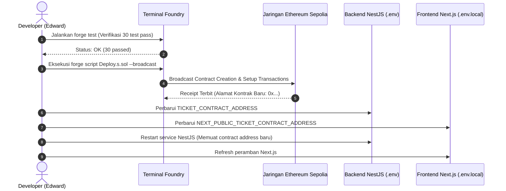

# Desain dan panduan operasional deployment smart contract Sepolia via Foundry broadcast

**Spesifikasi eksekusi script Deploy.s.sol, pembaruan alamat kontrak pada backend dan frontend, serta inisialisasi master data on-chain**

| Parameter | Deskripsi |
| :--- | :--- |
| **Status** | Spesifikasi operasional deployment final |
| **Penyusun** | Benedictus Leonardo Edward Stephen Sugianto (NRP: 160423176) |
| **Ruang lingkup** | Eksekusi skrip Foundry `Deploy.s.sol`, pembentukan transaksi contract creation di Sepolia Testnet, inisialisasi otomatis `systemSigner` dan data event, serta sinkronisasi alamat kontrak ke backend dan frontend |
| **Dokumen terkait** | [07-foundry-deployment-mechanism-and-scripting.md](file:///d:/STEVE/Project-TA-NFT-Marketplace/explanation/07-foundry-deployment-mechanism-and-scripting.md), [22-eip712-structured-data-signatures.md](file:///d:/STEVE/Project-TA-NFT-Marketplace/explanation/22-eip712-structured-data-signatures.md), [24-buyer-flow-behind-the-scene-midtrans-hooks.md](file:///d:/STEVE/Project-TA-NFT-Marketplace/explanation/24-buyer-flow-behind-the-scene-midtrans-hooks.md) |
| **Sasaran pembaca** | Mahasiswa penyusun, dosen pembimbing, dan tim penguji sidang tugas akhir |

---

## 1. Ringkasan eksekutif

Pembaruan logika smart contract memerlukan penerbitan ulang (*re-deployment*) bytecode ke jaringan Sepolia Testnet. Di ekosistem Ethereum, bytecode yang sudah masuk ke dalam blok bersifat kekal (*immutable*). Seluruh perubahan logika pada fungsi `mintTicket` (seperti integrasi verifikasi tanda tangan EIP-712 dan pengecekan kuota) baru akan aktif di blockchain publik setelah kontrak baru dideploy.

Deployment smart contract `TicketContract` dikerjakan menggunakan toolkit Foundry melalui berkas skrip [`contracts/script/Deploy.s.sol`](file:///d:/STEVE/Project-TA-NFT-Marketplace/contracts/script/Deploy.s.sol). Skrip ini mengeksekusi empat tahapan dalam satu alur siaran (*broadcast*):

1. Menerbitkan instance baru smart contract `TicketContract`.
2. Mendaftarkan alamat dompet admin backend sebagai `systemSigner` resmi untuk otorisasi EIP-712.
3. Mendaftarkan master data Event 1 dengan batas pembelian maksimal 2 tiket per dompet.
4. Mendaftarkan Kategori Tiket 1 dengan kuota 100 lembar dan harga dasar Rp 150.000.

Setelah proses siaran selesai di Sepolia, alamat kontrak baru yang terbentuk disalin ke berkas konfigurasi lingkungan [`backend/.env`](file:///d:/STEVE/Project-TA-NFT-Marketplace/backend/.env) dan [`frontend/.env.local`](file:///d:/STEVE/Project-TA-NFT-Marketplace/frontend/.env.local) agar seluruh subsistem membaca alamat yang seragam.

---

## 2. Sumber fakta dan acuan kode

Spesifikasi implementasi ini mengacu pada berkas repositori aktif berikut:

| Komponen | Berkas sumber | Lokasi baris | Perilaku terverifikasi |
| :--- | :--- | :--- | :--- |
| Skrip Deployment | [Deploy.s.sol](file:///d:/STEVE/Project-TA-NFT-Marketplace/contracts/script/Deploy.s.sol) | 8 - 40 | Pemanggilan `new TicketContract()`, `setSystemSigner`, `createEvent`, dan `addCategory` |
| Konfigurasi Kunci Kontrak | [contracts/.env](file:///d:/STEVE/Project-TA-NFT-Marketplace/contracts/.env) | 1 - 3 | Penyimpanan `SEPOLIA_RPC_URL` Alchemy dan `PRIVATE_KEY` deployer |
| Konfigurasi Backend | [backend/.env](file:///d:/STEVE/Project-TA-NFT-Marketplace/backend/.env) | 20 - 33 | Variabel `TICKET_CONTRACT_ADDRESS`, `ADMIN_WALLET_ADDRESS`, dan `ADMIN_PRIVATE_KEY` |
| Konfigurasi Frontend | [frontend/.env.local](file:///d:/STEVE/Project-TA-NFT-Marketplace/frontend/.env.local) | 9 - 14 | Variabel publik `NEXT_PUBLIC_TICKET_CONTRACT_ADDRESS` dan `NEXT_PUBLIC_ADMIN_WALLET_ADDRESS` |
| Smart Contract Inti | [TicketContract.sol](file:///d:/STEVE/Project-TA-NFT-Marketplace/contracts/src/TicketContract.sol) | 174 - 226 | Fungsi `mintTicket` dengan verifikasi EIP-712 dan pencatatan state tiket |

---

## 3. Tujuan dan batasan sistem

### 3.1 Tujuan
1. Menerbitkan bytecode terbaru smart contract `TicketContract` yang memuat fungsi `mintTicket` berstandar EIP-712 ke jaringan publik Sepolia.
2. Memastikan seluruh konfigurasi awal smart contract (`systemSigner`, inisialisasi Event 1, dan Kategori 1) terkonfigurasi pada blok yang sama saat deployment selesai.
3. Menghindari kesalahan manusia (*human error*) dalam pengaturan parameter kontrak dengan menggunakan skrip eksekusi deterministik.
4. Menyediakan prosedur audit verifikasi alamat baru untuk dihubungkan ke backend NestJS dan frontend Next.js.

### 3.2 Batasan (non-goals)
1. Tidak menggunakan antarmuka web pihak ketiga (seperti Remix IDE) yang rawan kesalahan koneksi dompet peramban.
2. Tidak melakukan migrasi data token lama (kontrak baru memulai pencatatan `_nextTokenId` dari angka 1).
3. Tidak menghapus riwayat transaksi kontrak lama di Sepolia (kontrak lama tetap ada di blockchain, tetapi diabaikan oleh backend).

---

## 4. Keputusan desain arsitektur

> **Why & What - Inisialisasi terintegrasi pada Deploy.s.sol**
>
> **What:** Menggabungkan deployment kontrak, konfigurasi `systemSigner`, pembuatan event, dan penetapan kategori dalam satu skrip siaran Foundry `Deploy.s.sol`.
>
> **Why:** Tanpa inisialisasi otomatis, kontrak baru berada dalam status nonaktif (`systemSigner` bernilai `0x0`). Jika ada transaksi pembelian masuk sebelum admin menjalankan transaksi konfigurasi susulan, seluruh transaksi minting akan ditolak dengan error `SystemSignerNotSet`. Penggabungan langkah ini menjamin kontrak siap pakai segera setelah blok deployment ditambang.
>
> **Alternatives considered:**
> - *Inisialisasi terpisah via script JavaScript pasca-deploy:* Ditolak karena menambah overhead perkakas baru dan membuka jeda waktu rawan (*race condition*) sebelum konfigurasi selesai.
>
> **Fallback:** Jika transaksi salah satu langkah revert di Sepolia, Foundry membatalkan siaran dan tidak ada gas fee lanjutan yang terbuang.

---

## 5. Prosedur operasional langkah demi langkah

Berikut tahapan eksekusi deployment dan integrasi sistem:



### Langkah 1: Pemeriksaan saldo dompet deployer
Pastikan dompet deployer (`0x8C2CF82F28567478eE12d2fDE1bF6E7304D1e0DA`) memiliki saldo gas fee SepoliaETH yang cukup (minimal 0.05 SepoliaETH). Saldo dapat dicek via Etherscan Sepolia (`https://sepolia.etherscan.io/address/0x8C2CF82F28567478eE12d2fDE1bF6E7304D1e0DA`).

### Langkah 2: Uji simulasi lokal (dry-run)
Sebelum membakar gas fee nyata, jalankan simulasi kering tanpa bendera `--broadcast` untuk memastikan seluruh baris kode di `Deploy.s.sol` tereksekusi tanpa revert:

```powershell
cd d:\STEVE\Project-TA-NFT-Marketplace\contracts
forge script script/Deploy.s.sol:DeployScript --rpc-url https://eth-sepolia.g.alchemy.com/v2/uLr2P86TqWknPAkOy_p0p -vvv
```

Jika simulasi menghasilkan laporan gas dan status berhasil, lanjutkan ke Langkah 3.

### Langkah 3: Eksekusi siaran fisik ke Sepolia
Jalankan perintah berikut di PowerShell untuk menandatangani dan menyiarkan transaksi secara on-chain:

```powershell
cd d:\STEVE\Project-TA-NFT-Marketplace\contracts
forge script script/Deploy.s.sol:DeployScript --rpc-url https://eth-sepolia.g.alchemy.com/v2/uLr2P86TqWknPAkOy_p0p --broadcast -vvvv
```

### Langkah 4: Pencatatan alamat kontrak baru
Perhatikan baris keluaran terminal. Cari teks yang berbunyi:
```text
== Logs ==
  Deploying TicketContract with deployer: 0x8C2CF82F28567478eE12d2fDE1bF6E7304D1e0DA
  TicketContract deployed at: 0x[ALAMAT_KONTRAK_BARU]
  System Signer set to: 0x8C2CF82F28567478eE12d2fDE1bF6E7304D1e0DA
  Event 1 created. Organizer: 0x8C2CF82F28567478eE12d2fDE1bF6E7304D1e0DA
  Category 1 added. Price: 150000 Quota: 100
```
Salin alamat hexadecimal 42-karakter setelah teks `TicketContract deployed at:`.

### Langkah 5: Sinkronisasi berkas lingkungan sistem

1. Buka berkas [`backend/.env`](file:///d:/STEVE/Project-TA-NFT-Marketplace/backend/.env) pada baris 21. Ganti nilainya dengan alamat baru:
   ```env
   TICKET_CONTRACT_ADDRESS=0x[ALAMAT_KONTRAK_BARU]
   ```
2. Buka berkas [`frontend/.env.local`](file:///d:/STEVE/Project-TA-NFT-Marketplace/frontend/.env.local) pada baris 10. Ganti nilainya dengan alamat baru:
   ```env
   NEXT_PUBLIC_TICKET_CONTRACT_ADDRESS=0x[ALAMAT_KONTRAK_BARU]
   ```

### Langkah 6: Muat ulang subsistem
1. Pada terminal backend, matikan server dengan tombol `Ctrl + C`, lalu jalankan kembali `npm run start:dev` agar modul `TicketsService` membaca alamat kontrak baru dari file `.env`.
2. Frontend Next.js membaca file `.env.local` saat kompilasi. Jika diperlukan, matikan terminal frontend dan jalankan kembali `npm run dev`.

---

## 6. Analisis penanganan kegagalan deployment

| Gejala kegagalan | Penyebab teknis | Tindakan pemulihan |
| :--- | :--- | :--- |
| `Server returned error: insufficient funds for gas * price + value` | Saldo SepoliaETH dompet deployer kurang dari batas minimum gas limit transaksi pembuatan kontrak. | Isi saldo SepoliaETH melalui faucet resmi (misal: Google Cloud Web3 Faucet atau Alchemy Sepolia Faucet). |
| `replacement transaction underpriced` | Transaksi sebelumnya dengan nonce yang sama masih tertahan di antrean mempool node RPC. | Tambahkan parameter `--legacy` atau tunggu 30 detik hingga transaksi sebelumnya masuk ke dalam blok. |
| `SystemSignerNotSet` saat minting tiket | Alamat kontrak di `.env` belum diperbarui sehingga backend masih memanggil kontrak lama yang belum diset signer-nya. | Ulangi Langkah 5 untuk memastikan alamat kontrak di `backend/.env` dan `frontend/.env.local` sama persis dengan keluaran log terminal. |
