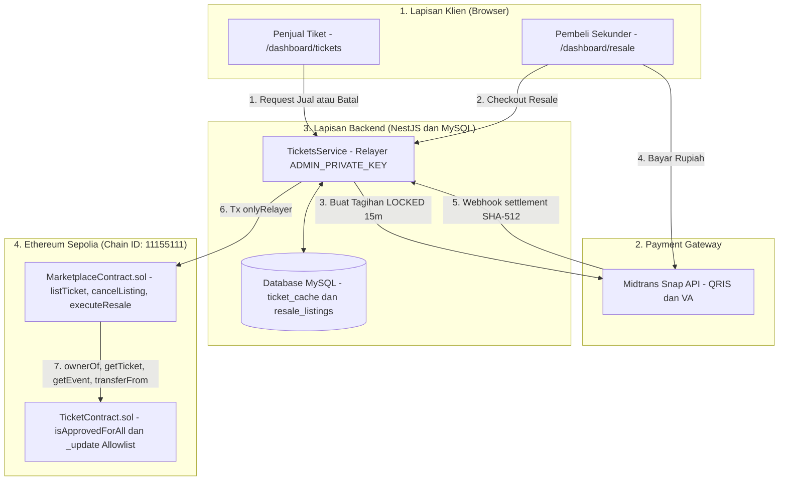
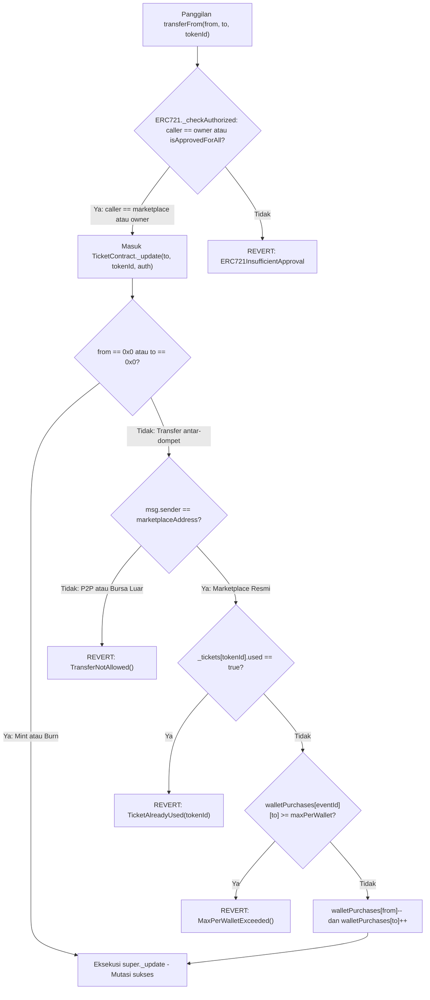
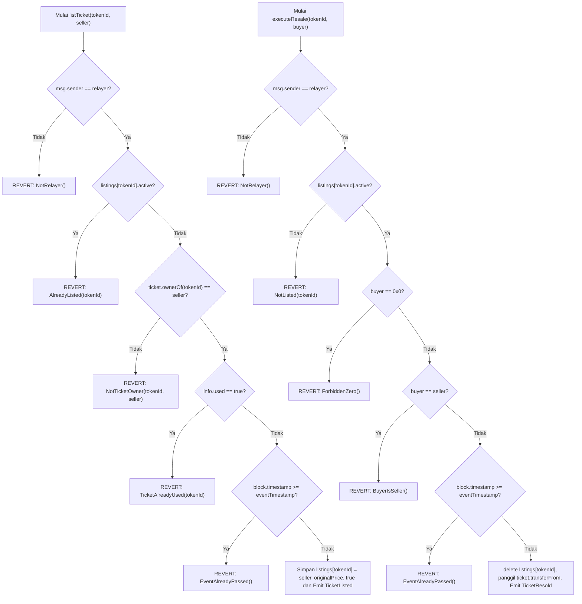
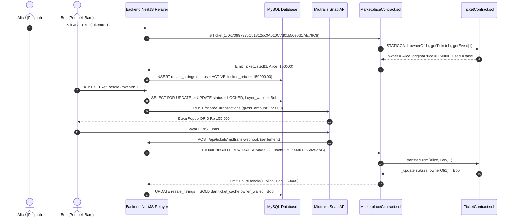

# Spesifikasi `MarketplaceContract.sol` & Allowlist Resale

**Pasar sekunder harga terkunci (`price == originalPrice`), gerbang transfer `_update`, zero-approval `isApprovedForAll`, ABI, dan jejak data penuh (no trim).**

| Parameter | Nilai |
| :--- | :--- |
| **Status** | Spesifikasi kontrak on-chain |
| **Penyusun** | Benedictus Leonardo Edward Stephen Sugianto (NRP: 160423176) |
| **Cakupan** | `MarketplaceContract.sol`, hook transfer `TicketContract.sol`, ABI, calldata 32-byte, integrasi relayer NestJS + Midtrans. Di luar cakupan: UI `/dashboard/resale` |
| **Terkait** | [06-smart-contract-fundamentals-and-mint-flow.md](file:///d:/STEVE/Project-TA-NFT-Marketplace/explanation/06-smart-contract-fundamentals-and-mint-flow.md), [08-evm-storage-capacity-and-multi-event-architecture.md](file:///d:/STEVE/Project-TA-NFT-Marketplace/explanation/08-evm-storage-capacity-and-multi-event-architecture.md), [21-midtrans-payment-gateway-integration.md](file:///d:/STEVE/Project-TA-NFT-Marketplace/explanation/21-midtrans-payment-gateway-integration.md), [24-buyer-flow-behind-the-scene-midtrans-hooks.md](file:///d:/STEVE/Project-TA-NFT-Marketplace/explanation/24-buyer-flow-behind-the-scene-midtrans-hooks.md) |

---

## 1. Inti keputusan

`MarketplaceContract.sol` satu-satunya pintu transfer NFT antar-user. Harga dikunci otomatis `price = originalPrice`. `TicketContract.sol` menolak semua `transferFrom` / `safeTransferFrom` selain dari `MarketplaceContract.sol` via `_update`, dan memberi izin operator otomatis via `isApprovedForAll` (penjual bebas gas `approve()`).

3 aturan inti:
1. **Zero-Markup Price Lock:** `listTicket(tokenId, seller)` tidak punya input harga. Harga diambil langsung dari `TicketContract.getTicket(tokenId).originalPrice`.
2. **Non-Escrow Listing:** Saat listing, NFT tetap di dompet penjual sampai pembeli baru lunas. Penjual tetap tidak bisa kirim NFT keluar karena diblokir `_update`. Hemat 1x gas transfer (~30.000 gas).
3. **Relayer Settlement (`onlyRelayer`):** Pembayaran pakai Rupiah (Midtrans Snap). Transaksi on-chain (`listTicket`, `cancelListing`, `executeResale`) dieksekusi wallet relayer backend NestJS (`ADMIN_PRIVATE_KEY`).

---

## 2. Peta kode

| Komponen | File | Baris | Status | Fakta kode |
| :--- | :--- | :--- | :--- | :--- |
| Kontrak pasar sekunder | [MarketplaceContract.sol](file:///d:/STEVE/Project-TA-NFT-Marketplace/contracts/src/MarketplaceContract.sol) | 1 - 110 | Aktif | Struct `Listing`, `onlyRelayer`, `listTicket`, `cancelListing`, `executeResale`, `setRelayer` |
| Setter allowlist | [TicketContract.sol](file:///d:/STEVE/Project-TA-NFT-Marketplace/contracts/src/TicketContract.sol) | 57, 186 - 192 | Aktif | State `marketplaceAddress` & `setMarketplace(address)` (`onlyOwner`) |
| Getter event | [TicketContract.sol](file:///d:/STEVE/Project-TA-NFT-Marketplace/contracts/src/TicketContract.sol) | 301 - 306 | Aktif | `getEvent(uint256)` untuk cek `eventTimestamp` |
| Zero-approval | [TicketContract.sol](file:///d:/STEVE/Project-TA-NFT-Marketplace/contracts/src/TicketContract.sol) | 309 - 319 | Aktif | `isApprovedForAll` return `true` jika `operator == marketplaceAddress` |
| Allowlist guard & kuota | [TicketContract.sol](file:///d:/STEVE/Project-TA-NFT-Marketplace/contracts/src/TicketContract.sol) | 322 - 345 | Aktif | `_update` tolak `msg.sender != marketplaceAddress`, tolak `used`, update `walletPurchases` |
| Wallet relayer | [tickets.service.ts](file:///d:/STEVE/Project-TA-NFT-Marketplace/backend/src/tickets/tickets.service.ts) | 37 - 60 | Aktif | `this.account` dari `ADMIN_PRIVATE_KEY` |
| Tabel DB resale | [README.md](file:///d:/STEVE/Project-TA-NFT-Marketplace/README.md) | 137 - 149 | Rancangan | `ticket_cache` & `resale_listings` (`ACTIVE`, `LOCKED`, `SOLD`, `CANCELLED`) |

---

## 3. Tujuan, batasan, Why & What

### 3.1 Tujuan
1. Blokir 100% transfer P2P atau bursa NFT luar di level EVM.
2. Tolak listing dan resale jika tiket sudah dipakai (`used == true`) atau acara lewat (`block.timestamp >= eventTimestamp`).
3. Hitung pembelian resale ke kuota `maxPerWallet`.

### 3.2 Batasan (non-goals)
1. Kontrak tidak simpan saldo Rupiah atau ETH.
2. Tidak ada lelang/tawar harga.
3. Tidak verifikasi signature P-256 on-chain (Smart Account user belum ter-deploy di Sepolia; verifikasi di backend).

### 3.3 Why & What

> **Why & What - Relayer (`onlyRelayer`) + Non-Escrow**
>
> **What:** Semua fungsi tulis di `MarketplaceContract.sol` dikunci `onlyRelayer` dan memindahkan NFT langsung dari penjual ke pembeli saat laku via `ticket.transferFrom(seller, buyer, tokenId)` tanpa titip NFT ke kontrak.
>
> **Why:** Smart Account ZeroDev user belum ter-deploy dan bersaldo 0 ETH. Kalau penjual panggil kontrak langsung atau wajib `approve()`, sistem harus deploy Smart Account (~250.000 gas) tiap listing. Pola non-escrow + `isApprovedForAll` otomatis memangkas proses jadi 1 transaksi relayer saat listing dan 1 transaksi saat laku. Risiko yang tidak diselesaikan: jika `ADMIN_PRIVATE_KEY` bocor, penyerang bisa panggil `listTicket` dan `executeResale`.
>
> **Alternatives considered:**
> - *Escrow NFT (kirim NFT ke kontrak saat `listTicket`):* Boros 2x gas transfer. Mubazir karena `_update` sudah mengunci NFT di dompet penjual.
> - *UserOperation langsung dari Smart Account penjual:* Bebas kepercayaan relayer saat listing, tapi wajib deploy akun Kernel ke Sepolia dan setup bundler/paymaster di klien.
> - *Listing hanya di MySQL:* Hemat gas listing, tapi hilang bukti audit on-chain (`TicketListed` & state `listings[tokenId]`).
>
> **Fallback:** Jika `ADMIN_PRIVATE_KEY` bocor, `owner` panggil `MarketplaceContract.setRelayer(newRelayer)` untuk rotasi kunci.

---

## 4. Diagram sistem dan flowchart

*(Setiap diagram disertai versi teks ASCII agar langsung terbaca di code editor tanpa preview, dan versi Mermaid untuk render grafis).*

### 4.1 Diagram arsitektur sistem (system design)

**Tampilan langsung (ASCII):**
```text
+-------------------------------------------------------------------------+
| LAPISAN KLIEN (Browser)                                                 |
|  [Penjual: /dashboard/tickets]        [Pembeli Baru: /dashboard/resale] |
+---------------+---------------------------------------+-----------------+
                | 1. Request Jual/Batal                 | 2. Checkout Resale
                v                                       v
+-------------------------------------------------------------------------+
| LAPISAN BACKEND (NestJS Relayer + MySQL)                                |
|  [Resale / TicketsService] <======> [(MySQL: ticket_cache & listings)]  |
|   Wallet EOA: ADMIN_PRIVATE_KEY                                         |
+---------------+---------------------------------------+-----------------+
                | 6. Tx Signed (onlyRelayer)            | 3. Buat Tagihan (LOCKED 15m)
                |                                       v
                |                        +--------------------------------+
                |                        | MIDTRANS SNAP API (QRIS / VA)  |
                |                        | 4. Pembeli bayar Rupiah        |
                |                        | 5. Kirim Webhook settlement    |
                |                        +--------------------------------+
                v
+-------------------------------------------------------------------------+
| ETHEREUM SEPOLIA (Chain ID: 11155111)                                   |
|                                                                         |
|  +----------------------------------+    7. STATICCALL: ownerOf,        |
|  | MarketplaceContract.sol          |       getTicket, getEvent         |
|  | - listings[tokenId]              |    8. CALL: transferFrom()        |
|  | - listTicket(tokenId, seller)    | ================================> |
|  | - cancelListing(tokenId)         |                                   |
|  | - executeResale(tokenId, buyer)  |    +---------------------------+  |
|  +----------------------------------+    | TicketContract.sol        |  |
|                                          | - _tickets[tokenId]       |  |
|                                          | - isApprovedForAll()      |  |
|                                          | - _update() Allowlist     |  |
|                                          +---------------------------+  |
+-------------------------------------------------------------------------+
```

**Mermaid:**


---

### 4.2 Flowchart gerbang `TicketContract._update` dan `isApprovedForAll`

**Tampilan langsung (ASCII):**
```text
          [ Panggilan transferFrom(from, to, tokenId) ]
                                |
                                v
      +---------------------------------------------------+
      | ERC721._checkAuthorized:                          |
      | caller == owner ATAU isApprovedForAll(owner,caller)|
      +-------------------------+-------------------------+
                                |
         +----------------------+----------------------+
         | caller == marketplaceAddress                | Bukan keduanya
         | (isApprovedForAll = true)                   v
         | ATAU caller == owner            [REVERT: ERC721InsufficientApproval]
         v
+---------------------------------------------------------+
| Masuk ke TicketContract._update(to, tokenId, auth)      |
+-------------------------+-------------------------------+
                          |
                          v
         +--------------------------------+
         | from == 0x0 ATAU to == 0x0 ?   |
         | (Apakah ini Mint atau Burn?)   |
         +-------+----------------+-------+
                 | Ya             | Tidak (Transfer antar-dompet)
                 |                v
                 |     +----------------------------------+
                 |     | msg.sender == marketplaceAddress?|
                 |     +----------+---------------+-------+
                 |                | Ya            | Tidak (Transfer P2P liar)
                 |                |               v
                 |                |     [REVERT: TransferNotAllowed()]
                 |                v
                 |     +----------------------------------+
                 |     | _tickets[tokenId].used == true ? |
                 |     +----------+---------------+-------+
                 |                | Tidak         | Ya
                 |                |               v
                 |                |     [REVERT: TicketAlreadyUsed(tokenId)]
                 |                v
                 |     +-------------------------------------------+
                 |     | walletPurchases[eventId][to] >= maxPerWallet|
                 |     +----------+---------------+----------------+
                 |                | Tidak         | Ya
                 |                |               v
                 |                |     [REVERT: MaxPerWalletExceeded()]
                 |                v
                 |     +-------------------------------------------+
                 |     | walletPurchases[eventId][from]--          |
                 |     | walletPurchases[eventId][to]++            |
                 |     +----------+--------------------------------+
                 |                |
                 v                v
      +---------------------------------------------------+
      | super._update(to, tokenId, auth) -> Transfer Sah  |
      +---------------------------------------------------+
```

**Mermaid:**


---

### 4.3 Flowchart fungsi `MarketplaceContract.sol`

**Tampilan langsung (ASCII):**
```text
ALUR A: listTicket(tokenId, seller)               ALUR B: executeResale(tokenId, buyer)
===================================               =====================================
[Mulai listTicket]                                [Mulai executeResale]
       |                                                 |
       v                                                 v
msg.sender == relayer? --Tidak--> [NotRelayer]    msg.sender == relayer? --Tidak--> [NotRelayer]
       | Ya                                              | Ya
       v                                                 v
listings[id].active? ---Ya-----> [AlreadyListed]  listings[id].active? --Tidak---> [NotListed]
       | Tidak                                           | Ya
       v                                                 v
ownerOf(id) == seller? -Tidak--> [NotTicketOwner] buyer == 0x0? ---------Ya------> [ForbiddenZero]
       | Ya                                              | Tidak
       v                                                 v
info.used == true? -----Ya-----> [TicketAlreadyUsed] buyer == seller? ---Ya------> [BuyerIsSeller]
       | Tidak                                           | Tidak
       v                                                 v
now >= eventTimestamp? -Ya-----> [EventAlreadyPassed] now >= eventTimestamp? -Ya-> [EventAlreadyPassed]
       | Tidak                                           | Tidak
       v                                                 v
Simpan listings[id] =                             1. delete listings[id] (CEI Pattern)
{seller, info.originalPrice, true}                2. ticket.transferFrom(seller, buyer, id)
Emit TicketListed                                 3. Emit TicketResold
```

**Mermaid:**


---

## 5. Katalog kontrak dan ABI

### 5.1 Konvensi
* **Chain:** Ethereum Sepolia (`chainId: 11155111`).
* **Compiler:** Solidity `^0.8.26` (Foundry `solc 0.8.36`, optimizer `200 runs`).
* **Hak akses tulis:** Semua mutasi resale wajib dari `relayer` (`onlyRelayer`). `setRelayer` wajib dari `owner` (`onlyOwner`).
* **Satuan `price`:** `uint96` Rupiah penuh tanpa sen (`150000` = Rp 150.000).

### 5.2 Tabel fungsi `MarketplaceContract.sol`
Source: [contracts/src/MarketplaceContract.sol](file:///d:/STEVE/Project-TA-NFT-Marketplace/contracts/src/MarketplaceContract.sol)

| Fungsi | Selector 4-byte | Visibilitas | Akses | Input | Output | Error Revert |
| :--- | :--- | :--- | :--- | :--- | :--- | :--- |
| `constructor` | `N/A` | `public` | Deployer | `(address ticketAddress, address relayerAddress)` | Bytecode | `ForbiddenZero` |
| `listTicket` | `0x53289b6e` | `external` | `onlyRelayer` | `(uint256 tokenId, address seller)` | `void` | `NotRelayer`, `AlreadyListed`, `NotTicketOwner`, `TicketNotFound`, `TicketAlreadyUsed`, `EventAlreadyPassed` |
| `cancelListing` | `0x305a67a8` | `external` | `onlyRelayer` | `(uint256 tokenId)` | `void` | `NotRelayer`, `NotListed` |
| `executeResale` | `0x1653c3b5` | `external` | `onlyRelayer` | `(uint256 tokenId, address buyer)` | `void` | `NotRelayer`, `NotListed`, `ForbiddenZero`, `BuyerIsSeller`, `EventAlreadyPassed`, `ERC721IncorrectOwner`, `TicketAlreadyUsed`, `MaxPerWalletExceeded` |
| `setRelayer` | `0x54fd4d50` | `external` | `onlyOwner` | `(address newRelayer)` | `void` | `OwnableUnauthorizedAccount`, `ForbiddenZero` |
| `listings` | Getter | `external view` | Publik | `(uint256 tokenId)` | `(address seller, uint96 price, bool active)` | - |
| `ticket` | Getter | `external view` | Publik | - | `address` | - |
| `relayer` | Getter | `external view` | Publik | - | `address` | - |

### 5.3 Semantik fungsi

* **`listTicket(uint256 tokenId, address seller)`:**
  * Panggil 3 `STATICCALL` ke `TicketContract`: `ownerOf(tokenId)`, `getTicket(tokenId)`, `getEvent(eventId)`.
  * Tulis `Listing({seller: seller, price: info.originalPrice, active: true})` ke `listings[tokenId]`.
  * Pancarkan `TicketListed(tokenId, seller, info.originalPrice)`.
  * Non-idempoten: panggilan ke-2 saat aktif melempar `AlreadyListed(tokenId)`.
* **`cancelListing(uint256 tokenId)`:**
  * Hapus `listings[tokenId]` (`seller = 0x0`, `price = 0`, `active = false`).
  * Pancarkan `ListingCancelled(tokenId, l.seller)`.
* **`executeResale(uint256 tokenId, address buyer)`:**
  * Hapus `listings[tokenId]` lebih dulu (pola CEI anti-reentrancy).
  * Panggil `ticket.transferFrom(l.seller, buyer, tokenId)`: memindahkan NFT, `walletPurchases[seller]--`, `walletPurchases[buyer]++`.
  * Pancarkan `Transfer` dan `TicketResold(tokenId, seller, buyer, l.price)`.
  * Kasus tepi: jika penjual scan masuk venue (`markUsed`) sesudah listing, `executeResale` gagal di `_update` dengan `TicketAlreadyUsed(tokenId)`.

### 5.4 Storage layout `struct Listing`
Source: [contracts/src/MarketplaceContract.sol:19-23](file:///d:/STEVE/Project-TA-NFT-Marketplace/contracts/src/MarketplaceContract.sol#L19-L23)

| Field | Tipe | Ukuran | Slot | Wajib | Arti |
| :--- | :--- | :--- | :--- | :--- | :--- |
| `seller` | `address` | 20 byte | Slot $p$, byte 0 - 19 | Ya | Dompet penjual |
| `price` | `uint96` | 12 byte | Slot $p$, byte 20 - 31 | Ya | Harga terkunci = `originalPrice` |
| `active` | `bool` | 1 byte | Slot $p+1$, byte 0 | Ya | `true` = sedang dijual |

### 5.5 Event Logs
Source: [contracts/src/MarketplaceContract.sol:29-41](file:///d:/STEVE/Project-TA-NFT-Marketplace/contracts/src/MarketplaceContract.sol#L29-L41)

| Event | Signature | Topic 1 (`indexed`) | Topic 2 (`indexed`) | Topic 3 (`indexed`) | Data |
| :--- | :--- | :--- | :--- | :--- | :--- |
| `RelayerUpdated` | `RelayerUpdated(address)` | `address relayer` | - | - | - |
| `TicketListed` | `TicketListed(uint256,address,uint96)` | `uint256 tokenId` | `address seller` | - | `uint96 price` |
| `ListingCancelled` | `ListingCancelled(uint256,address)` | `uint256 tokenId` | `address seller` | - | - |
| `TicketResold` | `TicketResold(uint256,address,address,uint96)` | `uint256 tokenId` | `address seller` | `address buyer` | `uint96 price` |

### 5.6 Custom Errors (EIP-838)
Source: [contracts/src/MarketplaceContract.sol:10-17](file:///d:/STEVE/Project-TA-NFT-Marketplace/contracts/src/MarketplaceContract.sol#L10-L17) & [contracts/src/TicketContract.sol:22-30](file:///d:/STEVE/Project-TA-NFT-Marketplace/contracts/src/TicketContract.sol#L22-L30)

| Error | Kontrak | Parameter | Pemicu |
| :--- | :--- | :--- | :--- |
| `NotRelayer()` | `MarketplaceContract` | - | `msg.sender != relayer` |
| `ForbiddenZero()` | Keduanya | - | Input alamat `0x0000000000000000000000000000000000000000` |
| `NotTicketOwner(uint256,address)` | `MarketplaceContract` | `(tokenId, seller)` | `ticket.ownerOf(tokenId) != seller` |
| `AlreadyListed(uint256)` | `MarketplaceContract` | `(tokenId)` | `listings[tokenId].active == true` saat `listTicket` |
| `NotListed(uint256)` | `MarketplaceContract` | `(tokenId)` | `listings[tokenId].active == false` saat batal/beli |
| `TicketAlreadyUsed(uint256)` | Keduanya | `(tokenId)` | `used == true` saat listing atau transfer |
| `EventAlreadyPassed()` | Keduanya | - | `block.timestamp >= eventTimestamp` |
| `BuyerIsSeller()` | `MarketplaceContract` | - | `buyer == l.seller` |
| `TransferNotAllowed()` | `TicketContract` | - | `msg.sender != marketplaceAddress` di `_update` |
| `MaxPerWalletExceeded()` | `TicketContract` | - | `walletPurchases[eventId][buyer] >= maxPerWallet` |

---

## 6. Alur end-to-end & contoh data lengkap (no trim)

### 6.1 Data skenario
* `eventId`: `1` (Konser Musik Kampus UBAYA 2026)
* `categoryId`: `1` (VIP, `price = 150000`, `quota = 100`, `maxPerWallet = 2`)
* `eventTimestamp`: `1796040000` (30 November 2026 12:00:00 UTC)
* `tokenId`: `1`
* `TicketContract.sol`: `0x08F9F8e90570A08851ca60419ae656FEF227c8a4`
* `MarketplaceContract.sol`: `0x9fE46736679d2D9a65F0992F2272dE9f3c7fa6e0`
* `relayer` (Admin EOA): `0xf39Fd6e51aad88F6F4ce6aB8827279cffFb92266`
* `Alice` (Penjual): `0x70997970C51812dc3A010C7d01b50e0d17dc79C8`
* `Bob` (Pembeli baru): `0x3C44CdDdB6a900fa2b585dd299e03d12FA4293BC`

### 6.2 Diagram sekuensial end-to-end

**Tampilan langsung (ASCII):**
```text
Alice (Penjual)      Bob (Pembeli)      Backend NestJS       MySQL DB        Midtrans         Marketplace      TicketContract
      |                    |                  |                 |               |                  |                 |
      |---1. Jual #1------>|                  |                 |               |                  |                 |
      |   (Konfirmasi)     |----------------->|                 |               |                  |                 |
      |                    |                  |--2. listTicket(1, Alice)-------------------------->|                 |
      |                    |                  |                 |               |                  |--3. ownerOf/get>|
      |                    |                  |<--4. Emit TicketListed(1, Alice, 150000)-----------|                 |
      |                    |                  |--5. INSERT ACTIVE-------------->|                  |                 |
      |                    |                  |                 |               |                  |                 |
      |                    |--6. Beli #1----->|                 |               |                  |                 |
      |                    |                  |--7. LOCKED 15m->|               |                  |                 |
      |                    |                  |--8. Create Snap Transaction---->|                  |                 |
      |                    |<--9. Snap Token--|                 |               |                  |                 |
      |                    |--10. Bayar QRIS Rp155.000------------------------->|                  |                 |
      |                    |                  |<--11. Webhook settlement--------|                  |                 |
      |                    |                  |--12. executeResale(1, Bob)------------------------>|                 |
      |                    |                  |                 |               |                  |--13. transfer-->|
      |                    |                  |<--14. Emit TicketResold(1, Alice, Bob, 150000)-----|                 |
      |                    |                  |--15. UPDATE SOLD & owner=Bob--->|                  |                 |
```

**Mermaid:**


---

### 6.3 Tahap 1: State awal (Alice pemilik Token #1)

**A. Storage `TicketContract.sol`:**
```json
{
  "_owners[1]": "0x70997970C51812dc3A010C7d01b50e0d17dc79C8",
  "_tickets[1]": {
    "eventId": "1",
    "categoryId": "1",
    "originalPrice": "150000",
    "used": false
  },
  "walletPurchases[1][0x70997970C51812dc3A010C7d01b50e0d17dc79C8]": 1,
  "walletPurchases[1][0x3C44CdDdB6a900fa2b585dd299e03d12FA4293BC]": 0
}
```

**B. Baris MySQL `ticket_cache`:**
```json
{
  "token_id": 1,
  "owner_wallet": "0x70997970C51812dc3A010C7d01b50e0d17dc79C8",
  "original_price": "150000.00",
  "used": 0,
  "synced_at": "2026-11-07T04:30:00.000Z",
  "events_id": 1,
  "orders_id": "a1b2c3d4-e5f6-4a7b-8c9d-0e1f2a3b4c5d"
}
```

---

### 6.4 Tahap 2: Alice daftar jual (`listTicket`)

**A. Request HTTP ke backend (`POST /api/tickets/resale/list`):**
```json
{
  "tokenId": 1,
  "sellerWallet": "0x70997970C51812dc3A010C7d01b50e0d17dc79C8"
}
```

**B. Calldata mentah (raw hex penuh) ke `MarketplaceContract.listTicket`:**
* Selector `listTicket(uint256,address)`: `0x53289b6e`
* Arg 1 (`tokenId = 1`): `0000000000000000000000000000000000000000000000000000000000000001`
* Arg 2 (`seller = Alice`): `00000000000000000000000070997970c51812dc3a010c7d01b50e0d17dc79c8`
```text
0x53289b6e000000000000000000000000000000000000000000000000000000000000000100000000000000000000000070997970c51812dc3a010c7d01b50e0d17dc79c8
```

**C. Event log `TicketListed` di Sepolia (`0x249f0` = `150000`):**
```json
{
  "address": "0x9fE46736679d2D9a65F0992F2272dE9f3c7fa6e0",
  "topics": [
    "0x8bcf9b0e0470b5c770198229d47c85c5106502a6021e9c2f5a905121f7b0b41d",
    "0x0000000000000000000000000000000000000000000000000000000000000001",
    "0x00000000000000000000000070997970c51812dc3a010c7d01b50e0d17dc79c8"
  ],
  "data": "0x00000000000000000000000000000000000000000000000000000000000249f0"
}
```

**D. State `MarketplaceContract.listings[1]`:**
```json
{
  "seller": "0x70997970C51812dc3A010C7d01b50e0d17dc79C8",
  "price": "150000",
  "active": true
}
```

**E. Baris MySQL `resale_listings` (`ACTIVE`):**
```json
{
  "id": "f47ac10b-58cc-4372-a567-0e02b2c3d479",
  "seller_wallet": "0x70997970C51812dc3A010C7d01b50e0d17dc79C8",
  "locked_price": "150000.00",
  "status": "ACTIVE",
  "listed_at": "2026-11-07T05:00:12.000Z",
  "ticket_cache_token_id": 1,
  "buyer_wallet": null,
  "admin_fee": "5000.00",
  "buyer_midtrans_transaction_id": null
}
```

---

### 6.5 Tahap 3: Bob kunci listing & buat tagihan Midtrans (`LOCKED`)

**A. Request ke Midtrans (`POST https://app.sandbox.midtrans.com/snap/v1/transactions`):**
```json
{
  "transaction_details": {
    "order_id": "RESALE-1-1762491900000-K9P2M",
    "gross_amount": 155000
  },
  "item_details": [
    {
      "id": "TICKET-TOKEN-1",
      "price": 150000,
      "quantity": 1,
      "name": "Resale Tiket VIP - Konser Musik Kampus UBAYA (Token #1)"
    },
    {
      "id": "ADMIN-FEE-GASLESS",
      "price": 5000,
      "quantity": 1,
      "name": "Biaya Layanan & Subsidi Gas Blockchain"
    }
  ],
  "customer_details": {
    "first_name": "Bob",
    "email": "bob@student.ubaya.ac.id"
  }
}
```

**B. Baris MySQL `resale_listings` (`LOCKED` 15 menit):**
```json
{
  "id": "f47ac10b-58cc-4372-a567-0e02b2c3d479",
  "seller_wallet": "0x70997970C51812dc3A010C7d01b50e0d17dc79C8",
  "locked_price": "150000.00",
  "status": "LOCKED",
  "listed_at": "2026-11-07T05:00:12.000Z",
  "ticket_cache_token_id": 1,
  "buyer_wallet": "0x3C44CdDdB6a900fa2b585dd299e03d12FA4293BC",
  "admin_fee": "5000.00",
  "buyer_midtrans_transaction_id": "RESALE-1-1762491900000-K9P2M"
}
```

---

### 6.6 Tahap 4: Webhook Midtrans `settlement` & `executeResale`

**A. Payload Webhook Midtrans ke `POST /api/tickets/midtrans-webhook`:**
* Formula SHA-512: `"RESALE-1-1762491900000-K9P2M" + "200" + "155000.00" + "SB-Mid-server-TESTKEY1234567890"`
```json
{
  "transaction_time": "2026-11-07 12:06:00",
  "transaction_status": "settlement",
  "transaction_id": "9f8e7d6c-5b4a-3f2e-1d0c-9b8a7f6e5d4c",
  "status_message": "midtrans payment notification",
  "status_code": "200",
  "signature_key": "c3ab8ff13720e8ad9047dd39466b3c8974e592c2fa383d4a3960714caef0c4f27a9eb2219c22801e565d735b1d56c47775f18d0d08a661e1a036c6e1b2f1d8c5",
  "settlement_time": "2026-11-07 12:06:05",
  "payment_type": "qris",
  "order_id": "RESALE-1-1762491900000-K9P2M",
  "merchant_id": "G123456789",
  "gross_amount": "155000.00",
  "fraud_status": "accept",
  "currency": "IDR"
}
```

**B. Calldata mentah (raw hex penuh) ke `MarketplaceContract.executeResale`:**
* Selector `executeResale(uint256,address)`: `0x1653c3b5`
* Arg 1 (`tokenId = 1`): `0000000000000000000000000000000000000000000000000000000000000001`
* Arg 2 (`buyer = Bob`): `0000000000000000000000003c44cdddb6a900fa2b585dd299e03d12fa4293bc`
```text
0x1653c3b500000000000000000000000000000000000000000000000000000000000000010000000000000000000000003c44cdddb6a900fa2b585dd299e03d12fa4293bc
```

**C. Calldata internal `MarketplaceContract` ke `TicketContract.transferFrom(Alice, Bob, 1)`:**
* Selector `transferFrom(address,address,uint256)`: `0x23b872dd`
```text
0x23b872dd00000000000000000000000070997970c51812dc3a010c7d01b50e0d17dc79c80000000000000000000000003c44cdddb6a900fa2b585dd299e03d12fa4293bc0000000000000000000000000000000000000000000000000000000000000001
```

**D. Event log `TicketResold` di Sepolia:**
```json
{
  "address": "0x9fE46736679d2D9a65F0992F2272dE9f3c7fa6e0",
  "topics": [
    "0x4e7c85c5106502a6021e9c2f5a905121f7b0b41d8bcf9b0e0470b5c770198229",
    "0x0000000000000000000000000000000000000000000000000000000000000001",
    "0x00000000000000000000000070997970c51812dc3a010c7d01b50e0d17dc79c8",
    "0x0000000000000000000000003c44cdddb6a900fa2b585dd299e03d12fa4293bc"
  ],
  "data": "0x00000000000000000000000000000000000000000000000000000000000249f0"
}
```

**E. State akhir on-chain & MySQL:**
1. `MarketplaceContract.listings[1]` (sesudah `delete`):
```json
{
  "seller": "0x0000000000000000000000000000000000000000",
  "price": "0",
  "active": false
}
```
2. `TicketContract.sol`:
```json
{
  "_owners[1]": "0x3C44CdDdB6a900fa2b585dd299e03d12FA4293BC",
  "_tickets[1]": {
    "eventId": "1",
    "categoryId": "1",
    "originalPrice": "150000",
    "used": false
  },
  "walletPurchases[1][0x70997970C51812dc3A010C7d01b50e0d17dc79C8]": 0,
  "walletPurchases[1][0x3C44CdDdB6a900fa2b585dd299e03d12FA4293BC]": 1
}
```
3. MySQL `resale_listings` & `ticket_cache`:
```json
{
  "resale_listings": {
    "id": "f47ac10b-58cc-4372-a567-0e02b2c3d479",
    "seller_wallet": "0x70997970C51812dc3A010C7d01b50e0d17dc79C8",
    "locked_price": "150000.00",
    "status": "SOLD",
    "listed_at": "2026-11-07T05:00:12.000Z",
    "ticket_cache_token_id": 1,
    "buyer_wallet": "0x3C44CdDdB6a900fa2b585dd299e03d12FA4293BC",
    "admin_fee": "5000.00",
    "buyer_midtrans_transaction_id": "9f8e7d6c-5b4a-3f2e-1d0c-9b8a7f6e5d4c"
  },
  "ticket_cache": {
    "token_id": 1,
    "owner_wallet": "0x3C44CdDdB6a900fa2b585dd299e03d12FA4293BC",
    "original_price": "150000.00",
    "used": 0,
    "synced_at": "2026-11-07T05:06:18.000Z",
    "events_id": 1,
    "orders_id": "a1b2c3d4-e5f6-4a7b-8c9d-0e1f2a3b4c5d"
  }
}
```

---

### 6.7 Tahap 5: Bukti revert transfer P2P liar (`TransferNotAllowed`)

Bob coba kirim Token `#1` langsung ke `0x90F79bf6EB2c4f870365E785982E1f101E93b906`:
* Calldata `TicketContract.transferFrom(Bob, Teman, 1)`:
```text
0x23b872dd0000000000000000000000003c44cdddb6a900fa2b585dd299e03d12fa4293bc00000000000000000000000090f79bf6eb2c4f870365e785982e1f101e93b9060000000000000000000000000000000000000000000000000000000000000001
```
* Cek di `_update`: `msg.sender` (`Bob`) $\neq$ `marketplaceAddress`.
* Output Revert (`keccak256("TransferNotAllowed()")[0:4]`):
```text
0x4bd63839
```

---

## 7. Untung, biaya, larangan

* **Untung:**
  1. Bursa luar (OpenSea/Blur) dan transfer P2P mati total di `_update`.
  2. Bukti harga jujur (`price == originalPrice`) tercatat publik di event `TicketResold`.
  3. Batal jual (`cancelListing`) hemat 50% gas karena tanpa transfer balik NFT.
* **Biaya:**
  1. Butuh relayer NestJS hidup dan saldo ETH di `ADMIN_PRIVATE_KEY`.
  2. Update `walletPurchases` di `_update` menambah ~5.000 - 22.100 gas saat resale.
* **Larangan (what not to do):**
  1. Jangan tambah parameter `price` di `listTicket`.
  2. Jangan ganti `transferFrom` jadi `safeTransferFrom` di `executeResale` (Smart Account pembeli bisa gagal terima jika tanpa `IERC721Receiver`).
  3. Pencairan uang Rupiah ke rekening penjual lama (`Alice`) wajib diproses off-chain sesudah event `TicketResold` sukses.

---

## 8. Pemetaan `struct` Solidity (On-Chain) vs Skema ERD MySQL (Off-Chain)

Arsitektur proyek menggunakan **Hybrid On-Chain / Off-Chain** sesuai ERD resmi `design/erd-nft-revisi-24-8.png`:
* **Entity TypeORM di Backend NestJS (Off-Chain MySQL):** Wajib **100% sama persis** per kolom dan tipe data dengan tabel ERD (`resale_listings`, `ticket_cache`, `events`, `ticket_categories`, `orders`).
* **`struct` di Smart Contract (On-Chain EVM):** Sengaja diperkecil hanya untuk field yang **wajib divalidasi oleh aturan keamanan blockchain** (kepemilikan NFT, kunci harga `originalPrice`, kuota `maxPerWallet`, status check-in `used`, dan waktu acara).

### 8.1 Alasan Teknis `struct` Solidity Tidak Menyalin Semua Kolom ERD

1. **Biaya Gas Storage EVM (`SSTORE` = 20.000 gas per slot 32-byte):**
   * Di `MarketplaceContract.sol`, `address seller` (20 byte) + `uint96 price` (12 byte) = **32 byte pas (1 slot storage)**, ditambah `bool active`.
   * Menyimpan string seperti UUID (`id CHAR(36)`), `buyer_midtrans_transaction_id VARCHAR(100)`, atau `venue_location VARCHAR(255)` di dalam `struct` Solidity memakan 4–6 slot storage tambahan (biaya gas bengkak **3x–5x lipat**) tanpa manfaat keamanan on-chain.
2. **Pemisahan Validasi Konsensus vs Operasional Pembayaran Fiat:**
   * EVM tidak memverifikasi ID transaksi Midtrans Rupiah atau biaya admin platform (`admin_fee`).
   * EVM hanya memvalidasi aturan anti-calo: harga jual = `originalPrice`, kuota `walletPurchases <= maxPerWallet`, tiket belum `used`, dan acara belum lewat (`block.timestamp < eventTimestamp`).
3. **Fungsi Tabel `ticket_cache` di ERD:**
   * Tabel `ticket_cache` (dengan kolom `synced_at DATETIME`) adalah **cermin baca cepat (off-chain cache)** dari state `TicketContract` (`_tickets` + `ownerOf`) agar dashboard web tidak lambat memanggil RPC Sepolia berulang-ulang.

### 8.2 Tabel Perbandingan: `resale_listings` (ERD) vs `struct Listing` (`MarketplaceContract.sol`)

| Kolom di ERD `resale_listings` | Di `MarketplaceContract.sol` | Alasan Desain |
| :--- | :--- | :--- |
| `id CHAR(36)` (PK UUID) | Tidak pakai UUID | Di MySQL perlu UUID karena 1 tiket bisa dijual berkali-kali (menyimpan histori). Di kontrak cukup `mapping(uint256 => Listing)` dengan key `tokenId` untuk listing aktif saat ini; histori tercatat di event log `TicketListed` & `TicketResold`. |
| `ticket_cache_token_id INT(11)` | Key mapping `uint256 tokenId` | Langsung menjadi kunci pencarian `listings[tokenId]`. |
| `seller_wallet CHAR(42)` | `address seller` | **Wajib on-chain** sebagai alamat asal saat `safeTransferFrom(seller, buyer, tokenId)`. |
| `locked_price DECIMAL(12,2)` | `uint96 price` | **Wajib on-chain** untuk memaksa harga jual = `originalPrice` (anti-calo). |
| `status ENUM('ACTIVE','LOCKED','SOLD','CANCELLED')` | `bool active` | On-chain hanya perlu tahu terdaftar (`true`) atau tidak (`false`). Status `LOCKED` (tahan 15 menit saat pembeli membuka popup Midtrans) murni dikelola di MySQL. |
| `buyer_wallet CHAR(42)` | Parameter `executeResale(..., buyer)` | Saat laku, `buyer` langsung tercatat sebagai `ownerOf(tokenId)` di ERC-721 dan di-emit ke event `TicketResold`. |
| `listed_at DATETIME` | Event block timestamp | Waktu pendaftaran disimpan di MySQL dan metadata blok event `TicketListed`. |
| `admin_fee DECIMAL(12,2)` | Hanya di MySQL | Biaya layanan Rupiah dikelola oleh backend off-chain. |
| `buyer_midtrans_transaction_id VARCHAR(100)` | Hanya di MySQL | ID transaksi pembayaran QRIS/VA Midtrans off-chain. |

### 8.3 Tabel Perbandingan: `ticket_cache` (ERD) vs `struct TicketInfo` (`TicketContract.sol`)

| Kolom di ERD `ticket_cache` | Di `TicketContract.sol` | Alasan Desain |
| :--- | :--- | :--- |
| `token_id INT` (PK) | Key mapping `_tickets[tokenId]` | ID token ERC-721. |
| `owner_wallet VARCHAR(42)` | `ERC721.ownerOf(tokenId)` | Disimpan otomatis oleh mapping `_owners` bawaan OpenZeppelin `ERC721`. |
| `original_price DECIMAL(12,2)` | `uint96 originalPrice` | Dikunci permanen saat minting sebagai patokan harga resale. |
| `used TINYINT` | `bool used` | Status check-in di pintu masuk venue. |
| `events_id INT` | `uint256 eventId` | Menghubungkan tiket ke event-nya. |
| `orders_id CHAR(36)`, `synced_at DATETIME` | Hanya di MySQL | Relasi ke tabel `orders` Midtrans & waktu sinkronisasi cache DB. |

### 8.4 Tabel Perbandingan: `events` (ERD) vs `struct EventInfo` (`TicketContract.sol`)

| Kolom di ERD `events` | Di `TicketContract.sol` | Alasan Desain |
| :--- | :--- | :--- |
| `on_chain_event_id BIGINT` | Key mapping `events[eventId]` | Kunci event di smart contract. |
| `organizers_id INT` | `address organizer` | Alamat wallet penyelenggara yang berhak mengelola event on-chain. |
| `start_date DATETIME` | `uint64 eventTimestamp` | Batas waktu validasi minting, resale, dan check-in. |
| *(Aturan Anti-Calo & Flash Sale)* | `uint32 maxPerWallet`, `bool salesOpen`, `uint64 saleStartTime` | Parameter kontrol penjualan on-chain (kuota per dompet, buka/tutup penjualan, dan jadwal Flash Sale KF-60). |
| `event_name`, `venue_location`, `category`, `capacity`, `image_ipfs_cid` | Hanya di MySQL | Metadata deskriptif dan gambar poster disimpan di MySQL/IPFS untuk efisiensi gas. |

---

## 9. Handoff & Panduan Lanjutan (Fase 1D ke Fase 2)

### 9.1 Status Saat Ini (Selesai Dikerjakan)
1. `contracts/src/TicketContract.sol`: **Selesai 100%** (sudah termasuk `TransferNotAllowed`, `SalesNotStarted`, `InvalidSaleStartTime`, `saleStartTime`, `SaleStartTimeSet`, `setSaleStartTime`, `getEvent`, `isApprovedForAll`, dan `_update`).
2. `contracts/src/MarketplaceContract.sol`: **Selesai 100%** (`listTicket`, `cancelListing`, `executeResale`, `setRelayer`).

### 9.2 Langkah 1 Berikutnya: Unit Test Foundry (`contracts/test/MarketplaceContract.t.sol`)
Buat file baru `contracts/test/MarketplaceContract.t.sol` dengan kode berikut, lalu jalankan `cd contracts && forge test -vv`:

```solidity
// SPDX-License-Identifier: MIT
pragma solidity ^0.8.26;

import {Test} from "forge-std/Test.sol";
import {TicketContract} from "../src/TicketContract.sol";
import {MarketplaceContract} from "../src/MarketplaceContract.sol";

contract MarketplaceContractTest is Test {
    TicketContract public ticket;
    MarketplaceContract public market;

    uint256 internal signerPrivateKey = 0xA11CE;
    address internal systemSigner;

    address internal owner = address(this);
    address internal organizer = address(0x100);
    address internal relayer = address(0x200);
    address internal alice = address(0x300);
    address internal bob = address(0x400);
    address internal charlie = address(0x500);

    uint256 internal constant EVENT_ID = 1;
    uint256 internal constant CAT_ID = 1;
    uint96 internal constant ORIGINAL_PRICE = 150_000;
    uint64 internal futureTimestamp;

    bytes32 private constant DOMAIN_TYPEHASH =
        keccak256("EIP712Domain(string name,string version,uint256 chainId,address verifyingContract)");
    bytes32 private constant MINT_TYPEHASH =
        keccak256("MintAuth(address to,uint256 eventId,uint256 categoryId,uint256 nonce)");

    function setUp() public {
        systemSigner = vm.addr(signerPrivateKey);
        futureTimestamp = uint64(block.timestamp + 7 days);

        ticket = new TicketContract();
        market = new MarketplaceContract(address(ticket), relayer);

        ticket.setSystemSigner(systemSigner);
        ticket.setMarketplace(address(market));

        ticket.createEvent(EVENT_ID, organizer, futureTimestamp, 2);
        vm.prank(organizer);
        ticket.createCategory(EVENT_ID, CAT_ID, ORIGINAL_PRICE, 100);
    }

    function _signMint(address to, uint256 eventId, uint256 categoryId, uint256 nonce) internal view returns (bytes memory) {
        bytes32 domainSeparator = keccak256(
            abi.encode(
                DOMAIN_TYPEHASH,
                keccak256(bytes("EventTicketNFT")),
                keccak256(bytes("1")),
                block.chainid,
                address(ticket)
            )
        );
        bytes32 structHash = keccak256(abi.encode(MINT_TYPEHASH, to, eventId, categoryId, nonce));
        bytes32 digest = keccak256(abi.encodePacked("\x19\x01", domainSeparator, structHash));
        (uint8 v, bytes32 r, bytes32 s) = vm.sign(signerPrivateKey, digest);
        return abi.encodePacked(r, s, v);
    }

    function _mintTo(address buyer, uint256 nonce) internal returns (uint256) {
        bytes memory sig = _signMint(buyer, EVENT_ID, CAT_ID, nonce);
        return ticket.mintTicket(buyer, EVENT_ID, CAT_ID, nonce, sig);
    }

    function test_DirectTransferBlocked_OutsideMarketplace() public {
        uint256 tokenId = _mintTo(alice, 1);
        vm.prank(alice);
        vm.expectRevert(TicketContract.TransferNotAllowed.selector);
        ticket.transferFrom(alice, bob, tokenId);
    }

    function test_IsApprovedForAll_AutoTrueForMarketplace() public view {
        assertTrue(ticket.isApprovedForAll(alice, address(market)));
        assertFalse(ticket.isApprovedForAll(alice, bob));
    }

    function test_ListTicket_LocksOriginalPrice() public {
        uint256 tokenId = _mintTo(alice, 1);

        vm.prank(relayer);
        market.listTicket(tokenId, alice);

        (address seller, uint96 price, bool active) = market.listings(tokenId);
        assertEq(seller, alice);
        assertEq(price, ORIGINAL_PRICE);
        assertTrue(active);
    }

    function test_ListTicket_RevertIfNotRelayer() public {
        uint256 tokenId = _mintTo(alice, 1);
        vm.prank(alice);
        vm.expectRevert(MarketplaceContract.NotRelayer.selector);
        market.listTicket(tokenId, alice);
    }

    function test_ListTicket_RevertIfNotTicketOwner() public {
        uint256 tokenId = _mintTo(alice, 1);
        vm.prank(relayer);
        vm.expectRevert(abi.encodeWithSelector(MarketplaceContract.NotTicketOwner.selector, tokenId, bob));
        market.listTicket(tokenId, bob);
    }

    function test_ListTicket_RevertIfEventPassed() public {
        uint256 tokenId = _mintTo(alice, 1);
        vm.warp(futureTimestamp + 1);
        vm.prank(relayer);
        vm.expectRevert(MarketplaceContract.EventAlreadyPassed.selector);
        market.listTicket(tokenId, alice);
    }

    function test_ExecuteResale_SuccessAndUpdatesWalletPurchases() public {
        uint256 tokenId = _mintTo(alice, 1);
        assertEq(ticket.getWalletPurchases(EVENT_ID, alice), 1);
        assertEq(ticket.getWalletPurchases(EVENT_ID, bob), 0);

        vm.prank(relayer);
        market.listTicket(tokenId, alice);

        vm.prank(relayer);
        market.executeResale(tokenId, bob);

        assertEq(ticket.ownerOf(tokenId), bob);
        assertEq(ticket.getWalletPurchases(EVENT_ID, alice), 0);
        assertEq(ticket.getWalletPurchases(EVENT_ID, bob), 1);

        (, , bool active) = market.listings(tokenId);
        assertFalse(active);
    }

    function test_ExecuteResale_RevertIfUsedDuringListing() public {
        uint256 tokenId = _mintTo(alice, 1);
        vm.prank(relayer);
        market.listTicket(tokenId, alice);

        vm.prank(organizer);
        ticket.useTicket(tokenId);

        vm.prank(relayer);
        vm.expectRevert(abi.encodeWithSelector(MarketplaceContract.TicketAlreadyUsed.selector, tokenId));
        market.executeResale(tokenId, bob);
    }

    function test_ExecuteResale_RevertIfBuyerExceedsMaxPerWallet() public {
        uint256 token1 = _mintTo(alice, 1);
        _mintTo(bob, 2);
        _mintTo(bob, 3); // Bob sudah punya 2 tiket (batas maxPerWallet = 2)

        vm.prank(relayer);
        market.listTicket(token1, alice);

        vm.prank(relayer);
        vm.expectRevert(TicketContract.MaxPerWalletExceeded.selector);
        market.executeResale(token1, bob);
    }

    function test_CancelListing_Success() public {
        uint256 tokenId = _mintTo(alice, 1);
        vm.prank(relayer);
        market.listTicket(tokenId, alice);

        vm.prank(relayer);
        market.cancelListing(tokenId, alice);

        vm.prank(relayer);
        vm.expectRevert(abi.encodeWithSelector(MarketplaceContract.NotListed.selector, tokenId));
        market.executeResale(tokenId, charlie);
    }

    function test_Mint_RevertIfSaleNotStarted() public {
        uint64 startTime = uint64(block.timestamp + 1 hours);
        vm.prank(organizer);
        ticket.setSaleStartTime(EVENT_ID, startTime);

        bytes memory sig = _signMint(alice, EVENT_ID, CAT_ID, 99);
        vm.expectRevert(abi.encodeWithSelector(TicketContract.SalesNotStarted.selector, startTime));
        ticket.mintTicket(alice, EVENT_ID, CAT_ID, 99, sig);

        vm.warp(startTime);
        uint256 tokenId = ticket.mintTicket(alice, EVENT_ID, CAT_ID, 99, sig);
        assertEq(ticket.ownerOf(tokenId), alice);
    }
}
```

### 9.3 Langkah 2 Berikutnya: Update Script Deploy (`Deploy.s.sol` & `deploy-contract.ts`)
1. `contracts/script/Deploy.s.sol`: Deploy `MarketplaceContract(address(ticket), deployer)` dan panggil `ticket.setMarketplace(address(market))`.
2. `backend/src/database/seeds/deploy-contract.ts`: Deploy `MarketplaceContract` sesudah `TicketContract`, panggil `setMarketplace`, dan cetak `MARKETPLACE_CONTRACT_ADDRESS`.

### 9.4 Langkah 3 Berikutnya: Fase 2 (Backend & Frontend Resale)
1. Buat entity TypeORM `backend/src/tickets/entities/ticket-cache.entity.ts` (`ticket_cache`) dan `backend/src/tickets/entities/resale-listing.entity.ts` (`resale_listings`) persis sesuai ERD `design/erd-nft-revisi-24-8.png`.
2. Tambah `backend/src/tickets/marketplace-abi.ts` dan integrasikan endpoint resale (`POST /api/tickets/resale/list`, `POST /api/tickets/resale/cancel`, `POST /api/tickets/resale/buy`, `GET /api/tickets/resale`, serta cabang `RESALE-` di `handleMidtransWebhook`) di `backend/src/tickets/tickets.service.ts` & `tickets.controller.ts`.
3. Tambah tombol **"Jual Tiket Resmi"** di `frontend/src/app/dashboard/tickets/TicketCard.tsx` dan halaman katalog `/dashboard/resale`.

