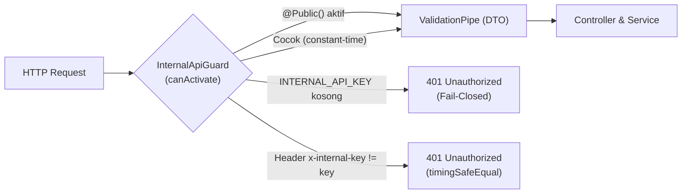

# Desain dan spesifikasi teknis batas kepercayaan backend (`InternalApiGuard`)

**Isolasi gerbang API NestJS dari akses langsung klien publik menggunakan shared secret server-to-server**

| | |
|---|---|
| **Status** | Terimplementasi di `backend/src/common/internal-api-guard.ts` |
| **Owner** | Backend & Security Architecture (NFTix TA) |
| **Scope** | Seluruh controller NestJS (`AuthController`, `EventsController`, `TicketsController`), kecuali `@Public()` pada `midtrans-webhook` |
| **Related** | [05-fullstack-auth-architecture-and-troubleshooting.md](file:///d:/STEVE/Project-TA-NFT-Marketplace/explanation/05-fullstack-auth-architecture-and-troubleshooting.md), [21-midtrans-payment-gateway-integration.md](file:///d:/STEVE/Project-TA-NFT-Marketplace/explanation/21-midtrans-payment-gateway-integration.md), [23-flash-sale-architecture-and-backend-security-audit.md](file:///d:/STEVE/Project-TA-NFT-Marketplace/explanation/23-flash-sale-architecture-and-backend-security-audit.md) |
| **Audience** | Tim pengembang, reviewer keamanan, dan penguji sidang Tugas Akhir |

---

## 1. Summary

Pemisahan **Next.js (`frontend/`)** dan **NestJS (`backend/`)** menciptakan batas fisik agar `RELAYER_PRIVATE_KEY`, `MIDTRANS_SERVER_KEY`, dan koneksi MySQL tidak pernah berada di proses peramban atau server UI. Namun tanpa guard otorisasi di tingkat API, penyerang dapat mem-bypass antarmuka Next.js dan menembak endpoint NestJS secara langsung (misalnya memalsukan parameter `?userId=`).

Solusi yang diterapkan adalah **`InternalApiGuard`** ([internal-api-guard.ts](file:///d:/STEVE/Project-TA-NFT-Marketplace/backend/src/common/internal-api-guard.ts)) pada seluruh controller utama dengan perilaku **fail-closed**, dikecualikan hanya untuk rute `@Public()` pada `POST /api/tickets/midtrans-webhook` yang diverifikasi secara independen melalui tanda tangan SHA-512 Midtrans.

---

## 2. Alur Eksekusi dan Siklus Permintaan NestJS

`InternalApiGuard` mengimplementasikan antarmuka `CanActivate`, sehingga NestJS mengeksekusinya **sebelum** `ValidationPipe` (DTO) dan handler Controller.

### Titik Pemasangan di Codebase

| Berkas | Konfigurasi | Efek |
|---|---|---|
| [internal-api-guard.ts](file:///d:/STEVE/Project-TA-NFT-Marketplace/backend/src/common/internal-api-guard.ts) | `InternalApiGuard`, `Public()` | Mengecek metadata `isPublic`, wajib ada `INTERNAL_API_KEY`, membandingkan `x-internal-key` via `crypto.timingSafeEqual`. |
| [auth.controller.ts](file:///d:/STEVE/Project-TA-NFT-Marketplace/backend/src/auth/auth.controller.ts#L8-L9) | `@UseGuards(InternalApiGuard)` | Melindungi `register`, `login`, `setup-wallet`, `verify-otp`. |
| [events.controller.ts](file:///d:/STEVE/Project-TA-NFT-Marketplace/backend/src/events/events.controller.ts#L46-L47) | `@UseGuards(InternalApiGuard)` | Melindungi katalog event dan detail organizer (`?userId=`). |
| [tickets.controller.ts](file:///d:/STEVE/Project-TA-NFT-Marketplace/backend/src/tickets/tickets.controller.ts#L19-L20) | `@UseGuards(InternalApiGuard)` + `@Public()` di `midtrans-webhook` | Melindungi seluruh endpoint tiket/relayer/resale, sambil tetap mengizinkan callback server Midtrans. |

---

## 3. Keputusan Arsitektur (Why & What)

> **Why & What - Pemisahan NestJS + InternalApiGuard dibanding Next.js Full-Stack Tunggal**
>
> **What:** Memisahkan backend NestJS di proses terpisah yang dilindungi `InternalApiGuard` berbasis `x-internal-key` (*fail-closed*), daripada menggabungkan seluruh API ke Route Handlers / Server Actions Next.js.
>
> **Why:** Dalam sistem Web2.5 yang memegang `RELAYER_PRIVATE_KEY` (`onlyOwner` untuk `mintTicket`, `registerIdentity`, `markUsed`, `executeResale`) serta pemrosesan NIK UU PDP di RAM, menggabungkan UI publik dan relayer dalam satu proses memperbesar *blast radius* jika terjadi kerentanan SSR/RSC atau *supply-chain attack* dependensi UI. Pemisahan ini juga mempermudah pengujian keamanan level API (Jest/Supertest atau simulasi bypass UI) pada prototipe TA. Pilihan ini tidak menggantikan otorisasi per-user (RBAC) di dalam `Service`.
>
> **Alternatives considered:**
> - *Next.js Full-Stack Tunggal:* Lebih cepat untuk prototipe CRUD sederhana tanpa dua proses, namun menyatukan zona publik dan zona pemegang kunci privat relayer dalam satu runtime serta tidak memiliki antrean/isolasi guard deklaratif bawaan seperti NestJS.
>
> **Fallback:** Jika `INTERNAL_API_KEY` belum terpasang di `.env`, guard menolak seluruh request privat (`401`) agar tidak terjadi kondisi *fail-open*.

> **Why & What - Perbandingan `timingSafeEqual` dan Pengecualian `@Public()`**
>
> **What:** Membandingkan `Buffer` header `x-internal-key` dengan `INTERNAL_API_KEY` menggunakan `node:crypto.timingSafeEqual`, serta mengecualikan `midtrans-webhook` dengan decorator `@Public()`.
>
> **Why:** Operator `===` pada string berhenti pada byte pertama yang berbeda sehingga rentan terhadap *timing side-channel attack*. Server Midtrans tidak memiliki `INTERNAL_API_KEY` internal kita, sehingga `midtrans-webhook` wajib `@Public()` dan keamanannya tetap dijamin oleh verifikasi `signature_key` SHA-512 memakai `MIDTRANS_SERVER_KEY`.
>
> **Alternatives considered:**
> - *IP Whitelist saja untuk seluruh endpoint:* Rapuh di lingkungan container/cloud dengan IP dinamis dan sulit diuji di localhost.
>
> **Fallback:** Memastikan panjang kedua `Buffer` sama sebelum memanggil `timingSafeEqual` agar tidak melempar `RangeError`.

---

## 4. Manfaat, Biaya, dan Risiko Sisa

### Manfaat
- Permintaan langsung dari luar (`curl`, Postman, skrip bot) ke `AuthController`, `EventsController`, maupun `TicketsController` ditolak `401` sebelum DTO dan Service dijalankan.
- Menjaga batas kepercayaan (*trust boundary*) yang dapat diuji dan diaudit secara independen untuk Bab 4 Tugas Akhir.

### Biaya / Konsekuensi
- Setiap pemanggil server-side di `frontend/` (Server Components dan Server Actions) wajib menyertakan header `'x-internal-key': process.env.INTERNAL_API_KEY || ''`.
- `INTERNAL_API_KEY` wajib disinkronkan di `backend/.env` dan `frontend/.env.local`.

### Risiko Sisa & Larangan Implementasi
- **Dilarang** memberi prefix `NEXT_PUBLIC_` pada `INTERNAL_API_KEY` karena akan membocorkan kunci internal ke bundle JavaScript peramban.
- **Dilarang** mengubah guard menjadi *fail-open* (`if (!expected) return true;`) di lingkungan produksi atau demo sidang.
- **Risiko sisa:** Di [main.ts](file:///d:/STEVE/Project-TA-NFT-Marketplace/backend/src/main.ts#L25-L28), CORS (`origin: true`) masih terbuka untuk memudahkan akses IP LAN saat demo; untuk deployment produksi wajib dikunci ke domain frontend resmi.

